# MAPA DEL PROYECTO — de la semilla al video

Generado por `lab/tools/mapa_modulos.py` (F42). Los hechos (imports, `subprocess`, la secuencia del form, el alcance por etapa, commits, md5) salen del código con `lab/tools/mapa_hechos.py`; sticker, recibe/entrega, modelo, etapa y estado los escribió quien leyó cada archivo entero (`lab/mapa/stickers/<zona>.json`, con el md5 del archivo leído). `python lab/tools/mapa_modulos.py --check` falla si un archivo de producción no tiene sticker o lo tiene viejo. Datos para máquinas: `lab/MAPA_PROYECTO.json`.

## La cadena como la corre el form

El form (`qa_studio_server.py`) lanza `run_pipeline.py`; `sequence()` corre las etapas de `ETAPAS` en orden desde la primera que falta (`etapa_de`). Cajas leídas de `run_pipeline.py` por AST; los rombos son compuertas del form (sin el form, la etapa para y reporta el comando).

```mermaid
flowchart TD
  RESEARCH["<b>RESEARCH (fase1)</b><br/><i>fase1.py</i><br/>módulos propios: csv_exporter, evidence_pool, fase1, m_judge_seeds<br/>niche_discoverer, qa_gallery.html, qa_multi.html, step_4a_facts<br/>step_4b_canonical, step_4c_meta, step_4d_summary, step_4e_visual_canon<br/>subtopic_classifier, subtopic_es_relevance, subtopic_extractor, subtopic_measurer<br/>topic_researcher, topic_validator, transcript_fetch, youtube_scanner<br/>modelo: Gemini Flash, Gemini Pro"]
  GUION["<b>GUION (fase1_5)</b><br/><i>fase1_5.py</i><br/>módulos propios: ficha_caso, gpt_helpers, guion_v3_reglas, guion_v4<br/>m01a_columna, m01a_escaleta, m01b_guionista, m01b_narrator<br/>m01c_editor, m01d_particion<br/>modelo: Claude Fable, Claude Opus, Claude Sonnet, GPT-6, Gemini Flash, Gemini Pro"]
  RESEARCH --> GUION
  PAPEL{"<b>PAPEL (compuerta del papel)</b><br/><i>fase1_5.py</i>"}
  GUION --> PAPEL
  VOZ["<b>VOZ (fase1_5 --from normalizer_gate)</b><br/><i>fase1_5.py</i><br/>módulos propios: m02_5_normalizer_gate, m03_imagenes_v3, m06_assembler, m07_music_director<br/>music_config, name_matching, qa_judge.html<br/>modelo: ElevenLabs Music, ElevenLabs TTS, ElevenLabs alineador, GPT Image (fal), Gemini Flash, Gemini Pro, Kling (fal), Seedream (fal)"]
  PAPEL --> VOZ
  ASSETS["<b>ASSETS (fase2a)</b><br/><i>fase2a.py</i><br/>módulos propios: fase2a, image_grade, vision_validator<br/>modelo: Flux (fal), GPT Image (fal), Gemini Flash, Kling (fal), Seedream (fal), Veo (fal)"]
  VOZ --> ASSETS
  G_visor_gate{"compuerta del form: visor_gate"}
  ASSETS --> G_visor_gate
  FONDOS["<b>FONDOS (fase2b sin gfx)</b><br/><i>fase2b.py</i><br/>módulos propios: flow_config, flow_director, flow_profiles<br/>modelo: Gemini Flash, Gemini Pro"]
  G_visor_gate --> FONDOS
  GUION_PANTALLA["<b>PANTALLA (fase2b --plan-only)</b><br/><i>fase2b.py</i><br/>módulos propios: gfx_guion<br/>modelo: Claude Fable, Claude Opus, Claude Sonnet, Gemini Flash, Gemini Pro"]
  FONDOS --> GUION_PANTALLA
  APROBAR_GUION{"<b>PANTALLA (compuerta del guion de pantalla)</b><br/><i>fase2b.py</i>"}
  GUION_PANTALLA --> APROBAR_GUION
  RENDER["<b>RENDER (fase2b --gfx --gfx-sparse)</b><br/><i>fase2b.py</i><br/>módulos propios: archive_clipping.html.tmpl, chapter_question.html.tmpl, gfx_common.css, gfx_safe_bake<br/>gfx_sparse, index.html.tmpl, lexico_propuestas.json, scene.html.tmpl<br/>title_card.html.tmpl<br/>modelo: Claude Sonnet, Gemini Flash, Gemini Pro"]
  APROBAR_GUION --> RENDER
  PACKAGING["<b>PACKAGING (fase3, form)</b><br/><i>fase3.py</i><br/>módulos propios: fase3, m09_packaging, m09_review_server<br/>modelo: Flux (fal), Gemini Flash, Gemini Pro, Kling (fal), Seedream (fal), Veo (fal)"]
  RENDER --> PACKAGING
```

### Las etapas

| # | etapa | función | comando | compuerta | módulos propios | modelo |
|---|---|---|---|---|---|---|
| 0 | RESEARCH (fase1) | `main (--research)` | `python fase1.py --no-chain` | — | csv_exporter, evidence_pool, fase1, m_judge_seeds, niche_discoverer, qa_gallery.html, qa_multi.html, step_4a_facts, step_4b_canonical, step_4c_meta, step_4d_summary, step_4e_visual_canon, subtopic_classifier, subtopic_es_relevance, subtopic_extractor, subtopic_measurer, topic_researcher, topic_validator, transcript_fetch, youtube_scanner | Gemini Flash, Gemini Pro |
| 1 | GUION (fase1_5) | `_paso_guion` | `python fase1_5.py --topic <tid> --batch` | — | ficha_caso, gpt_helpers, guion_v3_reglas, guion_v4, m01a_columna, m01a_escaleta, m01b_guionista, m01b_narrator, m01c_editor, m01d_particion | Claude Fable, Claude Opus, Claude Sonnet, GPT-6, Gemini Flash, Gemini Pro |
| 2 | PAPEL (compuerta del papel) | `_paso_papel` | `python fase1_5.py --topic <tid> --aprobar-papel Omar <…>` | papel_gate | — | — |
| 3 | VOZ (fase1_5 --from normalizer_gate) | `_paso_voz` | `python fase1_5.py --topic <tid> --from normalizer_gate --batch` | — | m02_5_normalizer_gate, m03_imagenes_v3, m06_assembler, m07_music_director, music_config, name_matching, qa_judge.html | ElevenLabs Music, ElevenLabs TTS, ElevenLabs alineador, GPT Image (fal), Gemini Flash, Gemini Pro, Kling (fal), Seedream (fal) |
| 4 | ASSETS (fase2a) | `_paso_assets` | `python fase2a.py --topic <tid>` | — | fase2a, image_grade, vision_validator | Flux (fal), GPT Image (fal), Gemini Flash, Kling (fal), Seedream (fal), Veo (fal) |
| 5 | FONDOS (fase2b sin gfx) | `_paso_fondos` | `python fase2b.py <tid>` | visor_gate | flow_config, flow_director, flow_profiles | Gemini Flash, Gemini Pro |
| 6 | PANTALLA (fase2b --plan-only) | `_paso_guion_pantalla` | `python fase2b.py <tid> --plan-only` | — | gfx_guion | Claude Fable, Claude Opus, Claude Sonnet, Gemini Flash, Gemini Pro |
| 7 | PANTALLA (compuerta del guion de pantalla) | `_paso_aprobar_guion` | `python fase2b.py <tid> --aprobar-guion Omar <…>` | guion_gate | — | — |
| 8 | RENDER (fase2b --gfx --gfx-sparse) | `_paso_render` | `python fase2b.py <tid> --reuse-visuals --keep-segments --gfx --gfx-sparse` | — | archive_clipping.html.tmpl, chapter_question.html.tmpl, gfx_common.css, gfx_safe_bake, gfx_sparse, index.html.tmpl, lexico_propuestas.json, scene.html.tmpl, title_card.html.tmpl | Claude Sonnet, Gemini Flash, Gemini Pro |
| 9 | PACKAGING (fase3, form) | `_paso_packaging` | `python fase3.py <tid>` | — | fase3, m09_packaging, m09_review_server | Flux (fal), Gemini Flash, Gemini Pro, Kling (fal), Seedream (fal), Veo (fal) |

### Conteo por estado

| estado | archivos |
|---|---|
| vivo | 132 |
| solo herramienta manual | 14 |
| huérfano | 10 |
| roto | 0 |
| (sin sticker) | 0 |

## Todos los módulos, por zona

### Zona research (28)

| módulo | sticker | recibe | entrega | modelo | etapa(s) | quién lo llama | nació / último cambio | estado |
|---|---|---|---|---|---|---|---|---|
| `fase1.py` | Es la pantalla de arranque del research: descubre temas nuevos (o reusa los guardados), los hace juzgar, deja elegir uno a Omar en el form, re-mide que no esté saturado en español, lo investiga y lo valida. Al final escribe qué tema salió para que run_pipeline siga con el guion. | data/selected_seeds.json (semillas), data/topics_db.json; respuestas de Omar por stdin (marcadores @@QAFORM@@ con QA_FORM); flags --video-type y --no-chain que le manda run_pipeline.py. | data/_last_research.json (los tids de esta corrida); data/selected_seeds.json reescrito con el juez; data/seeds_archive.json (seeds borrados); data/fase1_review.csv vía csv_exporter; marcadores del form por stdout. | — | research | run_pipeline (+ 5 tests) | e33f84a 2026-05-28 / a126d9f 2026-06-17 | vivo |
| `migrate_4e_into_topics_db.py` | Parche de una sola vez para temas viejos: copia los tres campos de la identidad visual (época, personas documentadas, anacronismos) desde el archivo del paso 4e a cada tema de topics_db.json. Hace backup y pide confirmación; hoy solo lo corre una persona a mano. | data/topics_db.json y data/scripts/_steps/<id>/05_visual_canon.json (ruta relativa a la carpeta desde donde se corre). | data/topics_db.json actualizado y copia data/topics_db.backup_<fecha>.json. | — | herramienta manual | — | e33f84a 2026-05-28 / e33f84a 2026-05-28 | solo herramienta manual |
| `niche_discoverer.py` | Es el buscador de temas nuevos: un menú que, sobre tres nichos fijos (océano, espacio, lugares abandonados), busca videos virales en inglés y mira si en español hay hueco, o le pide a Gemini misterios de 1950-2000 sin competencia en español, o deja escribir un tema a mano. Lo que sale son las semillas de tema que luego se investigan. | Las respuestas del menú (por input() o por los marcadores @@QAFORM@@ del form), data/dynamic_queries_cache.json (queries dinámicas de las últimas 24 h), y por red: YouTube vía script_engine/youtube_scanner y subtopic_*, Gemini Flash y Pro. | data/selected_seeds.json (lista de seeds con discovery_mode, root_niche, evidence), data/dynamic_queries_cache.json y, con el fan-out activo, data/_steps/dropped_by_cap.jsonl. Devuelve la lista de seeds a fase1.py y escribe los marcadores del form por stdout. | config.api.gemini_model (Gemini Flash): generar queries dinámicas por nicho (_gemini_generate_queries) y traducir los títulos virales a tema en español con event_key (_gemini_translate_viral_titles); config.api.gemini_model_research (Gemini Pro) + Google Search: arqueología digital: candidatos de misterios 1950-2000 (_gemini_archaeology_search); juez-LLM de script_engine/subtopic_measurer, subtopic_classifier y subtopic_extractor: medir saturación en español y, solo con SUBTEMA_FANOUT=1, clasificar y abrir el video en subtemas (el modelo lo fijan esos módulos, no este archivo) | research | fase1 (+ 7 tests) | e33f84a 2026-05-28 / 43f528a 2026-07-13 | vivo |
| `nicho_config.py` | Guarda la identidad del nicho activo (hoy solo dark_history: estética de realismo oscuro, referencias y frase de estilo fija). En producción solo sirve para elegir el perfil de capa gráfica según el nombre del nicho. | Nada; es una constante en código. | El diccionario del nicho activo; de ahí gfx_config toma el nombre para elegir el perfil en gfx_profiles/. | — | guion_pantalla; aprobar_guion; render | gfx_config, m03_visual | e33f84a 2026-05-28 / e33f84a 2026-05-28 | vivo |
| `purge_history.py` | Escoba manual: borra la basura histórica del proyecto (topics_db, semillas elegidas, CSV de revisión, pasos intermedios, guiones finales, logs de issues), con la opción de salvar un solo tema. Sin --execute solo muestra qué borraría. | Argumentos --execute y --keep <topic_id>; data/topics_db.json, data/selected_seeds.json, data/fase1_review.csv, data/scripts/_steps/, data/scripts/*.json, data/issues_log/. | Esos archivos y carpetas borrados o vaciados (topics_db.json y selected_seeds.json reescritos); solo texto por consola en dry-run. | — | herramienta manual | — | e33f84a 2026-05-28 / e33f84a 2026-05-28 | solo herramienta manual |
| `researcher_steps/__init__.py` | Archivo vacío que hace de paquete a la carpeta researcher_steps para poder importar sus módulos. | nada | nada (0 líneas) | — | research; guion | — | 21f2e10 2026-06-21 / 21f2e10 2026-06-21 | vivo |
| `researcher_steps/evidence_pool.py` | Arma el pool de evidencia del research: datos, cronología, lugares, citas y personajes, todo copiado literal de los bloques de investigación. Tiene las reglas para descartar lo que no está literal, lo que el bloque marca como no relacionado y los nombres que no hacen nada, y geocodifica los lugares con OpenStreetMap. Con el research v3 (el de siempre) solo se usa una parte de estas piezas; el resto corre con RESEARCH_V3=0. | los bloques angulares de investigación (tecnico/humano/misterio) como texto; el pool ya armado por research_v3 cuando entra por acting_filter, geocode o anchor_place | el evidence_pool {datos, cronologia, lugares, citas, personajes, _descartados, cifras_canonicas} con ids D01/T01/L01/Q01/P01; en la ruta v3 va dentro de 00_pool_v3.json; el caché de geocodificación queda en data/geocode_cache.json | Gemini Flash (call_flash_json de gemini_helpers, config.api.gemini_model): una llamada por bloque que copia datos literales del bloque (solo en la ruta RESEARCH_V3=0 y en add_block) | research | research_v3, step_4a_facts, verify_quotes (+ 5 tests) | 66ee44b 2026-10-20 (F5) / b24c505 2026-10-24 (F21) | vivo |
| `researcher_steps/ficha_caso.py` | Arma la ficha del caso: una sola llamada a un modelo que lee todo el research del tema (el pool) y devuelve las personas, la cronología, la historia (quién la sufre, los giros, el pico), las escenas, los hechos, las cifras, las citas y las contradicciones. Después un control sin IA revisa que cada cifra, hora, fecha y cita esté de verdad en el texto de los ids que cita, y lo que no está lo manda a «descartados». Es la única fuente de la escaleta y del guion. | data/scripts/_steps/<topic>/00_pool_v3.json (el pool de research, solo lectura) y el título del topic | data/scripts/_steps/<topic>/ficha_caso.json y FICHA_<tag>.md (más ficha_respuesta_cruda.json con la respuesta tal cual de la API); la leen la escaleta y el guion v4 (load / id_texts) | gpt-6.1-sol (constante MODELO, esfuerzo high): la llamada única que arma la ficha por defecto (gpt_helpers.make_call); claude-* (p. ej. claude-opus-5-5, por --modelo / modelo=): la misma llamada si se pide un modelo de Claude, por claude_helpers (esfuerzo ESFUERZO_POR_ETAPA['ficha']) | guion | fase1_5, guion_v4, m01a_escaleta (+ 13 tests) | b204868 2026-10-23 (F12) / 187166a 2026-10-25 (F25b) | vivo |
| `researcher_steps/pool_gate.py` | Es el semáforo entre el research y el guion: cuenta cuántos datos, citas verificadas, personas elegibles y eventos con fecha tiene el pool y lo marca verde, amarillo o rojo. Con rojo el tema vuelve al inbox con el motivo y no se gasta en guion ni imágenes; con amarillo solo avisa. Escribe un POOL_GATE.md. | el evidence_pool de research v3 (00_pool_v3.json o topic['evidence_pool']) y los umbrales de script_engine/video_length.py | dict del gate (color, métricas, faltan, motivos), data/scripts/_steps/<topic>/POOL_GATE.md y, si es rojo, la excepción PoolGateRed | — | research; guion | fase1_5, research_v3, m01a_escaleta, topic_researcher (+ 4 tests) | 6941f16 2026-10-22 (F7d) / 03370af 2026-10-24 (F23) | vivo |
| `researcher_steps/research_v3.py` | Es el investigador de documentos del video: dado el tema, busca en Google las páginas y PDF originales (informes, fallos, prensa de la época), los baja, los lee con el modelo y se queda solo con lo que puede probar con una frase copiada literal del documento. Con eso arma el pool de evidencia (datos, cronología, lugares, citas, personajes), marca qué citas están verificadas, calcula las cifras oficiales y un resumen para la escaleta, y pasa la compuerta del pool. | El seed del tema (seed_title, idiomas, etc., desde topic_researcher) y data/_steps/<id>/ con lo que ya haya de corridas anteriores: _perfil.json, fuentes.json (registro de fuentes), fuentes/manifest.json y fuentes/*.txt, _r1_cache.json, _r3_cache/, 00_pool_v3*.json. Por red: Google Search vía Gemini, las páginas y PDF de las fuentes, la Wayback Machine. Más data/geocode_cache.json. | En data/_steps/<id>/: _perfil.json, fuentes.json (registro), fuentes_r1.json, fuentes/<slug>.pdf\|html\|txt + manifest.json, _r1_cache.json, _r3_cache/r3_*.json, 00_pool_v3.json (evidence_pool con digest y _research_v3) y POOL_GATE.md (vía pool_gate). Devuelve (pool, 4 bloques angulares para 4a-4e, resultado de la compuerta). Además, durante el guion otros módulos le piden el vocabulario del caso (set_vocabulario, vocabulario, caso). | config.api.gemini_model_research (Gemini Pro) + Google Search: R1: descubrir las fuentes, 4 focos más una búsqueda por pista (search_pro); config.api.gemini_model (Gemini Flash) + Google Search: R1 alternativo cuando Pro no devuelve grounding (search_flash); gemini_helpers.call_flash_json (Gemini Flash): fichas de las URLs sin ficha (annotate_unmatched), fichas leídas del encabezado (refine_fichas), vocabulario del caso (seed_vocabulario) y perfil del seed (seed_profile); gemini_helpers.call_pro_json (Gemini Pro, thinking_budget=R3_THINKING): R3: extraer la evidencia de cada trozo de documento (extract_document) | research; guion | fase1_5, pool_gate, guion_v3_reglas, guion_v4, m05_narrative, topic_researcher (+ 12 tests) | 74fffa9 2026-10-21 (F7a) / 16def01 2026-10-25 (F26c) | vivo |
| `researcher_steps/step_4a_facts.py` | Le pide a un modelo entre 6 y 12 datos duros de los tres bloques de investigación (al menos 3 visuales), cada uno marcado con su bloque de origen, y la lista de fuentes. Con RESEARCH_V3=0 además arma el evidence_pool; con el research v3 solo extrae los facts. | los bloques angulares {tecnico, humano, misterio} como texto (topic_researcher.py:575-577) | {verified_facts, sources, evidence_pool}; topic_researcher lo guarda como data/scripts/_steps/<topic>/01_facts_sources.json | Gemini Flash (call_flash_json, config.api.gemini_model): extraer verified_facts y sources de los tres bloques | research | topic_researcher (+ 1 tests) | 21f2e10 2026-06-21 / 66ee44b 2026-10-20 (F5) | vivo |
| `researcher_steps/step_4b_canonical.py` | Le pide al modelo una descripción visual en inglés (20 a 35 palabras) del sujeto que más se repite en el video, o null si no hay un sujeto físico claro. Solo puede usar lugares y fechas que ya estén en los datos duros. | el seed, los bloques angulares y los verified_facts de 4a | {canonical_subject_description: str \| None}; topic_researcher lo guarda como 02_canonical.json en data/scripts/_steps/<topic>/ (lo lee también gfx_director) | Gemini Flash (call_flash_json, config.api.gemini_model): escribir la descripción canónica del sujeto | research | topic_researcher | 21f2e10 2026-06-21 / 21f2e10 2026-06-21 | vivo |
| `researcher_steps/step_4c_meta.py` | Le pide al modelo la ficha de marketing del video: título de hasta 62 caracteres, palabra de búsqueda, gancho, misterio, revelación, ángulo y un puntaje de viralidad de 1 a 10. Todo dato que use tiene que estar en los datos duros. | el seed, los bloques angulares, los verified_facts de 4a y el canonical de 4b | {video_title, search_keyword, hook, mystery, reveal, angle, virality_score}; topic_researcher lo guarda como 03_meta.json | Gemini Flash (call_flash_json, config.api.gemini_model): generar la meta narrativa del video | research | topic_researcher | 21f2e10 2026-06-21 / 21f2e10 2026-06-21 | vivo |
| `researcher_steps/step_4d_summary.py` | Le pide al modelo un resumen largo (1500 a 3000 caracteres) en tres párrafos (técnico, humano, misterio) que sirva de materia prima al guionista, sin repetir los datos duros ya extraídos. | el seed, los bloques angulares completos, los verified_facts, el canonical y la meta de 4c | {research_summary: str}; topic_researcher lo guarda como 04_summary.json | Gemini Flash (call_flash_json, config.api.gemini_model): escribir el research_summary de tres párrafos | research | topic_researcher | 21f2e10 2026-06-21 / 21f2e10 2026-06-21 | vivo |
| `researcher_steps/step_4e_visual_canon.py` | Le pregunta a un modelo cómo se ve el mundo del tema (ropa, tecnología, vehículos, colores, materiales de la época), qué personas con nombre hay y cómo se ven sin nombre, qué anacronismos prohibir y cuál es el objeto o sujeto central. Después limpia la respuesta con reglas fijas (saca el nombre y la época del aspecto de cada persona, normaliza los objetos). Si falla, devuelve una estructura vacía pero del mismo formato. | el seed del tema, los bloques de investigación (técnico/humano/misterio/visual), los verified_facts de 4a y el canonical de 4b (los pasa topic_researcher.py:603) | dict con era_visual_canon, documented_people, anachronism_blocklist, documented_props y central_subject; topic_researcher lo guarda como data/scripts/_steps/<topic>/05_visual_canon.json y lo pone en topics_db | Gemini Flash (call_flash_json de gemini_helpers; el modelo lo fija config.api.gemini_model): emitir el canon visual con response_schema, con un segundo intento sin esquema si la API lo rechaza | research | topic_researcher (+ 1 tests) | 21f2e10 2026-06-21 / 1e9bfc7 2026-07-04 | vivo |
| `researcher_steps/verify_quotes.py` | Reúne las herramientas para comprobar que una cita es real: normalizar texto tolerando caracteres rotos, buscar la cita literal en un documento, y una búsqueda con Google que pide la fuente original. En producción solo se usan las piezas chicas (buscar patrón literal, resolver redirecciones, saber si un autor tiene nombre propio); las funciones que verifican citas enteras ya nadie las llama. | citas y documentos del pool (texto, autor, fecha); un prompt de búsqueda | funciones auxiliares que research_v3 y m01b_guionista importan (_nz, _pattern, FFFD, _grounding, resolve_redirect, _named); verificacion por cita solo si se llamara a verify_literal / verify_testimonios | Gemini con Google Search (config.api.gemini_model, o retry_model): _search: buscar la fuente original de una cita testimonio (solo la usa verify_testimonios) | research; guion | research_v3, m01b_guionista (+ 2 tests) | c6f7684 2026-10-21 (F6b3) / b24c505 2026-10-24 (F21) | vivo |
| `script_engine/evidence.py` | Caja de herramientas común para leer el pool de evidencia: junta todos los ítems por id, dice qué cifra, fecha o nombre tiene que sonar literal en la narración para contar que el dato se usó (en dígitos o en palabras), detecta datos repetidos dentro de un capítulo, decide si dos ítems cuentan el mismo hecho y arregla mayúsculas pegadas. No llama a ningún modelo. | el evidence_pool (dict con datos, cronologia, citas, lugares, personajes) y textos de narración | funciones puras: items(), anchors(), used_in(), same_fact(), item_date(), repeats_in_cap(), is_hard(), fix_glued_caps(), etc.; no escribe archivos | — | guion; voz; guion_pantalla; render | fase2b, ficha_caso, gfx_guion, gfx_pool, gfx_realizador, guion_v3_reglas, guion_v4, m01a_columna, m01a_escaleta, m01a_skeleton, m01b_guionista, m01c_editor … (+ 7 tests) | 2be6c11 2026-10-20 (F5) / 03370af 2026-10-24 (F23) | vivo |
| `script_engine/learned_patterns.py` | Tabla de conocimiento del viejo juez visual m05: qué módulo suele causar cada tipo de falla de imagen, y listas (hoy vacías) de patrones aprendidos. Nada del pipeline vivo la usa: su único cliente, m05_judge.py, quedó desconectado de la cadena. | Una categoría de falla (texto). | El módulo causa raíz esperado (m03, m00, m01b) o None; diccionarios en memoria. | — | ninguna | m05_judge | e33f84a 2026-05-28 / e33f84a 2026-05-28 | huérfano |
| `script_engine/m_judge_seeds.py` | Antes de gastar plata en investigar los temas candidatos, un juez de IA les pone nota (oro, dudoso o descartar) para cazar dos trampas: ratio inflado sobre un canal chico y títulos demasiado genéricos. Vota 3 veces por tema y se queda con la mayoría; solo marca, no descarta. | Lista de seeds de data/selected_seeds.json (solo discovery_mode spy_arbitrage, con seed['evidence'] de vistas EN, ratio y saturación ES). | Los mismos seeds con seed['judge'] = {verdict, risk, reason, cohort, votes}; fase1.py los vuelve a guardar en data/selected_seeds.json. | Gemini Flash (_cfg.gemini_model vía gemini_helpers.call_flash_json): juzgar cada seed spy_arbitrage, 3 votos por seed | research | fase1 (+ 5 tests) | 5ad9904 2026-06-07 / 802f78c 2026-06-12 | vivo |
| `script_engine/subtopic_classifier.py` | Lee el transcript de un video viral y decide si trata de un solo asunto (atómico) o es una compilación de varios casos que se sostendrían solos (contenedor). Esa decisión define si el tema se abre en varios temas chicos. | Título y transcript limpio de un video viral en inglés. | {tipo: ATOMICO \| CONTENEDOR \| ERROR, razon} para niche_discoverer._try_subtema_fanout. | Gemini Flash (_cfg.gemini_model, con response_schema, temperature 0.0): clasificar el video como atómico o contenedor | research | niche_discoverer (+ 6 tests) | 2869713 2026-06-08 / 2869713 2026-06-08 | vivo |
| `script_engine/subtopic_es_relevance.py` | Dos ayudantes de IA para medir la competencia en español: uno pasa el nombre de un lugar o caso a la grafía con la que lo buscan los hispanohablantes (Chernobyl a Chernóbil) y el otro mira una lista de títulos y deja solo los que hablan de esa misma entidad. | Nombre de una entidad (texto) y lista de videos candidatos en español con título, vistas y meses. | {es_query, es_aliases} y la sub-lista de candidatos relevantes, para subtopic_measurer._measure_es. | Gemini Flash (_cfg.gemini_model, con response_schema): traducir la grafía a español y juzgar relevancia título-entidad | research | subtopic_measurer | fa8d0c7 2026-06-09 / fa8d0c7 2026-06-09 | vivo |
| `script_engine/subtopic_extractor.py` | Cuando un video viral resulta ser una compilación de muchos casos, lee su transcript y saca la lista de casos que de verdad tienen su propio tramo (sin las menciones al pasar). Para cada uno devuelve nombre, qué buscar y el ángulo; después un chequeo marca nombres dudosos por errores de transcripción. | Título y transcript limpio de un video contenedor; lista de nombres para verificar. | Lista de {nombre_en, search_query_en, angle_en} y un diccionario nombre → {canonical, is_real} que usa niche_discoverer.py para armar los seeds por subtema. | Gemini Flash (_cfg.gemini_model, llamada directa con response_schema): extraer sujetos-de-segmento y verificar grafías de nombres | research | niche_discoverer (+ 6 tests) | 2869713 2026-06-08 / 5eaaa12 2026-06-09 | vivo |
| `script_engine/subtopic_measurer.py` | Mide si un tema vale la pena: primero cuánta competencia hay en español (traduce el nombre, trae los videos y un juez de IA filtra los que hablan de lo mismo) y, si hay hueco, cuánta demanda tiene en inglés. Es el termómetro del descubrimiento de temas. | Una consulta de búsqueda y el nombre de la entidad (texto); resultados de YouTube que trae script_engine/youtube_scanner.py. | Diccionarios de medición (label de saturación ES, vistas EN, relevantes, query_fallback) que usan niche_discoverer.py y fase1.py para armar los seeds de data/selected_seeds.json. | Gemini Flash (_cfg.gemini_model, vía subtopic_es_relevance.translate_to_es y filter_relevant): traducir la grafía al español y filtrar qué videos ES tratan de la misma entidad | research | fase1, niche_discoverer (+ 10 tests) | 2869713 2026-06-08 / d68ca96 2026-06-09 | vivo |
| `script_engine/topics_db.py` | La libreta central de temas: lee y guarda data/topics_db.json, busca un tema por id, lo marca como video generado cuando termina el render y como empaquetado cuando fase3 arma el paquete de publicación. | data/topics_db.json y los ids de tema que le pasan las fases. | data/topics_db.json reescrito con status=video_generated, video_id, video_path y los flags packaged y packaged_at. | — | research; guion; papel; voz; assets; fondos; guion_pantalla; aprobar_guion; render; packaging | fase1_5, fase2a, fase2b, fase3, run_pipeline, topic_validator (+ 3 tests) | e33f84a 2026-05-28 / 40be3d9 2026-06-12 | vivo |
| `script_engine/transcript_fetch.py` | Baja los subtítulos de un video de YouTube a través del proxy del proyecto y los limpia. Distingue tres casos: texto, video sin subtítulos (cadena vacía) y falla de infraestructura (None), para no fabricar un tema falso cuando algo se cayó. | Un video_id de YouTube y los idiomas (en, es). | Texto limpio del transcript, '' si no hay subtítulos, o None si falló la infraestructura. | — | research | niche_discoverer (+ 6 tests) | 2869713 2026-06-08 / 321835a 2026-06-08 | vivo |
| `script_engine/youtube_scanner.py` | Es el que mira YouTube por todos los demás: cuenta videos en español e inglés para un tema, busca videos virales en inglés, mide cuán saturado está el español y arma la lista de competidores. Lo usan la validación de mercado y el buscador de nichos; no toca el video, solo decide qué temas valen. | Una búsqueda (palabra clave o título) y parámetros de ventana/vistas; internet por scrapetube con proxy, o la API de YouTube como respaldo (claves y proxy por nombre desde config). | Diccionarios y listas en memoria (competencia ES/EN, candidatos virales EN, saturación ES, competidores ES) a topic_validator.py, niche_discoverer.py, script_engine/subtopic_measurer.py y script_engine/transcript_fetch.py; no escribe archivos. | — | research | niche_discoverer, subtopic_measurer, transcript_fetch, topic_validator (+ 3 tests) | e33f84a 2026-05-28 / 3cf2cc7 2026-07-12 | vivo |
| `topic_researcher.py` | Investiga a fondo el tema elegido antes del guion: le hace a Gemini Pro varias consultas con búsqueda en Google (técnica, humana, misterio, visual), llama al research v3 de documentos y arma el tema completo (título, hechos verificados, resumen, canon visual, personas y objetos documentados). Lo deja guardado en la base de temas. | La semilla elegida (dict de data/selected_seeds.json o un archivo de semilla) y video_type; data/topics_db.json para no repetir títulos; los pasos de researcher_steps/ (step_4a a step_4e, research_v3, pool_gate). | data/topics_db.json con el topic nuevo (status 'researched'); data/scripts/_steps/<id>/00_pool_etiquetado.json a 05_visual_canon.json; data/seeds_archive.json y selected_seeds.json actualizados (solo research_topics); un topic guardado con id fijo por investigar_semilla (solo fase1_5 --semilla). | api.gemini_model_research (config): consultas angulares Pro + Google Search en _research_angle y el research simple de SHORT en _research_seed_simple | research | fase1, fase1_5 (+ 9 tests) | e33f84a 2026-05-28 / fc59a76 2026-10-27 (F41) | vivo |
| `topic_validator.py` | Después de investigar el tema, mide si vale la pena hacerlo: mira cuánto lo busca la gente en Google Trends, cuánta competencia hay en YouTube en español e inglés, y da un veredicto (oro, arbitraje, caliente, frío, desconocido). Si el tema sirve, además pide a Gemini 3 ganchos y 3 cierres de ejemplo y deja todo escrito en cada tema de la base. | data/topics_db.json (temas con competition_level vacío, vía script_engine/topics_db.load_db); data/trends_cache.json (caché de Trends, opcional); video_type ('short' o 'long') por parámetro; umbrales por nombre desde config (validator_strictness, apuesta_viral). | data/topics_db.json actualizado (competition_level, market_verdict, competition_data, human_options, suggested_format, is_apuesta_viral, video_type, status='validated'); data/trends_cache.json; lista de temas validados que devuelve a fase1.py. | api.gemini_model (config): generar 3 hooks + 3 outros por tema viable (oro/arbitraje/caliente) en _generate_human_options; si falla o bloquea cae a plantillas fijas sin LLM | research | fase1 | e33f84a 2026-05-28 / 5ad9904 2026-06-07 | vivo |

### Zona guion (16)

| módulo | sticker | recibe | entrega | modelo | etapa(s) | quién lo llama | nació / último cambio | estado |
|---|---|---|---|---|---|---|---|---|
| `fase1_5.py` | Es el director de la Fase 1: de un tema con el research hecho arma, en orden, la compuerta del pool, la ficha del caso, la escaleta, el guion v4 con su reparación, la partición en 7 capítulos y el guion de pantalla en papel, y se detiene en la PARADA del papel hasta que Omar lo aprueba (`--aprobar-papel`, con md5). Ya aprobado, sigue con la normalización de la voz, la voz, la música, los prompts de imagen, la foto madre y el ensamblado del contrato data/scripts/<id>.json que lee la Fase 2. | data/topics_db.json (topic con evidence_pool v3), data/scripts/_steps/<id>/ (_perfil.json, escaleta_notas.md, ficha_caso.json, 01a_escaleta.json, 01e_pantalla.json), data/seeds_archive.json (título de la semilla), una semilla .json con --semilla, output/audio/<id>/sync_map.json al reanudar | data/scripts/_steps/<id>/ (01a_escaleta, 01b_guionista_v4, 01a_skeleton, 01b_narration, 01b_narracion_v3, 06_judge_narrative, 01e_pantalla.json/.md, 01_v3_costos.json, aprobado con md5 dentro de 01e_pantalla.json); audio y sync_map de la voz (output/audio/<id>/), music_map, prompts de imagen de m03, la foto madre en topics_db y data/scripts/<id>.json | claude-fable-5-1 (guion_v4.DEFAULT_MODELO_GUION): guionista v4 y reparación; --modelo elige otro; claude-fable-5-1 (m01a_escaleta.DEFAULT_MODELO_ESCALETA): la escaleta; --modelo-escaleta elige otro; gpt-6.1-sol, esfuerzo high (ficha_caso.MODELO): la ficha del caso, solo si falta; claude-sonnet-5-5 (m01e_pantalla.MODELO): el guion de pantalla en papel; gemini_model_research / gemini_model (gemini_helpers, por m01d_particion): acortar un párrafo, regenerar un cap y títulos de cap; ElevenLabs (audio_manager.process_script): la voz de cada capítulo, en el paso de voz; openai/gpt-image-2 (foto_madre.MADRE_IMAGE_MODEL): la foto madre antes del ensamblado | guion; papel; voz | fase1, ficha_caso, run_pipeline (+ 14 tests) | e33f84a 2026-05-28 / fc59a76 2026-10-27 (F41) | vivo |
| `script_engine/guion_v3_reglas.py` | Biblioteca de reglas de oficio sobre el texto del guion, sin modelo: una cita por párrafo, el gancho sin fechas ni fotos, juicios que el caso no respalda, rol de quien habla, voz de tráiler, relleno, nombre completo del humano, frases repetidas entre capítulos, fechas completas repetidas, eco después de una cita y cierre. En el camino actual no frena nada salvo el chequeo de rol; el resto sale como métrica de lectura del guion. | texto de los capítulos y párrafos del guion, la escaleta (01a_escaleta.json) y el pool de evidencia; el perfil de roles del caso (researcher_steps/research_v3.py vocabulario/caso) | listas de problemas (texto) y métricas que devuelve a guion_v4 / m01b_guionista / m01d_particion / m05_narrative; no escribe archivos | — | guion | guion_v4, m01a_escaleta, m01b_guionista, m01d_particion, m05_narrative (+ 5 tests) | b18a7b3 2026-10-22 (F7c2) / 03370af 2026-10-24 (F23) | vivo |
| `script_engine/guion_v4.py` | Escribe la narración del video: manda a un modelo la escaleta y los datos de cada capítulo y recibe los párrafos de voz. Después revisa lo que escribió (cifras o citas inventadas, rol equivocado de quien habla, contaminación de otros casos, capítulos vacíos), repara en una sola ronda corrigiendo solo las frases con problema y reemplaza las fechas repetidas por «ese día». Al final calcula métricas de lectura que nunca rechazan. | data/scripts/_steps/<id>/01a_escaleta.json, el pool de evidencia del topic y data/scripts/_steps/<id>/ficha_caso.json (el texto de cada dato sale de la ficha) | los párrafos del guion con sus ids y la lista de bloqueantes antes/después de reparar (fase1_5 los guarda en data/scripts/_steps/<id>/01b_guionista_v4.json); de ahí salen la partición en capítulos, el papel, la voz y la pantalla | claude-fable-5-1 (DEFAULT_MODELO_GUION, vía claude_helpers.make_call con esfuerzo high): escribir los párrafos del guion y editar oraciones/regenerar capítulos en la reparación; gpt-6.1-sol (DEFAULT_MODELO, call_for(None)): modelo por defecto de call_for cuando no se le dice cuál; hoy lo usa la columna; gemini-pro, gpt-6-astra, gemini-4-argon, claude-opus-5-5 (lista MODELOS): alternativas que se eligen con --modelo | guion | fase1_5, m01a_columna, m01a_escaleta (+ 15 tests) | 6264058 2026-10-23 (F11) / b181889 2026-10-25 (F27a) | vivo |
| `script_engine/m01a_columna.py` | Escribe en una página la columna vertebral del caso (a quién seguimos, quién decide, qué pasa en cada uno de los 7 capítulos y qué queda afuera) para que Omar la lea; solo corre si se pide con --columna y no alimenta a la escaleta. Su parte que sí corre siempre es de apoyo: reconocer si una institución o persona existe en la ficha y sus variantes de nombre, que usa la escaleta para validar al antagonista. | ficha del caso v2 (data/scripts/_steps/<id>/ficha_caso.json), el pool de evidencia y el título/ángulo del topic | data/scripts/_steps/<id>/01a_columna.json y COLUMNA_<id>.md (solo con --columna), o 01a_columna_rechazada.json si falla dos veces | gpt-6.1-sol en esfuerzo high (guion_v4.call_for(None) → DEFAULT_MODELO): escribir la columna vertebral (una llamada y una regeneración si falla el chequeo) | guion | fase1_5, m01a_escaleta (+ 6 tests) | f263d23 2026-10-24 (F17) / ed55399 2026-10-24 (F22) | vivo |
| `script_engine/m01a_escaleta.py` | Decide la historia del video antes de escribirla: elige a quién seguimos, el momento más fuerte, y reparte el caso en 7 capítulos con sus escenas, datos y la pregunta que va en pantalla. Revisa el resultado con reglas mecánicas (cantidad de escenas, orden, que los datos existan) y, si falla, lo repite una sola vez; si vuelve a fallar, frena sin seguir gastando. Sin la ficha del caso v2 también frena sin llamar a ningún modelo. | data/scripts/_steps/<id>/ficha_caso.json (ficha v2 con historia), el pool de evidencia del topic (data/scripts/topics_db.json → evidence_pool), el título/ángulo del topic y la compuerta del pool (researcher_steps/pool_gate.py) | data/scripts/_steps/<id>/01a_escaleta.json (o 01a_escaleta_rechazada.json si falla dos veces) y POOL_GATE.md; esa escaleta la leen el guion v4, la partición y la capa gráfica | claude-fable-5-1 (DEFAULT_MODELO_ESCALETA, vía claude_helpers.make_call con ESFUERZO_POR_ETAPA['escaleta']): armar la escaleta de 7 capítulos con beats, humano, pico y pregunta de pantalla; cualquier otro de guion_v4.MODELOS (p. ej. gpt-6.1-sol) si se pasa --modelo-escaleta: lo mismo, con el modelo elegido a mano | guion | fase1_5, guion_v4, m01a_columna, m01b_guionista, m01c_editor, m01d_particion, tts_tags (+ 21 tests) | 4b41280 2026-10-21 (F6b) / fc59a76 2026-10-27 (F41) | vivo |
| `script_engine/m01a_skeleton.py` | Lo que queda del estructurador viejo: las constantes de la cadena (carpeta _steps, el contrato de 7 capítulos con su rol y duración, el intent narrativo por cap) y los pasos que reparten las cifras canónicas y los datos del pool reservados para pantalla en cada cap. | el esquema de caps y el evidence_pool (en memoria); duraciones de video_length | STEPS_DIR (data/scripts/_steps), CHAPTER_SCHEMA, DEFAULT_INTENT_BY_CAP y los campos evidence_ids / pantalla_ids / _pool_plan sobre el skeleton en memoria; no escribe archivos | — | guion; guion_pantalla; render | ficha_caso, m01a_columna, m01a_escaleta, m01d_particion, m01e_pantalla, tts_tags (+ 4 tests) | e33f84a 2026-05-28 / fc59a76 2026-10-27 (F41) | vivo |
| `script_engine/m01b_guionista.py` | Revisa la narración completa del video contra las reglas del guion v3 (gancho, ritmo, cifras, humano en ≥ 3 caps, citas sin verificar, largo del video, una cifra por conteo) y devuelve las duras y las blandas. Además trae las utilidades que usa el guion v4: reparte los párrafos por cap (caps_text), parte oraciones, cuenta palabras y detecta al antagonista verificado. El guionista que escribía el texto se borró en F41. | topic con evidence_pool, escaleta (01a_escaleta), párrafos del guion, ficha del caso (opcional) | un dict {hard, soft, score, por_cap} en memoria; no escribe archivos | — | guion | guion_v4, m01d_particion (+ 5 tests) | 896bce6 2026-10-21 (F6c) / fc59a76 2026-10-27 (F41) | vivo |
| `script_engine/m01b_narrator.py` | Lo que queda del narrador viejo: el validador de un capítulo. Revisa el largo por rol (hook, desarrollo, cierre), que la primera frase del gancho sea corta y que no haya aperturas, cierres ni conectores de YouTube prohibidos. También entrega la banda de caracteres por rol que usa la partición. | el texto de un cap, su rol y su número | levanta NarrationValidationError (con `kind`) o no devuelve nada; len_range devuelve (mín, máx) de caracteres; no escribe archivos | — | guion | m01b_guionista, m01d_particion (+ 3 tests) | e33f84a 2026-05-28 / fc59a76 2026-10-27 (F41) | vivo |
| `script_engine/m01c_editor.py` | Lo que queda del editor del guion: el prompt de la pasada opcional «--editor» que aprieta la narración sin agregar nada, la guardia léxica que verifica que un texto reescrito no meta cifras, nombres propios, adjetivos ni citas nuevas, y el puente que pide las etiquetas de voz (narration_tts). | texto antes y después de una edición; escaleta y párrafos para el prompt; los caps para las etiquetas | lista de problemas de la guardia léxica (vacía = pasa); el prompt y el esquema del editor; los caps con narration_tts; no escribe archivos | — | guion | guion_v4, m01d_particion (+ 5 tests) | 896bce6 2026-10-21 (F6c) / fc59a76 2026-10-27 (F41) | vivo |
| `script_engine/m01d_particion.py` | Reparte los párrafos del guion en los 7 capítulos con su largo en caracteres (mueve o acorta el último párrafo de un cap que se pasa), le pone título a cada capítulo con una llamada corta a Gemini (con título de respaldo si falla) y arma el contrato de 7 caps con etiquetas de voz que lee todo lo de río abajo. También trae el retoque quirúrgico de un cap (regenerate_cap_v3) que usa la reparación del guion v4. | los párrafos del guion v4 ya reparados, la escaleta (01a_escaleta), el evidence_pool del topic | data/scripts/_steps/<id>/01a_skeleton.json, 01b_narration.json y 01b_narracion_v3.json (narración por cap y por beat, títulos, narration_tts) | gemini_model_research (gemini_helpers.call_pro_json): acortar un párrafo (editor_shorten), regenerar un cap (regenerate_cap_v3, con el call de la cadena v4) y cut_phrases; gemini_model (gemini_helpers.call_flash_json): los 7 títulos de capítulo | guion | fase1_5, guion_v4 (+ 7 tests) | 317c5f1 2026-10-22 (F10) / fc59a76 2026-10-27 (F41) | vivo |
| `script_engine/m01e_pantalla.py` | Escribe el guion de pantalla en papel: para cada beat del video decide qué ficha de texto (un dato, una cita o un nombre del archivo del caso) y qué palabra de clima aparecen en pantalla y sobre qué oración de la voz, más los relojes de fechas. Una sola llamada a Claude con toda la narración, la escaleta y el archivo del caso; después el código valida todo en papel (candado de cifras y nombres, que la voz no lo diga ya, que no adelante nada, que quepa) y le devuelve al autor los motivos para reintentar solo los beats con problema. Deja el papel para que Omar lo apruebe antes de pagar la voz; la Fase 2 lo consume. | data/scripts/_steps/<id>/01a_escaleta.json, 01b_narracion_v3.json (párrafos por cap y beat), 01a_skeleton.json (títulos de cap), 00_pool_v3.json (el pool); perfil gfx (clave costos.m01e_tope_usd); voces ya generadas del narrador (segundos por palabra); vocabulario de clima | data/scripts/_steps/<id>/01e_pantalla.json (el papel, que luego se aprueba con md5), 01e_pantalla.md (para que lo lea Omar), 01e_pantalla.raw.json (caché y respuesta cruda); suma su costo al 01_v3_costos.json (paso «pantalla») vía fase1_5.run_pantalla | claude-sonnet-5-5 (constante MODELO, esfuerzo medium; Messages API de Anthropic vía claude_helpers._post): autor de las fichas y sellos del guion de pantalla: una llamada y hasta varias vueltas de reintento parcial, dentro del tope de costo del perfil | guion; guion_pantalla; render | fase1_5, fase2b, pantalla_entrada (+ 9 tests) | 9e9d844 2026-10-26 (F36) / fc59a76 2026-10-27 (F41) | vivo |
| `script_engine/name_matching.py` | Decide qué texto cuenta como el nombre de una persona documentada y, antes de mandar un prompt de imagen al generador, reemplaza esos nombres por un descriptor neutro (a dockworker of the era) para que el modelo no dibuje caras reales. No toca la narración ni las anclas de sincronización. | el prompt de imagen y la lista de personas documentadas (nombre, rol, era) | (prompt sin nombres, lista de reemplazos para el log), en memoria; no escribe archivos | — | voz | m03_visual, m05_judge | 496138f 2026-06-20 / 60c9c25 2026-06-24 | vivo |
| `script_engine/nombres.py` | Única fuente de verdad sobre nombres de persona: decide qué es un nombre, cuál es el apellido y si dos nombres son la misma persona, en cualquier alfabeto, con iniciales, partículas y cargos delante (Deputy Foster, Juan de la Cruz). También busca a una persona dentro de un texto. Lo usan el research, la escaleta, el guion y el papel para no confundir ni inventar nombres. | nombres y textos sueltos; el vocabulario del perfil del caso (roles de testigo y antagonista, formas de grupo) por set_tratamientos y set_grupos | valores en memoria (normalizados, listas de partes, booleanos); no escribe archivos | — | research; guion; guion_pantalla; render | evidence_pool, ficha_caso, pool_gate, research_v3, verify_quotes, evidence, guion_v3_reglas, guion_v4, m01a_columna, m01a_escaleta, m01b_guionista, m01d_particion … (+ 2 tests) | b24c505 2026-10-24 (F21) / 8be0ea9 2026-10-24 (F21c) | vivo |
| `script_engine/num_es.py` | Pasa números a palabras en español sin dependencias («6,500» a «seis mil quinientas», «6:10 AM» a «seis y diez de la mañana») y da las formas en que la voz puede decir una cifra. Sirve para comparar cifras escritas con cifras dichas y para que la voz lea bien horas, dólares y porcentajes. | números, cifras escritas como texto u horas | palabras o variantes en memoria; no escribe archivos | — | guion; voz; guion_pantalla; render | evidence, voz_datos, voz_utils, tts_normalizer (+ 1 tests) | fc955ef 2026-10-20 (F5) / fc955ef 2026-10-20 (F5) | vivo |
| `script_engine/tts_tags.py` | Le pone a la narración las etiquetas de ElevenLabs v4 (pausas largas y cortas, susurro o voz baja en la frase de golpe, voz lenta al abrir el gancho y el pico) con reglas fijas, sin modelo. La narración limpia queda igual (subtítulos, candado); las etiquetas van en un campo aparte que solo lee la voz, y después se pasan al texto normalizado que de verdad se graba. | la escaleta (intensidad por beat y pico), los párrafos por cap, el texto normalizado de cada cap | el campo narration_tts y el conteo tts_tags dentro de cada cap de 01b_narration.json; el texto normalizado con etiquetas que usa audio_manager para generar la voz | — | guion; voz | audio_manager, m01c_editor (+ 3 tests) | 3db3088 2026-10-22 (F9) / 03370af 2026-10-24 (F23) | vivo |
| `script_engine/video_length.py` | Guarda los parámetros de largo del video (palabras objetivo por cap, segundos por cap, tope de imágenes, mínimo y máximo de beats y umbrales de la compuerta del pool). Los lee de config.long_video y, si falta un campo, vale el default de acá; también calcula la banda de caracteres por rol. | config.long_video (config.py) o sus defaults | valores enteros (get) y la banda de caracteres por rol (char_band); no escribe archivos | — | research; guion; voz | pool_gate, guion_v4, m01a_escaleta, m01a_skeleton, m01b_guionista, m01b_narrator, m03_visual (+ 6 tests) | b18a7b3 2026-10-22 (F7c2) / c80e601 2026-10-25 (F25c) | vivo |

### Zona fase2a (33)

| módulo | sticker | recibe | entrega | modelo | etapa(s) | quién lo llama | nació / último cambio | estado |
|---|---|---|---|---|---|---|---|---|
| `anchor_timing.py` | Dice en qué segundo exacto de la voz empieza cada frase ancla de las imágenes, buscando sus primeras palabras en los tiempos de la voz. Lo comparten el armado de imágenes, la capa gráfica y el reparto de duraciones, para que todos midan igual. | lista de anchors (frases del guion) y las palabras con tiempos de output/audio/<id>/chNN_timestamps.json. | lista de segundos de inicio, uno por anchor, o None si algún anchor no se encuentra o los tiempos no crecen. | — | voz; fondos; render; orquestador/form | audio_manager, fase2b, qa_studio_server, gfx_layer, m03_visual (+ 2 tests) | 7881e82 2026-06-10 / f59d205 2026-07-04 | vivo |
| `art_config.py` | Parámetros técnicos de la generación de imágenes con Leonardo (modelo, tamaño, contraste, estilo). Leonardo ya no es el motor y ningún módulo importa este archivo. | Valores de config (modelo Leonardo, ancho y alto de imagen) | Nada: define LEONARDO_SETTINGS y nadie lo lee | — | ninguna | — | e33f84a 2026-05-28 / 0897432 2026-06-19 | huérfano |
| `art_profiles.py` | Catálogo viejo de estilos visuales (13 «perfiles de ADN»: submarino, polar, desierto, etc.) con sus textos de paleta/óptica, el movimiento de ambiente para clips Veo y utilidades para pegarlos a un prompt. Desde el chat 19 está desconectado del flujo: ningún módulo de producción lo importa. | Nada en producción (solo lo importan tests: test_module_02.py importa VALID_PROFILES y test_module_05.py lo simula) | Nada en producción; expone ART_PROFILES, VEO_MOTION, PROFILE_GUIDE, NEGATIVE_PROMPT_GLOBAL y las funciones stitch_*/detect_* | — | ninguna | — (+ 2 tests) | e33f84a 2026-05-28 / e33f84a 2026-05-28 | huérfano |
| `audio_config.py` | Es el interruptor que dice qué perfil de sonido usa el canal (MISTERIO_ABISAL) y deja listo AUDIO_STYLE, el perfil elegido, para quien lo consulte. | AUDIO_PROFILES de audio_profiles.py. | ACTIVE_AUDIO_PROFILE y AUDIO_STYLE. | — | guion; voz; herramienta manual | audio_manager, patch_sync_map_mixing, promote_palette_to_library_chat36, voz_utils (+ 1 tests) | e33f84a 2026-05-28 / e33f84a 2026-05-28 | vivo |
| `audio_manager.py` | Le da voz al video: manda el texto de cada capítulo a ElevenLabs, guarda el mp3, mide cuándo suena cada palabra con el alineador de ElevenLabs y arma el sync_map, el índice con duraciones, tiempos y volúmenes que usan todas las etapas siguientes. Si el texto no cambió, reusa el audio ya grabado. | guion armado por fase1_5 (video_id + capítulos con texto, intención y, si es guion v4, narration_tts); data/scripts/_steps/<id>/01b_narration_normalized.json si existe; perfil de audio de audio_config/audio_profiles. | output/audio/<id>/chNN.mp3, chNN_timestamps.json, chNN_alignment.json, chNN.meta.json y output/audio/<id>/sync_map.json. | ElevenLabs TTS: eleven_v4 con la voz voice_id_v4 del perfil para guiones con narration_tts; api.elevenlabs_model (constante de config) con la voz voice_id del perfil si TTS_V2=1 o no hay narration_tts: convertir el texto de cada capítulo en voz; ElevenLabs Forced Alignment (/v1/forced-alignment): sacar el tiempo de cada palabra del audio ya grabado | voz; orquestador/form | fase1_5, fase2a, qa_studio_server (+ 1 tests) | e33f84a 2026-05-28 / d2bb714 2026-10-22 (F9) | vivo |
| `audio_profiles.py` | Es el catálogo de perfiles de sonido del canal: qué voz usa cada perfil (Bill, MS Narrador v4, George, Daniel), los ajustes de la voz por tipo de momento narrativo y los volúmenes de música y efectos con su ducking. Solo datos. | nada (diccionarios escritos a mano). | AUDIO_PROFILES, VOICE_SETTINGS_BY_INTENT y VOICE_SETTINGS_BY_INTENT_V4, que importan audio_config, audio_manager y mixer_server. | — | guion; voz; herramienta manual | audio_config, audio_manager, mixer_server, patch_sync_map_mixing (+ 4 tests) | e33f84a 2026-05-28 / d2bb714 2026-10-22 (F9) | vivo |
| `engine_profiles.py` | Describe cada motor de imagen (Kling y Seedream) como una ficha: qué modelo llamar, dirección, tamaño de imagen, costo y, para Seedream, el orden de las piezas del prompt. Con la clave del motor activo devuelve su ficha, así cambiar de motor es cambiar de ficha y no de código. | api.image_engine y datos de config (nombres de modelo, ancho y alto de imagen) | El EngineProfile del motor pedido (o None para flux), que leen asset_manager y m03_visual | api.fal_kling_model: perfil Kling: model_id de la llamada a fal; fal-ai/bytedance/seedream/v5/lite/text-to-image (SEEDREAM_V5_LITE_MODEL_ID): perfil Seedream: model_id de la llamada a fal | voz; assets | asset_manager, m03_visual (+ 1 tests) | c0b85bc 2026-06-22 / 73e3613 2026-10-22 (F8) | vivo |
| `fase2a.py` | Es la etapa «assets» del form: toma el guion ensamblado del video, lo traduce al formato que esperan los gestores, comprueba que la voz ya esté hecha, reintenta la foto madre si faltó y manda a generar las imágenes de cada capítulo (y los clips Veo). Al terminar marca el tema como «assets_rendered». No arma el video: eso lo hace fase2b. | data/scripts/<id>.json (contrato que deja fase1_5), output/audio/<id>/sync_map.json (en LONG), data/topics_db (estado del tema), data/fase1_review.csv (solo si se corre sin --topic) | output/<id>/assets/assets_manifest.json (vía asset_manager), foto madre en output/<id>/foto_madre/ si faltaba, topic con status='assets_rendered' en la base de temas | api.image_engine (motor de imagen activo, vía asset_manager.process_script; perfiles en engine_profiles): generar las imágenes de cada capítulo; openai/gpt-image-2 (MADRE_IMAGE_MODEL, vía foto_madre): reintento idempotente de la foto madre; Veo vía fal (asset_manager._generate_veo_clip): clips de capítulos con render_engine='veo'; ElevenLabs (api.elevenlabs_model, audio_manager.process_script): solo la rama SHORT: generar la voz en un tiro | assets | run_pipeline | e33f84a 2026-05-28 / 741650a 2026-07-03 | vivo |
| `flow_config.py` | Ajustes técnicos del movimiento de cámara 2.5D (DepthFlow): calidad de render, la lista cerrada de los tres movimientos permitidos y los rangos de intensidad y estabilidad. | Nada del disco; solo la ruta base de config (BASE_DIR). | Constantes y helpers en memoria: flow_render, param_ranges, VALID_MOVEMENTS, render_inventory_for_prompt, clamp_intensity, clamp_steady. | — | fondos | depth_probe, flow_director, parallax_animator_v2 (+ 1 tests) | e33f84a 2026-05-28 / 4875be3 2026-06-11 | vivo |
| `flow_profiles.py` | Solo define la forma de los datos de un movimiento de cámara (FlowSpec). Era el catálogo de reglas por perfil de arte y quedó reducido a ese tipo desde el chat 19. | Nada. | La clase FlowSpec (TypedDict) que consumen fase2b, el director y el animador. | — | fondos | fase2b, flow_director, parallax_animator_v2 (+ 1 tests) | e33f84a 2026-05-28 / e33f84a 2026-05-28 | vivo |
| `foto_madre.py` | Genera la «foto madre» del video: una imagen de referencia limpia del sujeto principal (objeto o lugar) y de cada objeto clave anclado, para que después todas las imágenes de capítulo mantengan el mismo aspecto. Usa GPT Image 2 y, si falla, el motor de imagen activo; si ya hay un archivo (o Omar dejó uno a mano) lo reutiliza en vez de generar. | El topic de la base de temas (central_subject, era_visual_canon, documented_props, anachronism_blocklist) y el video_id | output/<id>/foto_madre/<nombre>.png y el path absoluto guardado en topic[...]['foto_madre'] (el que llama persiste con save_db) | openai/gpt-image-2 (MADRE_IMAGE_MODEL, vía fal): generar cada foto madre en 2560x1440; api.image_engine (vía asset_manager._generate_image_raw): fallback si GPT Image 2 falla | voz; assets | fase1_5, fase2a (+ 2 tests) | 8361059 2026-07-02 / 51997cf 2026-07-08 | vivo |
| `music_config.py` | Guarda lo que define el sonido de la música del canal: el texto del sonido del canal, qué pide cada momento narrativo (paleta), los prompts viejos por momento, la lista de estilos prohibidos, la dirección del servicio de música de ElevenLabs y el umbral del elegidor. Es solo datos y dos funciones para armar y validar prompts. | nada (constantes escritas a mano en el archivo). | constantes y funciones que importa m07_music_director (MUSIC_API_URL, MUSIC_MODEL_ID, PALETA_INTENTS, NEGATIVE_GLOBAL_STYLES, build_music_prompt, validate_music_config) y promote_palette_to_library_chat36.py. | — | voz | promote_palette_to_library_chat36, m07_music_director (+ 7 tests) | e33f84a 2026-05-28 / e3fd23a 2026-10-25 (F28b) | vivo |
| `patch_sync_map_mixing.py` | Parche descartable de una sola vez: reescribía el bloque de volúmenes del sync_map de Pripyat con el perfil de audio activo y dejaba una copia de respaldo. Nadie lo llama; si alguien lo corre, toca ese video fijo. | output/audio/7b52de57-eee6-4018-ac25-8357e9779d92/sync_map.json y el perfil activo de audio_profiles.py. | el mismo sync_map.json con el bloque mixing reemplazado y output/audio/<id>/sync_map.json.bak_pre_chat28_mixing_patch. | — | ninguna | — | e33f84a 2026-05-28 / e33f84a 2026-05-28 | huérfano |
| `promote_palette_to_library_chat36.py` | Script de una sola vez del chat 36: pasa los 7 tracks de música elegidos por Omar a la biblioteca de música (audio_library/) como la biblioteca fija, escribe su descriptor JSON y manda lo que hubiera en la biblioteca a un backup. No llama a ningún servicio de pago. | _music_palette_test_chat36/*.mp3 (los 7 ganadores), lo que haya en audio_library/, ACTIVE_AUDIO_PROFILE y NEGATIVE_GLOBAL_STYLES | audio_library/<intent>_curated.mp3 + .json, y los archivos previos movidos a audio_library_backup_nyos_chat36/ | — | herramienta manual | — | 17bf857 2026-06-01 / 17bf857 2026-06-01 | solo herramienta manual |
| `script_engine/depth_probe.py` | Mide la profundidad real de cada imagen con el estimador DepthAnythingV2 (en el entorno aislado de DepthFlow, en la GPU local) y decide qué imágenes pueden ser candidatas a zoom: las que tienen un sujeto cercano en el centro y un fondo que se aleja. También elige el tope de zooms por capítulo y marca las imágenes con retrato como de riesgo de deformación para que el render use un movimiento seguro. | Los PNG de cada capítulo (output/<id>/assets/*.png), los prompts de imagen del guion (data/scripts/<id>.json) y los veredictos cacheados del juez (output/<id>/assets/zoom_verdicts.json); el caché de métricas output/<id>/assets/depth_metrics.json. | output/<id>/assets/depth_metrics.json (c-b, percentiles y spread por imagen) y, en memoria para fase2b, la lista de candidatas, el orden de promoción y el riesgo de deformación low/high por imagen. | DepthAnythingV2 (broken.externals.depthmap, local en .venv-depthflow, sin costo de API): estimar el mapa de profundidad de cada PNG | fondos; guion_pantalla; render | fase2b (+ 2 tests) | 4875be3 2026-06-11 / aec3a4a 2026-10-19 (F2b) | vivo |
| `script_engine/flow_director.py` | Le pregunta a Gemini Flash, en una sola llamada, qué movimiento de cámara 2.5D (horizontal, vertical u orbital) darle a cada imagen del video, y garantiza que no haya más de dos seguidos iguales. Si Gemini falla, reparte movimientos por posición. | Lista de escenas en memoria (número, etiqueta de capítulo, narración, prompt de imagen) que arma fase2b desde el manifest y data/scripts/<id>.json. | Lista de FlowSpec (movement, intensity, steady, dof, reasoning), una por imagen; fase2b la cachea como flow_specs. | Gemini Flash vía gemini_helpers.call_flash_json (modelo = config gemini_model): elegir el movimiento DepthFlow de cada imagen en una sola pasada | fondos | fase2b | e33f84a 2026-05-28 / f290e99 2026-07-06 | vivo |
| `script_engine/image_grade.py` | Le da a cada imagen generada un aspecto de película vieja antes de animarla: baja la saturación, levanta un poco los negros, agrega viñeta leve, grano fino y un tono ligeramente frío, con ffmpeg. Guarda la imagen graduada al lado de la original y la original no se toca. | Cada PNG de imagen del manifest de assets (output/<id>/assets/...png) y, opcional, una clave image_grade en gfx_profiles/misterio.json (hoy el perfil no la trae: valen los DEFAULTS del módulo). | output/<id>/assets/<nombre>_graded.png al lado de cada original; asset_manager cambia el path del manifest al graduado. | — | assets | asset_manager (+ 1 tests) | d56bf14 2026-10-22 (F8b) / d56bf14 2026-10-22 (F8b) | vivo |
| `script_engine/m02_5_normalizer_gate.py` | Revisa cómo va a leer ElevenLabs cada capítulo antes de grabar la voz: Gemini marca siglas, años, horas, números grandes y palabras raras que se leerían mal y propone cómo escribirlas hablado; en modo batch se aplican todas, en modo manual una persona aprueba una por una. Las siglas que se repiten entre videos pasan al diccionario del canal. | narración del video (data/scripts/_steps/<id>/01b_narration.json, que no se toca); diccionario data/normalizer_custom_dict.json; siglas conocidas de tts_normalizer. | data/scripts/_steps/<id>/01b_narration_normalized.json (texto listo para la voz) y, si hay siglas recurrentes nuevas, entradas nuevas en data/normalizer_custom_dict.json. | Gemini Flash (call_flash_json, constante gemini_model de config): auditar la narración y proponer las formas habladas | voz | fase1_5 (+ 4 tests) | e33f84a 2026-05-28 / fc955ef 2026-10-20 (F5) | vivo |
| `script_engine/m03_imagenes_v3.py` | Reglas de las imágenes del guion v3: reparte los beats de la escaleta entre las imágenes de cada capítulo, pone el estilo de película granulada al principio y al final del prompt, y detecta o limpia lo que no puede llevar una imagen (manos y caras en primer plano, armas, sangre, menores en daño, conteos exactos, izquierda/derecha, texto en el idioma equivocado). También audita el video entero (motivos repetidos, cuerpos, planos medios) y propone re-encuadres. Todo es determinista, sin llamar a ningún modelo. | La escaleta y la narración v3 del tema (data/scripts/_steps/<id>/01a_escaleta.json y 01b_narracion_v3.json, o topic['escaleta'] / topic['parrafos_v3']), el evidence_pool del tema, y las anclas, slots y prosa que le pasa m03_visual. | Datos en memoria para m03_visual: beats por capítulo, asignación beat-imagen, prosa corregida y envuelta en el estilo, marcas sensible/motivos por imagen y reporte de auditoría (se guardan dentro de data/scripts/_steps/<id>/03_visual.json como _f8_imagenes y reencuadres_propuestos). No escribe archivos propios. | — | voz | m03_visual (+ 2 tests) | 73e3613 2026-10-22 (F8) / 317c5f1 2026-10-22 (F10) | vivo |
| `script_engine/m03_visual.py` | Escribe, para cada capítulo del documental, la descripción de cada imagen que después pinta el generador (Seedream). Elige qué frase de la narración ilustra cada imagen, llena la ficha de la escena con un modelo de Gemini, la teje en un texto fluido y revisa que las cifras de los datos verificados salgan bien, que no se cuelen nombres de personas ni texto escrito en la imagen. En los capítulos 1 y 7 además redacta el movimiento del clip de video. | El tema ya armado (data/topics_db.json: datos verificados, canon visual de época, personas y objetos documentados, evidence_pool), el esqueleto y la narración (data/scripts/_steps/<id>/01a_*.json y 01b_*.json), el mapa de sincronía del audio (output/audio/<id>/sync_map.json), los tiempos por palabra (output/audio/<id>/chNN_timestamps.json) y la escaleta v3 si existe (data/scripts/_steps/<id>/01a_escaleta.json, 01b_narracion_v3.json). | data/scripts/_steps/<id>/03_visual.json (por capítulo: image_prompts con prompt final, ancla de narración, rango emocional, foto_madre_ref; en caps 1 y 7: image_prompt, video_prompt y supplemental_image_prompts); lo devuelve también como dict a fase1_5.py, que lo ensambla al contrato data/scripts/<id>.json. Sus constantes DOCTRINE_* las reutiliza m09_packaging. | api.gemini_model_research (por config; call_pro_json): llenar los casilleros de cada imagen (slots) por capítulo y el movimiento del clip de apertura/cierre (description m03:slots y m03:motion); api.gemini_model (por config; call_flash_json, thinking_budget=0): elegir las anclas de narración (paso 1) y tejer los casilleros en prosa con candado de cifras (m03:fluidificador) | voz; packaging | fase1_5, m09_packaging (+ 18 tests) | e33f84a 2026-05-28 / b181889 2026-10-25 (F27a) | vivo |
| `script_engine/m05_judge.py` | Juez visual viejo: por cada capítulo le pide a Gemini Flash que compare lo que dice la narración con lo que va a mostrar cada imagen, y arma un reporte de problemas (nombres propios, texto legible, anacronismos) con un menú para aprobar o rechazar. Desde el chat 119 está desconectado de la cadena: nadie lo llama en producción. | data/topics_db.json y data/scripts/_steps/<id>/01a_skeleton.json, 03_visual.json y (opcional) 02_profiles.json; el prompt fijo script_engine/m05_PROMPT_v1.txt. | data/scripts/_steps/<id>/05_judge.json (veredicto PASS/FLAG, lista de issues con cohorte si se votó, reporte de texto). | Gemini Flash vía gemini_helpers.call_flash_json (modelo = config gemini_model): auditar por capítulo imagen contra narración, con response_schema y hasta 3 reintentos con feedback | ninguna | — (+ 4 tests) | e33f84a 2026-05-28 / f756b4a 2026-06-24 | huérfano |
| `script_engine/m05_narrative.py` | Juez de la narración, sin IA: mide cada capítulo del guion contra los datos del research (densidad de datos, repeticiones, adjetivos, cifras inventadas, fechas mezcladas, citas falsas, datos reservados para pantalla) y deja un reporte. También presta sus detectores al guionista v4 y a la capa gráfica. | Texto de la narración + evidence_pool del topic (data/scripts/_steps/<id>/01_facts_sources.json, 01a_skeleton.json, 01b_narration.json). | data/scripts/_steps/<id>/06_judge_narrative.json y listas de problemas en memoria para guion_v4, pantalla_colocar y gfx_layer. | — | guion; guion_pantalla; render | fase1_5, gfx_peak, gfx_pool, guion_v4, m01b_guionista, m01b_narrator, m01c_editor (+ 10 tests) | fc955ef 2026-10-20 (F5) / 03370af 2026-10-24 (F23) | vivo |
| `script_engine/m06_assembler.py` | Arma el archivo final del guion de un video (el «contrato» que leen los assets y el render): junta la narración, los prompts visuales y la foto madre del sujeto, marca los capítulos 1 y 7 para Veo y el resto para Flux. | data/scripts/_steps/<id>/01b_narration.json y 03_visual.json, y el topic en data/topics_db.json (foto madre, hechos, evidence_pool, fuentes). | data/scripts/<id>.json (capítulos, foto_madre_registry, evidence_pool, verified_facts, contadores veo/flux). | — | voz | fase1_5, m06_classifier | e33f84a 2026-05-28 / 66ee44b 2026-10-20 (F5) | vivo |
| `script_engine/m06_classifier.py` | Clasificador viejo que venía después del juez visual: para cada problema que el juez marcó le pide a Gemini Flash que lo ponga en un cajón (auto-corregible, leve, grave, falso positivo), reescribe prompts, arma un handoff para Claude Code y ofrece un menú. Desconectado de la cadena desde el chat 119. | Salida del juez m05 (all_issues con cohorte), data/scripts/_steps/<id>/03_visual.json, 01b_narration.json, 01a_skeleton.json, data/topics_db.json y data/issues_log/known_fps.json. | data/issues_log/<id>/<bucket>_NN.json, HANDOFF_CC_<fecha>.md, backup 03_visual.json.bak_pre_m06 y, al pasar, data/scripts/<id>.json vía m06_assembler. | Gemini Flash vía gemini_helpers.call_flash_json (modelo = config gemini_model): clasificar cada issue en un bucket con response_schema | ninguna | — (+ 1 tests) | e33f84a 2026-05-28 / 96c7b7b 2026-06-17 | huérfano |
| `script_engine/m07_music_director.py` | Elige la música de fondo de cada capítulo: mira qué pistas ya tiene la biblioteca del canal para ese tipo de momento (gancho, tensión, golpe...), le pide a Gemini que elija una y escribe el mapa de música del video. Si el momento no tiene pista, genera una nueva con ElevenLabs Music y se la hace escuchar a una persona para aprobarla. | sync_map del video (output/audio/<id>/sync_map.json, con el momento narrativo de cada capítulo); pistas de audio_library/*.json y *.mp3; prompts y paleta de music_config.py. | output/audio/<id>/music_map.json (qué pista suena en cada capítulo); si genera pista nueva, audio_library/<pista>.mp3 y .json. | Gemini Flash (call_flash_json, constante gemini_model de config): elegir entre 2 o más pistas candidatas de la biblioteca para un capítulo; ElevenLabs Music music_v1 (MUSIC_MODEL_ID): generar una pista nueva cuando ninguna encaja (endpoint /v1/music/detailed) | voz | fase1_5, promote_palette_to_library_chat36 (+ 2 tests) | e33f84a 2026-05-28 / e3fd23a 2026-10-25 (F28b) | vivo |
| `script_engine/music_intensity.py` | Decide cuándo sube, baja o se calla la música dentro de cada capítulo: la deja de fondo, la sube 3 dB en los momentos intensos, le da un golpe de +5 dB al pico del video y la silencia un instante antes del pico y durante las citas de testigos. No genera audio nuevo: calcula tramos y los aplica como volumen sobre la pieza. | data/scripts/_steps/<id>/01a_escaleta.json, 01b_narracion_v3.json y 00_pool_v3.json; output/audio/<id>/chNN_timestamps.json; la pieza de música de cada capítulo (wav). | mapa en memoria {chNN: tramos} para fase2b y el wav de música con la envolvente aplicada (en el lugar); beat_pico_de_cap y tiempos_por_palabra los leen otros módulos. | — | guion; fondos; guion_pantalla; render | fase2b, gfx_realizador, m01e_pantalla, voz_datos (+ 2 tests) | e3fd23a 2026-10-25 (F28b) / 5ae6177 2026-10-25 (F29b) | vivo |
| `script_engine/parallax_animator_v2.py` | Le da movimiento a cada imagen fija del video: arma un clip mudo de pocos segundos con efecto de profundidad 2.5D (DepthFlow, corre local en la GPU, sin costo) y, si DepthFlow falla, cae a un zoom simple de FFmpeg. Para los paneos y la órbita renderiza siempre un ciclo de 7 s y lo repite hasta la duración que pide la imagen; también atenúa el movimiento de las imágenes de riesgo medio de deformación. | Imagen base (output/<id>/assets/...png), duración, un FlowSpec ya decidido por flow_director (movimiento, intensidad, steady, dof), venv aislado .venv-depthflow | Clip mp4 silencioso por imagen (el mini clip que fase2b pega en el capítulo, work_dir/_mini_NN.mp4); devuelve 'depthflow' o 'kenburns' según lo que usó | — | fondos; render | fase2b (+ 4 tests) | e33f84a 2026-05-28 / 65d072e 2026-10-19 (F2) | vivo |
| `script_engine/vision_validator.py` | Guardia de calidad por visión: mira una imagen generada con Gemini y dice si corresponde a su prompt (sujeto, escala, época sin objetos modernos, sin texto ni logos). Si falla, arma el prompt corregido para un segundo intento. Hoy está apagado por una constante en asset_manager.py: el camino de generación pasa por él solo si se la cambia a True. | Un PNG generado (output/<id>/assets/*.png) y el prompt original con que se generó. | Un veredicto en memoria {match, reason, correction_suggestion, failure_type} y, si se pide, el prompt corregido para reintentar. No escribe archivos. | gemini-2.5-flash (constante VISION_MODEL del archivo, con visión): auditar que la imagen corresponda al prompt | assets | asset_manager | e33f84a 2026-05-28 / e33f84a 2026-05-28 | vivo |
| `script_engine/voz_datos.py` | Saca datos de la voz y de la escaleta sin usar ningún modelo: dónde está el pico de cada capítulo, cuándo la voz dice una fecha completa (para mostrar el reloj en pantalla) y en qué esquina cabe ese reloj sin pisar otros rótulos. | Oraciones de la voz con tiempos, escaleta (pico), pool de evidencia, plan de la capa gráfica | Pico del cap, pico del plan, reloj armado desde la voz y esquina libre del reloj (en memoria, no escribe archivos) | — | guion_pantalla; render | gfx_layer, gfx_pool, pantalla_entrada (+ 4 tests) | 4a2c6fb 2026-10-26 (F36) / 68e6c41 2026-10-27 (F38e) | vivo |
| `script_engine/voz_utils.py` | La caja de herramientas para leer la voz y el texto: entiende cifras en dígitos y en letras (incluidas fracciones como «un centímetro y medio» y decimales), nombres propios, años que nombra el relato, y parte la narración en oraciones con cada palabra numerada y con sus tiempos. También calcula cuántos segundos por palabra habla el narrador, midiéndolo sobre las voces ya generadas. | Texto o lista de palabras con tiempos de la voz (chNN_timestamps.json), output/audio/<id>/chNN.meta.json para medir la velocidad del narrador, AUDIO_STYLE de audio_config | Listas de cifras, nombres, años y oraciones numeradas; segundos por palabra {valor, oraciones, caps, voz}; no escribe archivos | — | guion; guion_pantalla; render | gfx_layer, gfx_realizador, m01e_pantalla, pantalla_entrada, pantalla_filtros, voz_datos (+ 11 tests) | 4a2c6fb 2026-10-26 (F36) / 95f2e49 2026-10-27 (F38c) | vivo |
| `script_engine/zoom_judge.py` | Mira cada imagen candidata con Gemini (visión, a ciegas, temperatura 0) y la clasifica en una de cinco categorías de composición: sujeto con fondo, cara en primer plano, superficie plana, corredor o túnel, otro. Solo las de sujeto con fondo se promueven a zoom; las caras se marcan para no deformarlas. Guarda los veredictos para no volver a llamar al modelo. | Los PNG candidatos (output/<id>/assets/*.png) y el caché output/<id>/assets/zoom_verdicts.json. | output/<id>/assets/zoom_verdicts.json ({imagen: {categoria, confianza, razon}}) y, en memoria para fase2b, el sí/no de promoción a zoom. | api.gemini_model (por config), con visión: clasificar cada imagen en la taxonomía de 5 categorías | fondos; guion_pantalla; render | fase2b (+ 1 tests) | 4875be3 2026-06-11 / 4875be3 2026-06-11 | vivo |
| `subs_remap.py` | Hace que los subtítulos muestren el texto original legible y no el fonético que se le dio a la voz: compara palabra a palabra el texto normalizado con el original y reasigna los tiempos que ya existían. No gasta API. | texto original del capítulo (plan.narration) y las palabras con tiempos de output/audio/<id>/chNN_timestamps.json. | lista de palabras originales con start y end, lista para armar el .ass de los subtítulos. | — | fondos; render | fase2b, gfx_layer (+ 1 tests) | 1e14b01 2026-06-10 / 1e14b01 2026-06-10 | vivo |
| `tts_normalizer.py` | Arregla el texto antes de dárselo a la voz: expande siglas conocidas, abreviaturas y unidades (FBI, Dr., km/h), pasa horas con AM/PM, dólares, porcentajes a forma hablada y saca las comillas de las citas. Carga además el diccionario del canal cada vez que se importa. | texto de un capítulo; data/normalizer_custom_dict.json. | texto normalizado en memoria (no escribe archivos). | — | voz; fondos; render | anchor_timing, audio_manager, m02_5_normalizer_gate (+ 2 tests) | e33f84a 2026-05-28 / fc955ef 2026-10-20 (F5) | vivo |

### Zona fase2b_gfx (40)

| módulo | sticker | recibe | entrega | modelo | etapa(s) | quién lo llama | nació / último cambio | estado |
|---|---|---|---|---|---|---|---|---|
| `fase2b.py` | Arma el video final a partir de lo que ya dejaron la voz y las imágenes: anima cada imagen, le pone la capa gráfica (títulos, fichas, sellos) cuando se pide, quema los subtítulos, pega la voz, encadena los capítulos con corte a negro y mezcla la música por debajo de la voz. También genera el guion de pantalla (--plan-only) que Omar lee antes de aprobar, y escribe la aprobación (--aprobar-guion). | output/audio/<id>/sync_map.json + chNN.mp3 + chNN_timestamps.json (+ chNN_alignment.json); output/<id>/assets/assets_manifest.json + imágenes/clips por capítulo; data/scripts/<id>.json (narración, prompts, anchors, video_type); output/audio/<id>/music_map.json; data/scripts/_steps/<id>/01a_escaleta.json, 01b_narracion_v3.json, 00_pool_v3.json y 01e_pantalla.json (guion en papel); output/<id>/_fase2b_work/ (visuales base ya cocidos, planes gfx_plan_chNN.resolved.json); output/<id>/assets/flow_specs.json, depth_metrics.json y zoom_verdicts.json (cachés). | output/<id>/<id>_final.mp4 (sin --gfx) o <id>_final_gfx.mp4 (con --gfx) y el respaldo *_no_music.mp4; output/<id>/_fase2b_work/ (seg_NN_chNN.mp4, chNN_flux_visual.mp4, chNN_hybrid_visual.mp4, chNN_subs.ass, segments_manifest.json, mezcla_preview.wav); output/<id>/flow_plan.json; output/audio/<id>/intensity_map.json; output/<id>/GUION_PANTALLA.md/.json (--plan-only); el bloque aprobado dentro de GUION_PANTALLA.json (--aprobar-guion); estado video_generated en topics_db. | api.gemini_model (constante de config, vía script_engine/flow_director.select_movements_batch): elegir el movimiento de cámara de cada imagen (una sola tanda para todo el video; si falla, cae a movimiento vertical fijo); solo corre en la etapa fondos, no con --reuse-visuals; api.gemini_model (constante de config, vía script_engine/zoom_judge.judge_candidates): visión sobre las imágenes candidatas a zoom y sobre las que tienen persona en el prompt (router anti-deformación); cacheado en zoom_verdicts.json | fondos; guion_pantalla; aprobar_guion; render | gfx_lab_server, mixer_server, qa_studio_server, run_pipeline (+ 25 tests) | e33f84a 2026-05-28 / 598c65b 2026-10-27 (F40) | vivo |
| `gfx_config.py` | El tablero de perillas de la capa gráfica: duraciones, tamaños, colores, calidad de render y qué bloques (título, datos, recortes, sellos, zoom) están prendidos. Carga el perfil del canal (gfx_profiles/<perfil>.json) y lo valida: una clave desconocida frena todo. Los demás módulos de la capa gráfica leen sus números de acá. | gfx_profiles/<perfil>.json elegido por la variable GFX_PROFILE o por el nicho activo (nicho_config.get_active_nicho); script_engine/sfx/*.wav para validar los sonidos; config.BASE_DIR | Objetos gfx_rules (GfxRules), gfx_render, GFX_INVENTORY, GRADE_VARIANTS, ACTIVE_PROFILE, active_moods(), sfx_for(), ICON_KEYS, listas de claves huérfanas del perfil (PERFIL_HUERFANAS), clamp_box y clamp_quality | — | guion; fondos; guion_pantalla; aprobar_guion; render | fase2b, gfx_lab_server, clima, gfx_intensity, gfx_layer, gfx_literal_lock, gfx_peak, gfx_pool, gfx_project, gfx_review, gfx_safe_bake, gfx_sparse … (+ 14 tests) | 39e301f 2026-10-18 / 838a104 2026-10-26 (F37) | vivo |
| `gfx_lab_server.py` | Laboratorio de identidad de la capa gráfica: un mini-servidor local donde Omar ve un capítulo ya renderizado, prueba sellos, datos y recortes sobre las fotos y guarda su plan. Solo sirve para diseñar la identidad; el form no lo lanza y no escribe nada de lo que va al video final. | output/audio/<id>/sync_map.json, output/<id>/assets/assets_manifest.json, output/<id>/_fase2b_work/<cap>_flux_visual.mp4 (o gfx_<cap>/public/base.mp4), gfx_plan_<cap>.resolved.json, gfx_question_<cap>.json y flow_specs.json; lab/identidad/ (index.html, catalogo.json, plan_<cap>_lab.json); gfx_profiles/icons/*.svg; script_engine/sfx/*.wav; runtime de hyperframes en script_engine/gfx_runtime/node_modules | Páginas y APIs HTTP en localhost:8765; lab/identidad/plan_<cap>_lab.json (estado guardado por la página); proyectos de preview output/<id>/_fase2b_work/gfx_lab_<cap>/ y gfx_lab_<cap>_solo/ (base.mp4 con cola, lab_scenes.json, miniaturas JPG) | — | herramienta manual | — (+ 2 tests) | 0902908 2026-10-19 (F3) / 838a104 2026-10-26 (F37) | solo herramienta manual |
| `gfx_profiles/finanzas.json` | Perfil gráfico alternativo para un canal de finanzas (tipografías, duraciones y qué bloques van). Solo se aplica si el nicho activo es «finanzas»; hoy el canal es de misterio, así que no se usa en los videos. | Claves de primer nivel: name, description, nichos, fonts, tokens, blocks | Los valores que gfx_config.load_profile vuelca en gfx_rules e inventario cuando este perfil es el activo | — | guion; fondos; guion_pantalla; aprobar_guion; render | gfx_config, gfx_intensity, image_grade, m01e_pantalla | 187e01e 2026-10-19 (F2) / b7b86fd 2026-10-19 (F2) | vivo |
| `gfx_profiles/lexico_propuestas.json` | Cuaderno de palabras nuevas de carga (horror, abismo, tragedia…) que el director de intensidad propone al leer cada capítulo. Cuando una palabra aparece en dos videos distintos, pasa al léxico del perfil de misterio. | Lo escribe gfx_intensity.record_proposals con las cargas que propone el modelo del director de intensidad en cada render con capa gráfica (no en --plan-only) | Mapa palabra → {categoria, peso, videos, concreta}; las que cumplen la regla de los 2 videos se promueven a moods de gfx_profiles/misterio.json | — | render | gfx_config, gfx_intensity, image_grade, m01e_pantalla | 1762916 2026-10-20 (F4b) / a67ed45 2026-10-27 (F39) | vivo |
| `gfx_profiles/misterio.json` | La identidad gráfica del canal de misterio: tipografías, tamaños y tiempos de título, datos y recortes, qué bloques se usan y cuántos por capítulo, el léxico de palabras de carga con su clima (veneno, agua, muerte, oscuridad), los sellos y el sonido del título. Es el perfil que manda en todos los renders. | Lo editó Omar con el laboratorio de identidad (F3) y se ajusta a mano; claves de primer nivel: name, description, nichos, fonts, tokens, sellos_clima, moods, sfx, blocks, channel_bug, identity | Los valores de gfx_rules, el inventario de bloques, active_moods(), sfx_for(), sellos de clima y topes de costo del papel (por gfx_config) | — | guion; fondos; guion_pantalla; aprobar_guion; render | gfx_config, gfx_intensity, image_grade, m01e_pantalla | 187e01e 2026-10-19 (F2) / a67ed45 2026-10-27 (F39) | vivo |
| `gfx_profiles/misterio_critico_fewshot.json` | Ejemplos de cómo juzgaba el crítico visual viejo si un bloque gráfico suma, repite o estorba. Ese crítico se borró en F36 §D y ningún código lee este archivo. | Claves de primer nivel: fuente, ejemplos | Nada: nadie lo carga | — | ninguna | gfx_config, gfx_intensity, image_grade, m01e_pantalla | 39e37ac 2026-10-20 (F4e) / 39e37ac 2026-10-20 (F4e) | huérfano |
| `gfx_profiles/misterio_golden_ch02.json` | Plan «dorado» del capítulo 2 que Omar guardó con el laboratorio de identidad el 2026-10-20: qué bloques van en cada momento y con qué tokens. Es una foto de referencia; ningún código lo lee. | Claves de primer nivel: profile, video_id, cap, saved_at, plan, rejected_by_lock, tokens, anotado, marks (lo guardó el lab F3) | Nada: nadie lo carga | — | ninguna | gfx_config, gfx_intensity, image_grade, m01e_pantalla | f5c54bd 2026-10-20 (F4) / f5c54bd 2026-10-20 (F4) | huérfano |
| `mixer_server.py` | Mesa de mezcla para calibrar de oído cuánto suena la música bajo la voz de cada capítulo. Omar escucha, ajusta dos números (volumen y volumen de piso) y los guarda en el json de la pista de música; también puede mandar a re-armar el video con un botón. | output/audio/<id>/music_map.json, output/audio/<id>/<cap>.mp3 (voz), output/audio/<id>/sync_map.json (título opcional), audio_library/<track>.mp3 y su .json, audio_profiles.AUDIO_PROFILES[MISTERIO_ABISAL][mixing], mixer.html | Servidor en 127.0.0.1:8000; mezclas de prueba output/audio/<id>/_mixer_renders_chat40/mix_<cap>_<mv>_<mvf>.mp3; escribe music_volume y music_volume_floor en el json de la pista (audio_library/<track>.json); el botón Re-armar lanza `python fase2b.py <id>` | — | herramienta manual | — (+ 3 tests) | e242e17 2026-06-02 / 59435e9 2026-06-02 | solo herramienta manual |
| `script_engine/aprobacion.py` | La compuerta del render: guarda quién aprobó el guion de pantalla y una huella de los planes de ese momento. Si después alguien cambia los planes, la huella no coincide y el render con capa gráfica no arranca hasta volver a aprobar. | output/<id>/GUION_PANTALLA.json (el guion generado por --plan-only) y output/<id>/_fase2b_work/gfx_plan_ch*.resolved.json (los planes resueltos de cada capítulo). | El bloque `aprobado: {por, fecha, md5_planes, planes}` escrito dentro de output/<id>/GUION_PANTALLA.json (aprobar) y un sí/no con el motivo para quien pregunte (estado: hook guard_render, run_pipeline y la capa gráfica). | — | aprobar_guion; render; orquestador/form; Claude Code | fase2b, run_pipeline, gfx_layer (+ 2 tests) | f97c6f1 2026-10-26 (F33) / f39c28f 2026-10-27 (F37) | vivo |
| `script_engine/clima.py` | Pone los sellos de clima (la palabra grande en rojo, como MUERTE o AGUA): la palabra y la oración vienen del guion en papel; acá se elige el instante probando la misma escalera de intentos que las fichas, sin cruzar el corte, sin chocar con otro bloque y con el crítico en cada intento. | sellos del papel (ent_rot), oraciones y palabras de la voz, moods del perfil, vocabulario sellos_clima del perfil activo, planes resueltos de caps anteriores | plan['emphasis'] con los sellos, filas de lo movido o sin colocar (plan['sellos_tema']) y veredictos (plan['critico_sellos']); en memoria | — | guion; guion_pantalla; render | gfx_layer, m01e_pantalla, pantalla_colocar (+ 4 tests) | 4a2c6fb 2026-10-26 (F36) / 838a104 2026-10-26 (F37) | vivo |
| `script_engine/freeze_check.py` | Mira un mp4 ya renderizado y avisa si hay tramos donde la imagen queda congelada más de 1,5 segundos, salvo los que son quietos a propósito (pausa de la pregunta de cierre, negro). Se corre a mano sobre los chNN_gfx.mp4; ninguna etapa del form lo usa. | Uno o más mp4 pasados por línea de comandos (p. ej. output/<id>/_fase2b_work/chNN_gfx.mp4); ffmpeg tomado del PATH. | Un JSON por pantalla con {archivo, congelados: [(inicio, duración)], ok}; no escribe archivos. | — | herramienta manual | — (+ 1 tests) | 8db0c49 2026-10-22 (F10) / 8db0c49 2026-10-22 (F10) | solo herramienta manual |
| `script_engine/gfx_critic.py` | El editor visual: Gemini mira la foto en el instante en que va un bloque y dice si estorba, es decir, si tapa un rostro o un texto de la imagen. Se llama en cada intento del reparto; si estorba, el bloque se mueve al intento siguiente en vez de cortarse. También arma la hoja de contactos del render. | video base del cap (output/<id>/work/…/base.mp4 vía gfx_layer), bloque en un intento (instante y lado), palabras con tiempos de la voz | fila de veredicto por intento (pasa o no); caché output/<id>/work/gfx_critic_rot_<cap>.json; cuadros en gfx_critic_<cap>/; hoja de contactos hoja_contactos_<cap>.jpg | Gemini (config api.gemini_model) con imagen: juzgar si un bloque de pantalla estorba sobre la foto | guion_pantalla; render | gfx_layer (+ 4 tests) | 39e37ac 2026-10-20 (F4e) / 838a104 2026-10-26 (F37) | vivo |
| `script_engine/gfx_director.py` | Reúne el contexto de un capítulo para la capa gráfica sin usar modelo: guion, partición, fuentes del candado literal, narración del video y pool de evidencia. También saca la palabra clave de la pregunta de cierre. | data/scripts/<id>.json, data/scripts/_steps/<topic_id>/01a_skeleton.json y 02_canonical.json, plan del cap | diccionario de contexto del cap (sources, pool, skeleton, narración, capítulos) y la palabra clave de la pregunta; en memoria | — | guion_pantalla; render | fase2b, gfx_lab_server, gfx_layer (+ 5 tests) | 39e301f 2026-10-18 / 838a104 2026-10-26 (F37) | vivo |
| `script_engine/gfx_guion.py` | Escribe el guion de pantalla: todo lo que se va a ver en el video, en texto y en el orden del mp4 final, con lo que cada filtro cortó, quién y por qué, y los chequeos antes del render (nunca al mismo tiempo, bloque que cruza un corte, lectura a 15 cps, cifra que contradice la voz, costuras, inicio de voz y de música, gancho no vacío, papel sin colocar o sin alinear). Es lo que Omar y el analista leen para aprobar. | Por cap: el plan resuelto, las escenas, los beats, las oraciones de la voz, los timestamps y la mezcla de audio de previsualización, armados por fase2b._solo_plan (_fase2b_work/gfx_plan_chNN.resolved.json, gfx_escenas_chNN.json, 01a_escaleta.json). | output/<id>/GUION_PANTALLA.md y output/<id>/GUION_PANTALLA.json. | — | guion_pantalla | fase2b (+ 4 tests) | 308032a 2026-10-26 (F32) / 68e6c41 2026-10-27 (F38e) | vivo |
| `script_engine/gfx_intensity.py` | Un modelo de Gemini lee la narración de cada capítulo y marca qué frase pega más fuerte y qué palabras cargan miedo, muerte o agua, sin escribir texto nuevo. Esas palabras suman al léxico de clima del capítulo y las nuevas se guardan como propuestas para el perfil. | frases numeradas del capítulo (más 2 del anterior y 2 del siguiente), moods del perfil activo (gfx_profiles/misterio.json), narración completa del video | intensidad por frase, cargas validadas y frase pico (en memoria); caché output/<id>/work/gfx_intensity_<cap>.json; propuestas en gfx_profiles/lexico_propuestas.json | Gemini Flash vía gemini_helpers.call_flash_json (config api.gemini_model): marcar intensidad por frase, frase pico y palabras de carga del capítulo | guion_pantalla; render | gfx_layer (+ 5 tests) | 1762916 2026-10-20 (F4b) / cc625e2 2026-10-21 (F5f) | vivo |
| `script_engine/gfx_layer.py` | Es el director de orquesta de la capa gráfica de un capítulo: parte del clip de fondo ya cocido, arma el plan de lo que se ve (title card, fichas, recortes, sellos, reloj, pregunta de cierre, transiciones), lo pasa por el candado literal y dibuja la capa en HyperFrames. Con el guion de pantalla aprobado dibuja exactamente ese plan (plan congelado); en modo plan-only solo planea y escribe los archivos de cues, escenas y pausa, sin render. Cualquier falla devuelve el clip de fondo sin capa. | El clip de fondo del cap (data/.../_fase2b_work/chNN_*_visual.mp4), el ChapterPlan de fase2b, los timestamps de la voz, 01a_escaleta.json y el papel del topic (data/scripts/_steps/<id>/), el pool de fuentes, gfx_plan_chNN.resolved.json aprobado (si hay guion aprobado) y los tokens de gfx_config. | _fase2b_work/chNN_gfx.mp4 (+ chNN_gfx.plan.md5), gfx_chNN/ (proyecto HyperFrames y base -g30), gfx_plan_chNN.resolved.json, gfx_escenas_chNN.json, gfx_sfx_chNN.json, gfx_pause_chNN.json, gfx_sparse_chNN.json, gfx_safe_bake_chNN.json, gfx_chNN.log, gfx_cues_chNN.md/.json, hoja_contactos_chNN.jpg. | — | guion_pantalla; render | fase2b, gfx_lab_server (+ 6 tests) | 39e301f 2026-10-18 / 68e6c41 2026-10-27 (F38e) | vivo |
| `script_engine/gfx_literal_lock.py` | El candado: un texto que no está literal en las fuentes del capítulo (narración, partición, pool, fuentes) no sale en pantalla. Los bloques del papel traen su propio candado, así que acá solo se revisan el title card y el reloj; lo rechazado se quita y nunca se reescribe. | plan resuelto del cap y diccionario de fuentes (ctx['sources'] de gfx_director) | plan sin lo no literal y lista de rechazados (output/<id>/work/gfx_plan_<cap>.resolved.json › rejected) | — | guion_pantalla; render | gfx_lab_server, gfx_director, gfx_layer (+ 6 tests) | 39e301f 2026-10-18 / 838a104 2026-10-26 (F37) | vivo |
| `script_engine/gfx_peak.py` | Utilería de la voz que usan varios módulos: parte la narración en oraciones con sus palabras y tiempos, busca las palabras del léxico de moods y, si hay un sustantivo con ícono y un adjetivo de la misma categoría en una frase, prefiere el sustantivo. | palabras con tiempos de la voz y el léxico de moods del perfil | oraciones con índices y tiempos, aciertos del léxico, aciertos filtrados; en memoria | — | guion; guion_pantalla; render | fase2b, clima, gfx_critic, gfx_layer, gfx_pool, pantalla_colocar, voz_utils (+ 7 tests) | 9d36be7 2026-10-20 (F3) / 9a7522e 2026-10-26 (F36) | vivo |
| `script_engine/gfx_pool.py` | Le da a la pantalla las piezas del archivo de evidencia que necesita: las fuentes literales que el candado acepta, los ids que ya salieron en capítulos anteriores, el reloj de fechas del capítulo y los cortes de cláusula y conteos que usa la escaleta en Fase 1. Casi todo lo demás que trae (recortes, citas, contadores) quedó como historia sin uso. | pool de evidencia del video (data/scripts/<id>.json › evidence_pool), palabras con tiempos de la voz, planes resueltos de caps anteriores (output/<id>/work/gfx_plan_ch*.resolved.json) | fuentes literales para el candado (dict), ids ya mostrados, el bloque del reloj (time_ticker), opciones de cláusula, grupos de conteo; no escribe archivos | — | guion; guion_pantalla; render | gfx_director, gfx_layer, m01a_escaleta, m01a_skeleton, pantalla_colocar, voz_datos (+ 5 tests) | e18e656 2026-10-20 (F5) / 838a104 2026-10-26 (F37) | vivo |
| `script_engine/gfx_project.py` | Es el armador de las pantallas: recibe el plan ya resuelto (textos literales, tiempos en segundos) y las escenas del cap y escribe el proyecto HyperFrames completo, con el title card, las fichas, los recortes de archivo, los sellos y capas de clima, el reloj de esquina, la pregunta de cierre, el corte a negro y las transiciones. No usa ningún modelo. También mide cuántas líneas ocupa una ficha (lo usa el guion en papel para validar) y lista los eventos del cap para la hoja de cues. | Plan resuelto (dict) y lista de GfxScene de gfx_layer, base.mp4 -g30 en gfx_chNN/public/, tipografías y gsap de gfx_config (GFX_FONTS_DIR, gsap_js), plantillas de gfx_templates/, tokens gfx_rules. | gfx_chNN/index.html, compositions/scene_NN.html, hyperframes.json, public/fonts, public/cuts/*.jpg (freezes), public/safe/*, vendor/gsap.min.js; en memoria: cue_events, ficha_medida, transitions_of. | — | guion; guion_pantalla; render | gfx_lab_server, clima, gfx_layer, gfx_sparse, m01e_pantalla, pantalla_colocar (+ 24 tests) | 39e301f 2026-10-18 / 68e6c41 2026-10-27 (F38e) | vivo |
| `script_engine/gfx_realizador.py` | Hace que la pantalla obedezca a la escaleta: calcula la ventana de tiempo de cada beat en la voz, la pregunta de cierre del capítulo (sale de la voz y dice de dónde salió) y el cierre del plan (deja solo los sellos del papel y ningún acercamiento suelto). También ordena el final: reparto, cierre y crítico. | data/scripts/_steps/<topic_id>/01a_escaleta.json y 01b_narracion_v3.json, pool de evidencia, palabras con tiempos de la voz | beats con ventanas y candidatos (en memoria y en output/<id>/work/gfx_beats_<cap>.json), texto y fuente de la pregunta de cierre, plan cerrado (realizador.filas) | — | guion; guion_pantalla; render | gfx_layer, m01e_pantalla, voz_datos (+ 3 tests) | 2fcd603 2026-10-25 (F29a) / 5008f4d 2026-10-27 (F38e) | vivo |
| `script_engine/gfx_review.py` | Deja la hoja de cues del cap (una línea por bloque visible con su segundo, notas y huecos) y una página HTML estática con el video del segmento y esos cues clicables, para revisar el render sin servidor. | Eventos del cap (gfx_project.cue_events), líneas de log de gfx_layer, gap_warnings del plan y el mp4 del segmento. | _fase2b_work/gfx_cues_chNN.md y .json; _fase2b_work/gfx_review_chNN.html. | — | guion_pantalla; render | fase2b, gfx_layer (+ 2 tests) | 39e301f 2026-10-18 / 046c4c9 2026-10-19 (F2b) | vivo |
| `script_engine/gfx_safe_bake.py` | Cuece con ffmpeg el movimiento «seguro» (acercar, alejar, paneo o foto quieta) de las escenas que van desde un PNG, con la misma curva que usaba el navegador, y las pega en su tramo del clip de fondo. Así esas escenas no obligan a pasar por HyperFrames. | Clip base -g30 (gfx_chNN/public/base.mp4), lista de GfxScene con su campo safe (PNG, movimiento, origen), ancho, alto y fps. | gfx_chNN/public/base_cocido.mp4 y el informe gfx_safe_bake_chNN.json (lo escribe gfx_layer). | — | render | gfx_layer (+ 1 tests) | 94d9496 2026-10-25 (F30a) / 94d9496 2026-10-25 (F30a) | vivo |
| `script_engine/gfx_sparse.py` | Hace el render «disperso»: en vez de pasar el cap entero por el navegador, calcula las ventanas donde hay bloques o transiciones, las junta en un proyecto corto y después cose esas ventanas con el clip de fondo usando un solo ffmpeg, que además pone la viñeta y el grano parejos. Así solo se renderizan en HyperFrames los tramos con algo en pantalla. | Plan resuelto, lista de GfxScene, base.mp4 -g30 (o base_cocido.mp4), render de HyperFrames de las ventanas (gfx_chNN_sparse/renders/chNN_sparse.mp4), tokens gfx_rules y gfx_render. | Ventanas y offsets en memoria, gfx_chNN_sparse/public/base.mp4, public/vignette.png y grain.png, y el cap cosido gfx_chNN/renders/chNN_gfx_stitch.mp4 (que gfx_layer mueve a chNN_gfx.mp4). | — | render | gfx_layer (+ 7 tests) | f3d42ed 2026-10-19 (F2) / 9a7522e 2026-10-26 (F36) | vivo |
| `script_engine/gfx_style.py` | Aplica la identidad visual del canal de forma determinista: elige el movimiento de cada foto (acercar, alejar, paneo, quieta, 3D), decide la transición de entrada de cada corte según el relato (zoom del pico, fundido en cambio de beat o de tiempo, fundido a negro al cierre, corte) y chequea las reglas duras del plan final. | Escenas del cap, ChapterPlan (motor y assets), image_prompts del capítulo, el plan resuelto con pico, reloj y beats de la escaleta, tokens gfx_rules. | Por escena: movimiento seguro marcado en GfxScene.safe, resolved['identity'] con movimientos y violaciones, resolved['transitions'] con la transición por escena. | — | guion_pantalla; render | gfx_lab_server, gfx_layer, gfx_project, gfx_sparse (+ 2 tests) | f5c54bd 2026-10-20 (F4) / 838a104 2026-10-26 (F37) | vivo |
| `script_engine/gfx_templates/archive_clipping.html.tmpl` | Plantilla del recorte de archivo: el papel con kicker, regla y titular (y cuerpo opcional) que aparece sobre la foto. | Campos que sustituye gfx_project.write_project: i, start, duration, paper, font, side, kicker, headline, head_style, body_block, icon_html. | Un bloque HTML dentro de gfx_chNN/index.html. | — | render | gfx_project | 39e301f 2026-10-18 / ee20f45 2026-10-21 (F5) | vivo |
| `script_engine/gfx_templates/chapter_question.html.tmpl` | Plantilla de la pregunta de cierre del capítulo: el fondo oscurecido y el texto centrado. | Campos que sustituye gfx_project.write_project: start, duration, text_html. | Un bloque HTML dentro de gfx_chNN/index.html. | — | render | gfx_project | b7b86fd 2026-10-19 (F2) / beb2b8f 2026-10-20 (F3) | vivo |
| `script_engine/gfx_templates/gfx_common.css` | Hoja de estilos común de la capa gráfica: title card, ficha, pregunta de cierre, recorte de archivo, flash y las capas de grade (viñeta, grano), con los tokens del perfil. Trae también reglas de bloques que ya no se dibujan (dato con lupa, contador, etiqueta de zoom, ícono). | Tokens de gfx_project.render_css (colores, tipografías, tamaños, escalas) sustituidos con string.Template. | El bloque <style> de gfx_chNN/index.html. | — | render | gfx_config, gfx_project | 39e301f 2026-10-18 / 9a7522e 2026-10-26 (F36) | vivo |
| `script_engine/gfx_templates/gfx_grade.json` | Receta de color (ruedas, viñeta, grano, bloom) en el formato del tratamiento nativo de HyperFrames. Quedó versionada pero nadie la lee: el grade real sale de las capas CSS y del ffmpeg del render disperso. | Nada: ningún código la lee. | Nada. | — | ninguna | — | 39e301f 2026-10-18 / 39e301f 2026-10-18 | huérfano |
| `script_engine/gfx_templates/index.html.tmpl` | Plantilla madre del proyecto HyperFrames del cap: la página con el css, las escenas, los overlays y el timeline de gsap. | Campos que sustituye gfx_project.write_project: width, height, duration, css, scene_hosts, overlays, init_js, timeline_js. | gfx_chNN/index.html. | — | render | gfx_project | 39e301f 2026-10-18 / 39e301f 2026-10-18 | vivo |
| `script_engine/gfx_templates/scene.html.tmpl` | Plantilla de una escena (un plano del cap): el tramo del video base, la imagen segura si hay, la transición de entrada y el punch. | Campos que sustituye gfx_project._scene_html: n, duration, width, height, media_start, inner_html, outer_html, init_js, timeline_js. | gfx_chNN/compositions/scene_NN.html. | — | render | gfx_project | 39e301f 2026-10-18 / 39e301f 2026-10-18 | vivo |
| `script_engine/gfx_templates/title_card.html.tmpl` | Plantilla del title card, que la ficha reutiliza (kicker, título y raya): mismo molde, la ficha sin fondo oscurecido. | Campos que sustituye gfx_project: dim_html, tid, start, duration, line_style, box_class, kicker, title. | Un bloque HTML dentro de gfx_chNN/index.html (title card y cada ficha). | — | render | gfx_project | 39e301f 2026-10-18 / 2fde994 2026-10-26 (F32) | vivo |
| `script_engine/gfx_vision.py` | Gemini mira cada foto y dice qué detalles tiene y dónde (rostro, manos, objetos, texto). Con eso el render elige un movimiento seguro y acerca al rostro en lugar de deformarlo. El resultado se guarda para no volver a gastar. | PNG de la escena o cuadro del video base | hasta 3 detalles por foto con caja y tipo; caché output/<id>/assets/photo_details.json; caja del rostro o manos | Gemini (config api.gemini_model) con imagen: listar detalles acercables de cada foto | guion_pantalla; render | gfx_layer (+ 1 tests) | 93064c8 2026-10-20 (F4b) / 9a7522e 2026-10-26 (F36) | vivo |
| `script_engine/pantalla_colocar.py` | Decide dónde y cuánto dura cada texto del guion en papel: cuánto tarda en leerse, qué instantes de su oración se prueban si no entra, y reparte todo para que nunca haya dos cosas al mismo tiempo, moviendo en vez de cortar (otro instante, la escena siguiente, la oración siguiente, el otro lado). El reloj no cruza el corte de su escena. | bloques del papel ya filtrados (resultado de pantalla_filtros.validar_papel), escenas del cap, oraciones de la voz con tiempos (ent_rot), pool de evidencia, el crítico visual como juez opcional | plan del cap con callouts, archive_clippings, time_ticker acomodados y filas de lo colocado, movido o fuera (en memoria; gfx_layer lo escribe en output/<id>/work/gfx_plan_<cap>.resolved.json) | — | guion; guion_pantalla; render | clima, gfx_layer, m01e_pantalla, pantalla_filtros (+ 7 tests) | 838a104 2026-10-26 (F37) / 5008f4d 2026-10-27 (F38e) | vivo |
| `script_engine/pantalla_entrada.py` | La entrada de Fase 2 para el texto de pantalla: lee el guion en papel que dejó Fase 1, alinea sus oraciones con las de la voz y ancla cada ficha, sello y reloj a su oración y palabra. No escribe nada ni usa modelo. | data/scripts/_steps/<topic_id>/01e_pantalla.json (vía m01e_pantalla.cargar_papel), contexto del cap (escaleta, pool, narración), beats con ventanas, palabras con tiempos | entrada del cap (oraciones, beats, ítems del pool, pico, voz del video) y papel del cap (bloques, sellos, relojes, alineación); en memoria | — | guion_pantalla; render | fase2b, gfx_layer (+ 5 tests) | 838a104 2026-10-26 (F37) / 7ecc26a 2026-10-27 (F40) | vivo |
| `script_engine/pantalla_filtros.py` | Los filtros que deciden si un texto del guion en papel sale o no, en un orden fijo: anclar a la voz, candado de lo literal, que la voz no lo diga ya, que no adelante lo que viene, y que haya dónde leerlo. Además compara cifras del bloque contra las de la voz para el chequeo del guion. | bloques del papel (anclados a oración y palabra), entrada del cap (ent: ítems del pool, oraciones, beats, voz del video), palabras con tiempos y escenas | bloques que pasan con sus tiempos e intentos, rechazos con la regla y el motivo, y los a_pantalla que faltan (en memoria, para pantalla_colocar.colocar) | — | guion; guion_pantalla; render | gfx_guion, m01e_pantalla, pantalla_colocar (+ 8 tests) | 838a104 2026-10-26 (F37) / 7ecc26a 2026-10-27 (F40) | vivo |
| `script_engine/transition_applier.py` | Pega los capítulos uno detrás de otro para armar el video completo. Con la capa gráfica (--gfx) hace un corte a negro y el capítulo siguiente sube desde negro, re-encodeando solo una ventana alrededor de cada unión; sin la capa gráfica usa las transiciones de los perfiles de arte (incluido el flash blanco) o, si algo falla, un corte seco. | Lista de segmentos mp4 por capítulo (output/<id>/_fase2b_work/chNN_*.mp4), los art_profile de cada cap y los args del encoder (fase2b._venc()); ajustes de transition_config / transition_profiles | output/<id>/_fase2b_work/_concat_video.ts y _concat_audio.wav (insumos de la mezcla de música) más el mp4 concatenado sin música (final_path) | — | fondos; render | fase2b (+ 2 tests) | e33f84a 2026-05-28 / 6c5092c 2026-10-26 (F30b) | vivo |
| `transition_config.py` | Las perillas del pegado entre capítulos (calidad del video, fps, codec, interruptor general de transiciones) y la lista cerrada de transiciones válidas con su duración (flash blanco, zoom, fundidos, corte seco). | Nada: son constantes del módulo | transition_render (ajustes de ffmpeg), TRANSITION_INVENTORY, VALID_TRANSITIONS, DEFAULT_TRANSITION, get_effect(), is_valid(), transition_param_ranges | — | fondos; render | transition_applier, transition_profiles | e33f84a 2026-05-28 / e33f84a 2026-05-28 | vivo |
| `transition_profiles.py` | Reglas de qué transición entre capítulos le va a cada estilo de arte (submarino, interior, polar, etc.): cuáles se prefieren, cuáles están prohibidas y cuál se usa en cada unión del relato (entrada, medio, clímax, revelación). | transition_config.py (inventario de transiciones válidas y DEFAULT_TRANSITION) | TRANSITION_PROFILES, get_default_transition(), is_allowed(), get_rules(), NARRATIVE_POSITIONS que consume script_engine/transition_applier.py | — | fondos; render | transition_applier | e33f84a 2026-05-28 / e33f84a 2026-05-28 | vivo |

### Zona orquestador (39)

| módulo | sticker | recibe | entrega | modelo | etapa(s) | quién lo llama | nació / último cambio | estado |
|---|---|---|---|---|---|---|---|---|
| `.claude/agents/simulador.md` | Instrucciones del ayudante de Claude Code que prueba en seco una regla o filtro nuevo contra el guion de pantalla de un video ya hecho y devuelve cuántos eventos cortaría y tres ejemplos, antes de que nadie escriba código. No toca el pipeline ni el video. | La regla tal como la escribe el handoff y un topic de prueba (por defecto f8s3-vajont-f30); lee output/<topic>/GUION_PANTALLA.json. | Una tabla propuestos, cortados por la regla, quedan, con tres ejemplos y una línea de lectura (sale en el reporte de la tanda). | sonnet (campo model del agente de Claude Code): es el modelo con que corre el propio ayudante | Claude Code | — | 2d87032 2026-10-26 (F33) / 838a104 2026-10-26 (F37) | vivo |
| `.claude/agents/structure-auditor.md` | Instrucciones del ayudante de Claude Code que recorre el repo para armar un resumen de estructura (qué hace cada módulo, quién llama a quién por subprocess o por archivos) y lo deja en _repo_audit/STRUCTURE_DIGEST.md para que una persona arme REPO_MAP.md. No toca código. | Una lista fija de 55 módulos de producción dentro del propio texto del agente, más el código del repo. | Un único archivo, _repo_audit/STRUCTURE_DIGEST.md, y un resumen de tres líneas. | sonnet (campo model del agente de Claude Code): es el modelo con que corre el propio ayudante | Claude Code | — | (fuera de git) / (fuera de git) | solo herramienta manual |
| `.claude/commands/tanda.md` | El comando /tanda de Claude Code: el procedimiento de 12 pasos con que Claude programa una tanda desde un handoff (leer reglas, declarar módulos, una variable por vez, constantes con origen, simulador, PARADA, suite de tests, mapa, reporte con revisor, ESTADO). Ordena cómo se trabaja; no genera video. | La ruta del handoff y la autorización de Omar ($ARGUMENTS). | Instrucciones que Claude sigue: el reporte lab/hyperframes/fNN/FNN_REPORT.md, el commit por parte y lab/ESTADO_SESION.md actualizado. | — | Claude Code | — | 2d87032 2026-10-26 (F33) / 601a5bf 2026-10-27 (F42) | vivo |
| `.claude/hooks/README.md` | La tabla que explica los seis candados automáticos de Claude Code en este repo (qué bloquean, cuándo avisan) y sus límites conocidos; desde F42 dice que guard_mapa corre el chequeo del mapa del proyecto. Es documentación para las personas; no se ejecuta. | Nada. | Nada (texto de consulta). | — | Claude Code | — | 40a434d 2026-10-25 (F26d) / 601a5bf 2026-10-27 (F42) | solo herramienta manual |
| `.claude/hooks/_comun.py` | Piezas compartidas por los candados de Claude Code: leer el evento que manda la herramienta, partir un comando en sus partes (&&, \|, ;), entender un git ... y frenar con un motivo. No hace nada por sí solo. | El JSON del evento por stdin y el texto del comando que Claude quiere correr. | Funciones para los otros hooks; bloquear() sale con código 2 y escribe el motivo por stderr. | — | Claude Code | — | 40a434d 2026-10-25 (F26d) / 40a434d 2026-10-25 (F26d) | vivo |
| `.claude/hooks/guard_git.py` | Candado de Claude Code sobre git: no deja commitear .env, config.py, lab/_gpt_probe_analista ni archivos que tengan una llave de Anthropic u OpenAI adentro, y bloquea el push a main y el merge estando en main. Protege las llaves y la rama principal. | El comando de Bash/PowerShell que Claude va a correr (evento PreToolUse) y lo que git dice que entraría (git add --dry-run, git diff --cached). | Nada si pasa; si no, sale con código 2 y el motivo para Claude. | — | Claude Code | README.md, settings.json | 40a434d 2026-10-25 (F26d) / 40a434d 2026-10-25 (F26d) | vivo |
| `.claude/hooks/guard_mapa.py` | Aviso de Claude Code antes de cada git commit: corre el chequeo del mapa del proyecto y, si un archivo de producción que entra en el commit no tiene sticker en el mapa o lo tiene desactualizado, avisa. No bloquea, solo recuerda reescribir el sticker. | El comando de git commit del evento PreToolUse y lab/tools/mapa_modulos.py (check, que compara md5 contra lab/mapa/stickers/*.json). | Un mensaje de aviso (systemMessage y additionalContext) con los archivos con sticker viejo; nunca frena el commit. | — | Claude Code | README.md, settings.json | ba7e958 2026-10-26 (F33) / 601a5bf 2026-10-27 (F42) | vivo |
| `.claude/hooks/guard_render.py` | Candado de Claude Code sobre el render: no deja correr fase2b con --gfx (el render con la capa gráfica) si el guion de pantalla del video no existe, no está aprobado por Omar o cambió después de aprobarse. Así no se gasta un render sin la aprobación. | El comando de Bash/PowerShell del evento PreToolUse y output/<topic>/GUION_PANTALLA.json, que juzga script_engine/aprobacion.py. | Nada si pasa; si no, sale con código 2 y el motivo. | — | Claude Code | README.md, settings.json | f97c6f1 2026-10-26 (F33) / fc889c9 2026-10-26 (F33) | vivo |
| `.claude/hooks/md5_prompt.py` | Aviso de Claude Code después de editar un archivo: si es un PROMPT_*.md o tiene un bloque ## SISTEMA, dice el md5 nuevo y el que tenía en el último commit (y el del bloque), para que se vea cuándo un prompt cambió de verdad. No bloquea. | La ruta del archivo editado (evento PostToolUse Edit/Write/MultiEdit) y el contenido de HEAD (git show). | Un mensaje de aviso con los md5 (systemMessage y additionalContext). | — | Claude Code | README.md, settings.json | 40a434d 2026-10-25 (F26d) / 40a434d 2026-10-25 (F26d) | vivo |
| `.claude/hooks/suite_rapida.py` | Candado de Claude Code antes de cada git commit: corre la suite rápida de tests (f25c, f24, f21) y si alguno falla, frena el commit y muestra el final del error. Evita commitear algo roto. | El comando de git commit del evento PreToolUse y los tests test_module_f25c.py, f24.py y f21.py (o la lista de HOOK_SUITE_RAPIDA). | Nada si la suite pasa; si no, sale con código 2 con las últimas 25 líneas de pytest. | — | Claude Code | README.md, settings.json | 40a434d 2026-10-25 (F26d) / 40a434d 2026-10-25 (F26d) | vivo |
| `.claude/hooks/tope_tanda.py` | Candado de Claude Code sobre el gasto: antes de correr fase1_5.py o fase2a.py mira el tope en dólares de la tanda (lab/TOPE_TANDA.json) y, si el gasto del historial desde que empezó la tanda ya lo alcanzó, no deja arrancar. Sin archivo de tope no hace nada. | El comando de Bash/PowerShell del evento PreToolUse, lab/TOPE_TANDA.json y data/cost_history.json (lee total_cost y created_at de cada video). | Nada si hay margen; si no, sale con código 2 con el gasto y el tope. | — | Claude Code | README.md, settings.json | 40a434d 2026-10-25 (F26d) / 40a434d 2026-10-25 (F26d) | vivo |
| `asset_manager.py` | Es el que genera las fotos (y los clips de Veo, si el capítulo los pide) de cada capítulo del video. Manda cada prompt de imagen al motor elegido en la configuración (hoy Seedream; Kling y Flux quedan como alternativas), usa la foto madre como ancla cuando el guion lo pide, y si una imagen falla copia la vecina del mismo capítulo para no desfasar los tiempos. Al final aplica el grade de color y deja el manifiesto con todo lo que salió. | El guion canónico con image_prompts/video_prompts por capítulo y foto_madre_registry (data/scripts/<id>.json), el sync_map de voz (output/<id>/audio/sync_map.json, opcional) y las fotos madre en disco (rutas del registry). | output/<id>/assets/<capNN>_flux/<capNN>_img_NN.png (y _supp_NN.png, _graded.png), output/<id>/assets/<capNN>_veo/<capNN>_clip_NN.mp4 y output/<id>/assets/assets_manifest.json. Además, otros módulos le piden la función de imagen cruda (foto_madre.py, m09_packaging). | api.image_engine (valor por defecto seedream; perfiles seedream y kling en engine_profiles.py; ruta histórica api.fal_image_model / fal_image_model_ultra para flux): generar cada imagen por fal.ai (t2i, o /edit anclado con la foto madre); api.fal_video_model (Veo 3.1 Lite image-to-video): clips de video de los capítulos veo; validador de visión (script_engine/vision_validator.py), apagado por ENABLE_VISION_VALIDATOR=False: validar la imagen contra su prompt (hoy no corre) | assets; packaging | fase2a, foto_madre, qa_studio_server, m09_packaging (+ 5 tests) | e33f84a 2026-05-28 / d56bf14 2026-10-22 (F8b) | vivo |
| `claude_helpers.py` | Es el teléfono para hablar con Claude (Anthropic) y recibir la respuesta como datos ordenados. Habla directo por internet en modo streaming, reintenta si la API se satura o el JSON viene roto, y anota lo que cuesta cada llamada. Lo usan la ficha del caso, la escaleta, el guion y el papel de pantalla. | Prompt, instrucción de sistema, esquema y esfuerzo de razonamiento desde researcher_steps/ficha_caso.py, script_engine/guion_v4.py, m01a_escaleta.py y m01e_pantalla.py; la llave ANTHROPIC_API_KEY del entorno o del .env (nunca se imprime). | Un dict ya parseado a quien llama y una entrada de costo por tokens en cost_tracker (service «Anthropic <modelo>»). Si el modelo se niega o falla tres veces, ClaudeError. | claude-fable-5-1: escaleta y guion v4 por defecto (F22e/F25c); precio en PRICES; claude-opus-5-5: alternativa de guion/ficha/escaleta con --modelo; claude-sonnet-5-5: papel de pantalla (m01e_pantalla.MODELO) | guion; papel; guion_pantalla | ficha_caso, guion_v4, m01a_escaleta, m01e_pantalla (+ 8 tests) | cd5fde5 2026-10-24 (F22b) / b2db299 2026-10-25 (F25a) | vivo |
| `config.py` | Es el panel de control central: rutas del proyecto, endpoints y modelos de cada servicio, parámetros del video (resolución, fps, concurrencia de imágenes), precios por llamada, largos objetivo del video largo y umbrales del validador de temas. También crea el cliente de Gemini que comparten todos los módulos. | Nada de archivos: son constantes y dataclasses en el propio archivo; al importarse crea las carpetas output/, logs/ y data/ si faltan. | Los objetos api, pipeline, long_video, short_video, apuesta_viral, validator_strictness y gemini_client, las rutas BASE_DIR/OUTPUT_DIR/LOGS_DIR/DATA_DIR y la función estimated_cost_for. | api.gemini_model, api.gemini_model_research, api.image_engine, api.fal_video_model, api.elevenlabs_model (solo los fija; no los llama): declara qué modelo usa cada etapa; el cliente gemini_client se crea acá | research; guion; papel; voz; assets; fondos; guion_pantalla; aprobar_guion; render; packaging | art_config, asset_manager, audio_manager, cost_tracker, csv_exporter, engine_profiles, error_handler, fase1, fase1_5, fase2a, fase2b, flow_config … (+ 21 tests) | (fuera de git) / (fuera de git) | vivo |
| `cost_tracker.py` | Es la caja registradora del pipeline: cada vez que un módulo gasta plata en una API (Gemini, Flux, Kling, Seedream, Veo, ElevenLabs, y también Claude y GPT por la puerta de atrás) anota cuánto, en qué etapa y para qué video. Al cerrar el video guarda el total en el historial y, en la corrida del form, avisa el gasto de Gemini en vivo. | Llamadas de los demás módulos (track_gemini_response, track_flux_pro, track_kling, track_seedream, track_fal, track_elevenlabs, _add_entry desde claude_helpers/gpt_helpers) y las tarifas de config.py (pipeline.costs: gemini_per_call, gemini_vision_per_call, flux_pro_per_image, flux_pro_ultra_per_image, kling_per_image, seedream_per_image, leonardo_per_image, fal_per_clip, elevenlabs_per_char, gemini_rates_per_1m). Lee data/cost_history.json. | data/cost_history.json (un reporte por video, se agrega al cerrar con end_video; bajo pytest no escribe), data/session_report_<fecha>.json (save_session_report, lo llama fase1.py), resúmenes impresos en consola (print_summary / print_gemini_report) y el marcador de costo en vivo para el form (qa_form_markers.emit_cost_marker, solo Gemini). | — | research; guion; papel; voz; assets; fondos; guion_pantalla; render; packaging | asset_manager, audio_manager, claude_helpers, fase1, fase1_5, fase2a, fase2b, gemini_helpers, gpt_helpers, niche_discoverer, ficha_caso, research_v3 … (+ 6 tests) | e33f84a 2026-05-28 / 16def01 2026-10-25 (F26c) | vivo |
| `csv_exporter.py` | Escribe y lee el CSV de revisión de temas (data/fase1_review.csv): una fila por tema validado, con veredicto, título, ganchos, cierres y costo estimado. También sabe armar el CSV de un solo tema para que fase2a lo procese sin que nadie edite nada. | data/topics_db.json (temas con status validated) y, para el costo estimado, config.estimated_cost_for. | data/fase1_review.csv (UTF-8 con BOM, todas las celdas entre comillas) y un resumen por consola; parse_decisions_csv devuelve un dict approved/skipped/pending/malformed. | — | research | fase1, fase1_5 (+ 1 tests) | e33f84a 2026-05-28 / b73f4f4 2026-05-31 | vivo |
| `dependencias.py` | Dice qué librerías de afuera necesita la cadena del form y cuáles le faltan al Python que corre: sigue los imports desde los scripts de cada etapa de run_pipeline, separa las requeridas de las opcionales (las que están dentro de un try que atrapa la falta) y pregunta si están sin importarlas. Con --requirements da la línea distribución==versión de cada requerida instalada. | El código del repo (run_pipeline.py y los scripts que lanza, con sus imports) y el Python con que se corre. | La tabla librería · requerida/opcional · archivo:línea · la tiene; faltantes() con las que no están; el comando de pip. | — | herramienta manual | — | (fuera de git) / (fuera de git) | solo herramienta manual |
| `error_handler.py` | Es el encargado de avisar cuando algo sale mal y de insistir: escribe el diario del pipeline (archivo y consola), y ofrece el decorador que repite una llamada a una API si falla (más veces y esperando más cuando el servidor está saturado). Si todo falla, corta con un error que dice en qué etapa pasó. | Mensajes y excepciones de casi todos los módulos (log_info, log_error, log_warning, log_success) y funciones envueltas con @error_handler.retry(PipelineStage.X); LOGS_DIR, max_retries y retry_delay_seconds de config.py. | logs/pipeline_<fecha>.log (se crea al importar el módulo), líneas por consola, y PipelineError cuando se agotan los reintentos. | — | research; guion; papel; voz; assets; fondos; guion_pantalla; render; packaging | asset_manager, audio_manager, claude_helpers, cost_tracker, fase2a, fase2b, foto_madre, gpt_helpers, niche_discoverer, flow_director, gfx_layer, m02_5_normalizer_gate … (+ 2 tests) | e33f84a 2026-05-28 / e33f84a 2026-05-28 | vivo |
| `fase3.py` | Es el paso de empaquetado: toma el video ya terminado, genera las candidatas de título y miniaturas si faltan y abre el form de m09 para que Omar elija y componga; al primer componer marca el tema como empaquetado. La subida a YouTube sigue a mano. | <topic_id> (o un menú de los topics terminados sin empaquetar), data/topics_db.json (status video_generated y video_path del mp4), flags de passthrough para m09 con --headless. | Llama a script_engine/m09_packaging (candidatas, review, componer) y marca packaged en data/topics_db.json; con --headless lanza python -m script_engine.m09_packaging como subproceso. | — | packaging | run_pipeline (+ 1 tests) | 40be3d9 2026-06-12 / b904547 2026-06-12 | vivo |
| `gemini_helpers.py` | Es el único teléfono para hablar con Gemini y recibir la respuesta como datos ordenados: manda el pedido, reintenta si el servidor está caído, y si el modelo devuelve un JSON roto o vacío lo vuelve a llamar hasta tres veces. Cada llamada real queda anotada en el costo. | Prompt, instrucción de sistema opcional, esquema de salida opcional y tag de la llamada, desde research (research_v3, step_4a..4e, m_judge_seeds, subtopic_*), guion (m01d_particion, guion_v4), voz (m02_5_normalizer_gate, m03_visual, m05_judge, m06_classifier, m07_music_director), fondos/render (flow_director, gfx_intensity) y el qa_studio (arreglos de frase/clip/narración); modelo y llave de config.py (APIConfig: gemini_api_key, gemini_model, gemini_model_research). | Un dict ya parseado a quien llama; si falla tres veces, data/_debug/json_invalid_<fecha>.txt con la respuesta cruda y un ValueError. Anota el costo por tokens en cost_tracker. | APIConfig.gemini_model (config.py): call_flash_json: tareas rápidas (normalizador, juez, clasificador, extracción de hechos, fluidificador); APIConfig.gemini_model_research (config.py): call_pro_json: research largo y guion con Gemini Pro; el que pase quien llama (p. ej. gemini-4-argon desde guion_v4.MODELOS): call_model_json / make_call: modelo explícito atado por el guionista v4 | research; guion; voz; fondos; guion_pantalla; render | qa_studio_server, evidence_pool, research_v3, step_4a_facts, step_4b_canonical, step_4c_meta, step_4d_summary, step_4e_visual_canon, flow_director, gfx_intensity, guion_v4, m01d_particion … (+ 6 tests) | e33f84a 2026-05-28 / b181889 2026-10-25 (F27a) | vivo |
| `gpt_helpers.py` | Es el teléfono para hablar con GPT (OpenAI) y recibir la respuesta como datos ordenados. Misma forma que el de Gemini y el de Claude, así el guion no se entera de qué modelo contesta; reintenta y anota el costo. Es el modelo por defecto de la ficha del caso. | Prompt, sistema, esquema y esfuerzo desde researcher_steps/ficha_caso.py (call_for) y script_engine/guion_v4.py (call_for); la llave OPENAI_API_KEY del entorno o del .env (nunca se imprime). | Un dict ya parseado a quien llama y una entrada de costo en cost_tracker (service «OpenAI <modelo>», con los tokens de razonamiento aparte). Si falla tres veces, GPTError. | gpt-6.1-sol: ficha del caso, escaleta y columna por defecto (guion_v4.DEFAULT_MODELO); gpt-6-astra: alternativa más cara del guionista con --modelo | guion | ficha_caso, guion_v4 (+ 5 tests) | 4fe4db7 2026-10-23 (F11b) / b204868 2026-10-23 (F12) | vivo |
| `mixer.html` | La pantalla de la mesa de mezcla: Omar elige un capítulo, mueve dos deslizadores (volumen de la música y piso de la música), escucha una vista previa y el render real, y guarda el volumen en el json del track de música. También tiene un botón para volver a armar el video. | Lo que le sirve mixer_server.py: /caps, /topic, /suggested_start, /audio/voice, /audio/music, /defaults, /render_confirm, /save, /rerun, /rerun_status. | Pedidos POST al mixer_server (guardar volumen en audio_library/<track>.json, render de prueba, re-armado con fase2b); no escribe archivos por sí misma. | — | herramienta manual | mixer_server | e242e17 2026-06-02 / eebf028 2026-06-02 | solo herramienta manual |
| `qa_choice.html` | El diálogo genérico de botones del form de Omar: muestra una pregunta y una columna de opciones con su tecla (la recomendada en verde); un click o la tecla elige. Lo usan los menús de una sola opción como tipo de video y las compuertas de papel, visor y guion. | El marcador del form vía window.renderChoice(marker) (menu, prompt, options, default, body). | La clave elegida por window.qaFormAnswer({menu, action:'choose', value}), que el form manda por stdin a la etapa que espera. | — | research; papel; fondos; aprobar_guion | qa_studio_server | 9fbd14e 2026-06-15 / 0ce8cef 2026-06-16 | vivo |
| `qa_form.html` | Es la pantalla del form de producción asistida: muestra una barra con las fases del pipeline, el costo de Gemini en vivo y, cuando el pipeline necesita una decisión de Omar, abre el diálogo (elegir tema, aprobar el papel, aprobar el guion de pantalla, ir al visor). También deja retomar un tema que quedó a medias. | Del servidor: /form_state (fase activa, costo, marcador pendiente, últimas líneas de consola), /form_topics (lista de topics de data/topics_db.json) y los diálogos de qa_choice.html, qa_gallery.html, qa_multi.html y qa_judge.html por /form_menu. | Respuestas al servidor: POST /form_launch, /form_resume?topic=<id>, /form_answer con la tecla elegida (A, P, C, número de seed…) y /form_shutdown. | — | orquestador/form | qa_studio_server | cc38b98 2026-06-14 / 0354cbc 2026-10-27 (F41) | vivo |
| `qa_form_markers.py` | Es el mensajero entre el pipeline y el form: cuando el form está activo, imprime una línea especial (con un diálogo o con un gasto de Gemini) que el servidor del form lee para mostrarle un botón a Omar o sumar el costo. Sin el form no imprime nada. | La variable de entorno QA_FORM y los datos del diálogo (menú, opciones, texto, payload) o del gasto (modelo, USD, tokens) que le pasan run_pipeline, m05_judge y cost_tracker. | Una línea por stdout: @@QAFORM@@ {json} (diálogo) o @@QAFORM_COST@@ {json} (costo). | — | research; guion; papel; voz; assets; fondos; guion_pantalla; aprobar_guion; render; packaging | cost_tracker, run_pipeline, m05_judge (+ 2 tests) | 50b4524 2026-06-16 / 1c95090 2026-07-04 | vivo |
| `qa_gallery.html` | La galería de temas pendientes del form de Omar: una tarjeta por tema con su nicho, competencia, demanda del viral en inglés y el aviso del juez. Omar toca una tarjeta, aprieta Producir, o borra un tema o pide generar nuevos. | El marcador del form vía window.renderGallery(marker) que llama qa_form.html (menú reuse_seeds antes del juez, seed_pick después). | Respuestas al form por window.qaFormAnswer: produce (con índice y título), delete o regenerate, que el form traduce a una línea por stdin para fase1.py. | — | research | qa_studio_server | 152769d 2026-06-16 / c494631 2026-06-17 | vivo |
| `qa_judge.html` | La pantalla del juez del form: muestra los problemas que el juez encontró en el guion antes de gastar en imágenes (capítulo, imagen, categoría, gravedad, motivo) y los botones para verlos uno por uno, aprobar todos los arreglos, rechazarlos o salir. | El marcador judge_action del form vía window.renderJudge(marker), con el veredicto y la lista de issues (los arma script_engine/m05_judge.py). | La tecla elegida (V, A, R o S) por window.qaFormAnswer, que el form manda por stdin al gate del juez. | — | voz | qa_studio_server | 50b4524 2026-06-16 / 50b4524 2026-06-16 | vivo |
| `qa_multi.html` | El diálogo de casillas del form de Omar: Omar marca uno o varios nichos (o Todos) y confirma. Se usa en el paso donde se eligen los nichos para buscar temas. | El marcador del form vía window.renderMulti(marker) (menu, prompt, options, body). | Una lista de claves elegidas por window.qaFormAnswer, que el form une con coma y manda por stdin (por ejemplo 1,3 o A). | — | research | qa_studio_server | d5975ee 2026-06-15 / d5975ee 2026-06-15 | vivo |
| `qa_seed_pick.html` | Pantalla vieja de selección de temas (lista con columnas de hueco, demanda, ratio y riesgo, y una sección de dudosos). Fue reemplazada por qa_gallery.html y ya nadie la sirve. | Nada: el servidor ya no la entrega; esperaba window.renderSeeds(items) desde el form. | Nada: emitía produce o delete por window.qaFormAnswer, pero ninguna ruta la abre. | — | ninguna | qa_studio_server | cc38b98 2026-06-14 / cc14d4d 2026-06-17 | huérfano |
| `qa_studio.html` | Es la pantalla del visor por capítulo: muestra la línea de tiempo de cada capítulo con sus fotos y clips, deja escuchar la narración tramo por tramo, marcar fotos para regenerar, pedir un fix de foto o de clip, corregir una pronunciación y lanzar ENSAMBLAR VIDEO. También embebe el formulario de miniaturas. | Del servidor: /topic, /caps, /cap?cap=chNN (segmentos con tiempos y anchors), /img, /clip y /audio del capítulo, /marks, /fix_status, /assemble_status, /thumbs_status. | Pedidos al servidor: POST /mark, /fix_image, /fix_clip, /fix_narration, /assemble y /thumbs_start. | — | orquestador/form | qa_studio_server | 3d684a2 2026-06-14 / 7c0b2e5 2026-10-21 (F5e) | vivo |
| `qa_studio_server.py` | Es el servidor local que Omar levanta a mano para producir un video con botones: sirve la pantalla del form y la del visor de capítulos, lanza el orquestador (run_pipeline) como proceso hijo y le pasa las respuestas de Omar. También deja arreglar a mano una foto, un clip o una pronunciación de un capítulo y armar el video con el botón ENSAMBLAR. | Pedidos HTTP del navegador (form y visor); data/scripts/<id>.json, output/audio/<id>/chNN.mp3 y chNN_timestamps.json, output/<id>/assets/chNN_flux/*.png y chNN_veo/*.mp4, data/topics_db.json (lista de retomar), data/scripts/_steps/<id>/01b_narration_normalized.json; las líneas @@QAFORM@@ y @@QAFORM_COST@@ que imprime run_pipeline. | Las páginas qa_form.html y qa_studio.html; JSON de estado del form (fase, costo Gemini en vivo, diálogo pendiente); líneas por stdin al hijo; imágenes y clips regenerados en output/<id>/assets/ con copia en _qa_backups/; output/<id>/assets/_qa_marks.json (fotos marcadas); data/normalizer_custom_dict.json; el audio del capítulo re-hecho; levanta fase2b, run_pipeline y el servidor de miniaturas de m09 como subprocesos. | Gemini (config api.gemini_model, vía gemini_helpers.call_flash_json): reescribir el prompt de una foto con el cambio que pide Omar (_fix_core, _clipfix_core) y detectar qué palabra se pronuncia mal (_narrfix_core); imagen (config api.fal_image_model, vía asset_manager._generate_flux_image_at): regenerar una foto suelta (fix de foto, fix de clip y marcar para regenerar); Veo (config api.fal_video_model, vía asset_manager._generate_veo_clip): regenerar el clip de un capítulo veo sobre la foto nueva; ElevenLabs (vía audio_manager.process_script): re-hacer el audio de un capítulo tras corregir la pronunciación | orquestador/form | — (+ 6 tests) | 3d684a2 2026-06-14 / 0354cbc 2026-10-27 (F41) | vivo |
| `report_foto_madre_edits.py` | Herramienta de telemetría que se corre a mano: recorre los manifiestos de assets de cada corrida y lista qué imágenes salieron ancladas a la foto madre (por /edit), marcando las que todavía muestran telemetría vieja. No genera imágenes ni llama a ninguna API. | output/<id>/assets/assets_manifest.json de cada corrida (o solo la de --topic <id>). | output/<id>/assets/foto_madre_edits.json por corrida y el índice output/foto_madre_edits.json, más una tabla por consola. | — | herramienta manual | — | 7ecb047 2026-07-03 / 7ecb047 2026-07-03 | solo herramienta manual |
| `run_pipeline.py` | Es el director de orquesta: toma un tema y corre una tras otra las etapas (guion, papel, voz, assets, fondos, guion de pantalla, aprobar guion, render, packaging), cada una como programa aparte. Antes de cada paso mira qué archivos ya existen en disco y arranca donde quedó; frena en las dos compuertas donde Omar tiene que aprobar y nunca aprueba solo. | --topic <id> (o --research para elegir tema nuevo con fase1); data/scripts/_steps/<id>/01e_pantalla.md, data/scripts/<id>.json, output/<id>/assets/assets_manifest.json, output/<id>/_fase2b_work/*, output/<id>/GUION_PANTALLA.json, output/<id>/<id>_final_gfx.mp4, data/topics_db.json, data/_last_research.json; la tecla A/P/C que manda el form por stdin. | No escribe archivos de producción: lanza fase1.py, fase1_5.py, fase2a.py, fase2b.py y fase3.py como subprocesos; imprime los encabezados de fase y los marcadores @@QAFORM@@ para el form, y el reporte final con el comando para retomar. | — | orquestador/form | qa_studio_server (+ 1 tests) | 1127427 2026-06-13 / e68410a 2026-10-27 (F41) | vivo |
| `script_engine/__init__.py` | Es el marcador de paquete de script_engine (la carpeta con los módulos del guion y de las etapas): no hace nada salvo permitir que se importen los demás módulos. Su docstring es solo una lista vieja de módulos. | Nada. | Nada (solo docstring). | — | orquestador/form | — | e33f84a 2026-05-28 / e33f84a 2026-05-28 | vivo |
| `script_engine/m09_packaging.py` | Arma el paquete de publicación de YouTube: le pide a Gemini 6 títulos, 6 textos para la miniatura, descripción y etiquetas a partir del guion y los hechos verificados, genera 3 conceptos de miniatura con imagen, y compone la miniatura final con el texto encima y el checklist para subir el video a mano. Se puede correr por pasos (candidatas, componer) o abriendo el formulario web de revisión. | data/scripts/<id>.json (guion con narración y verified_facts), opcionalmente _lab_out/lab_fidelity_punch_chat56/audit_map.csv y las imágenes de output/<id>/assets/ para las 'existentes', la fuente script_engine/fonts/Anton-Regular.ttf y la ruta del MP4 final (--video-path). | output/<id>/publish/metadata.json, metadata_candidatos.md, hero_iterations.json, thumb_candidates/{existing_NN,fresh_NN}.png, thumb_final_NN.png (o .jpg si pesa más de 2 MB) y CHECKLIST_PUBLICACION.md. | api.gemini_model (config.py): metadata (títulos, overlays, descripción, tags) y los 3 conceptos de miniatura con su casting, vía _gemini_json; api.image_engine vía asset_manager._generate_image_raw (por defecto seedream): renderizar las miniaturas frescas fresh_NN.png | packaging | fase3, qa_studio_server, m09_review_server (+ 8 tests) | 1720d01 2026-06-11 / 93064c8 2026-10-20 (F4b) | vivo |
| `script_engine/m09_review_server.py` | Es la pantalla web local donde Omar revisa las miniaturas: ve las candidatas, elige una, pide más con una crítica, borra las que no sirven y compone la final con texto, color y tamaño. Es un servidor chico en 127.0.0.1 que usa el packaging para hacer todo el trabajo. | Las candidatas y la metadata de output/<id>/publish/ (thumb_candidates/*.png, metadata.json, hero_iterations.json) y los clicks de Omar por HTTP (/generate, /compose, /delete_candidate). | Nuevas candidatas fresh_NN.png y hero_iterations.json, thumb_final_NN.png con metadata.json y CHECKLIST_PUBLICACION.md actualizados, y candidatas borradas movidas a output/<id>/publish/_qa_backups/. Avisa a fase3 con on_compose para marcar el tema como empaquetado. | — | packaging | m09_packaging (+ 2 tests) | 4205175 2026-06-11 / dcbcaff 2026-07-05 | vivo |
| `tools/build_gemini_validation_prompt.py` | Herramienta de escritorio: arma un texto listo para pegar en Gemini, con las instrucciones de un analista de contenido más el volcado de evidencia de los temas, para pedirle una segunda opinión sobre cuáles producir. No participa de ningún video. | data/topic_evidence_dump.md (lo deja dump_topic_evidence.py). | data/gemini_validation_prompt.txt. | — | herramienta manual | — | 5ad9904 2026-06-07 / 5ad9904 2026-06-07 | solo herramienta manual |
| `tools/dump_topic_evidence.py` | Herramienta de escritorio de Omar o del analista: junta en un solo texto toda la evidencia de mercado de cada tema candidato (veredicto, vistas del viral en inglés, hook) para leerla o pegarla a otro modelo. No participa de ningún video. | data/topics_db.json (la base de temas). | data/topic_evidence_dump.md y data/topic_evidence_dump.json. | — | herramienta manual | — | 5ad9904 2026-06-07 / 5ad9904 2026-06-07 | solo herramienta manual |
| `version_stamp.py` | Escribe un VERSION.json con un identificador de versión (fecha y hora más un código al azar) cada vez que alguien lo corre. Nada del pipeline lo usa: es un sello manual de cuando se empuja el código. | Nada (usa el reloj y un token aleatorio). | VERSION.json en la raíz (push_id y pushed_at_local) y el PUSH_ID por pantalla. | — | herramienta manual | — | 3ae12be 2026-05-29 / 3ae12be 2026-05-29 | solo herramienta manual |

## Compartidos (los alcanzan dos o más scripts de etapa)

| módulo | etapas (sticker) | etapas por import (A) |
|---|---|---|
| `anchor_timing.py` | voz; fondos; render; orquestador/form | research; guion; papel; voz; assets; fondos; guion_pantalla; aprobar_guion; render; packaging |
| `asset_manager.py` | assets; packaging | research; guion; papel; voz; assets; packaging |
| `audio_config.py` | guion; voz; herramienta manual | research; guion; papel; voz; assets; fondos; guion_pantalla; aprobar_guion; render |
| `audio_manager.py` | voz; orquestador/form | research; guion; papel; voz; assets |
| `audio_profiles.py` | guion; voz; herramienta manual | research; guion; papel; voz; assets; fondos; guion_pantalla; aprobar_guion; render |
| `claude_helpers.py` | guion; papel; guion_pantalla | research; guion; papel; voz; assets; fondos; guion_pantalla; aprobar_guion; render |
| `config.py` | research; guion; papel; voz; assets; fondos; guion_pantalla; aprobar_guion; render; packaging | research; guion; papel; voz; assets; fondos; guion_pantalla; aprobar_guion; render; packaging |
| `cost_tracker.py` | research; guion; papel; voz; assets; fondos; guion_pantalla; render; packaging | research; guion; papel; voz; assets; fondos; guion_pantalla; aprobar_guion; render; packaging |
| `csv_exporter.py` | research | research; guion; papel; voz; assets |
| `engine_profiles.py` | voz; assets | research; guion; papel; voz; assets; packaging |
| `error_handler.py` | research; guion; papel; voz; assets; fondos; guion_pantalla; render; packaging | research; guion; papel; voz; assets; fondos; guion_pantalla; aprobar_guion; render; packaging |
| `fase1_5.py` | guion; papel; voz | research; guion; papel; voz; assets |
| `foto_madre.py` | voz; assets | research; guion; papel; voz; assets |
| `gemini_helpers.py` | research; guion; voz; fondos; guion_pantalla; render | research; guion; papel; voz; assets; fondos; guion_pantalla; aprobar_guion; render; packaging |
| `gfx_config.py` | guion; fondos; guion_pantalla; aprobar_guion; render | research; guion; papel; voz; assets; fondos; guion_pantalla; aprobar_guion; render |
| `gfx_profiles/finanzas.json` | guion; fondos; guion_pantalla; aprobar_guion; render | research; guion; papel; voz; assets; fondos; guion_pantalla; aprobar_guion; render; packaging |
| `gfx_profiles/lexico_propuestas.json` | render | research; guion; papel; voz; assets; fondos; guion_pantalla; aprobar_guion; render; packaging |
| `gfx_profiles/misterio.json` | guion; fondos; guion_pantalla; aprobar_guion; render | research; guion; papel; voz; assets; fondos; guion_pantalla; aprobar_guion; render; packaging |
| `gfx_profiles/misterio_critico_fewshot.json` | ninguna | research; guion; papel; voz; assets; fondos; guion_pantalla; aprobar_guion; render; packaging |
| `gfx_profiles/misterio_golden_ch02.json` | ninguna | research; guion; papel; voz; assets; fondos; guion_pantalla; aprobar_guion; render; packaging |
| `gpt_helpers.py` | guion | research; guion; papel; voz; assets |
| `music_config.py` | voz | research; guion; papel; voz; assets |
| `nicho_config.py` | guion_pantalla; aprobar_guion; render | research; guion; papel; voz; assets; fondos; guion_pantalla; aprobar_guion; render; packaging |
| `qa_form_markers.py` | research; guion; papel; voz; assets; fondos; guion_pantalla; aprobar_guion; render; packaging | research; guion; papel; voz; assets; fondos; guion_pantalla; aprobar_guion; render; packaging |
| `researcher_steps/__init__.py` | research; guion | research; guion; papel; voz; assets; fondos; guion_pantalla; aprobar_guion; render |
| `researcher_steps/evidence_pool.py` | research | research; guion; papel; voz; assets; fondos; guion_pantalla; aprobar_guion; render |
| `researcher_steps/ficha_caso.py` | guion | research; guion; papel; voz; assets |
| `researcher_steps/pool_gate.py` | research; guion | research; guion; papel; voz; assets; fondos; guion_pantalla; aprobar_guion; render |
| `researcher_steps/research_v3.py` | research; guion | research; guion; papel; voz; assets; fondos; guion_pantalla; aprobar_guion; render |
| `researcher_steps/step_4a_facts.py` | research | research; guion; papel; voz; assets |
| `researcher_steps/step_4b_canonical.py` | research | research; guion; papel; voz; assets |
| `researcher_steps/step_4c_meta.py` | research | research; guion; papel; voz; assets |
| `researcher_steps/step_4d_summary.py` | research | research; guion; papel; voz; assets |
| `researcher_steps/step_4e_visual_canon.py` | research | research; guion; papel; voz; assets |
| `researcher_steps/verify_quotes.py` | research; guion | research; guion; papel; voz; assets; fondos; guion_pantalla; aprobar_guion; render |
| `script_engine/__init__.py` | orquestador/form | research; guion; papel; voz; assets; fondos; guion_pantalla; aprobar_guion; render; packaging |
| `script_engine/clima.py` | guion; guion_pantalla; render | research; guion; papel; voz; assets; fondos; guion_pantalla; aprobar_guion; render |
| `script_engine/evidence.py` | guion; voz; guion_pantalla; render | research; guion; papel; voz; assets; fondos; guion_pantalla; aprobar_guion; render; packaging |
| `script_engine/gfx_peak.py` | guion; guion_pantalla; render | research; guion; papel; voz; assets; fondos; guion_pantalla; aprobar_guion; render |
| `script_engine/gfx_pool.py` | guion; guion_pantalla; render | research; guion; papel; voz; assets; fondos; guion_pantalla; aprobar_guion; render |
| `script_engine/gfx_project.py` | guion; guion_pantalla; render | research; guion; papel; voz; assets; fondos; guion_pantalla; aprobar_guion; render |
| `script_engine/gfx_realizador.py` | guion; guion_pantalla; render | research; guion; papel; voz; assets; fondos; guion_pantalla; aprobar_guion; render |
| `script_engine/gfx_style.py` | guion_pantalla; render | research; guion; papel; voz; assets; fondos; guion_pantalla; aprobar_guion; render |
| `script_engine/gfx_templates/archive_clipping.html.tmpl` | render | research; guion; papel; voz; assets; fondos; guion_pantalla; aprobar_guion; render |
| `script_engine/gfx_templates/chapter_question.html.tmpl` | render | research; guion; papel; voz; assets; fondos; guion_pantalla; aprobar_guion; render |
| `script_engine/gfx_templates/gfx_common.css` | render | research; guion; papel; voz; assets; fondos; guion_pantalla; aprobar_guion; render |
| `script_engine/gfx_templates/index.html.tmpl` | render | research; guion; papel; voz; assets; fondos; guion_pantalla; aprobar_guion; render |
| `script_engine/gfx_templates/scene.html.tmpl` | render | research; guion; papel; voz; assets; fondos; guion_pantalla; aprobar_guion; render |
| `script_engine/gfx_templates/title_card.html.tmpl` | render | research; guion; papel; voz; assets; fondos; guion_pantalla; aprobar_guion; render |
| `script_engine/guion_v3_reglas.py` | guion | research; guion; papel; voz; assets; fondos; guion_pantalla; aprobar_guion; render |
| `script_engine/guion_v4.py` | guion | research; guion; papel; voz; assets |
| `script_engine/image_grade.py` | assets | research; guion; papel; voz; assets; packaging |
| `script_engine/m01a_columna.py` | guion | research; guion; papel; voz; assets |
| `script_engine/m01a_escaleta.py` | guion | research; guion; papel; voz; assets |
| `script_engine/m01a_skeleton.py` | guion; guion_pantalla; render | research; guion; papel; voz; assets; fondos; guion_pantalla; aprobar_guion; render |
| `script_engine/m01b_guionista.py` | guion | research; guion; papel; voz; assets |
| `script_engine/m01b_narrator.py` | guion | research; guion; papel; voz; assets |
| `script_engine/m01c_editor.py` | guion | research; guion; papel; voz; assets |
| `script_engine/m01d_particion.py` | guion | research; guion; papel; voz; assets |
| `script_engine/m01e_pantalla.py` | guion; guion_pantalla; render | research; guion; papel; voz; assets; fondos; guion_pantalla; aprobar_guion; render |
| `script_engine/m02_5_normalizer_gate.py` | voz | research; guion; papel; voz; assets |
| `script_engine/m03_imagenes_v3.py` | voz | research; guion; papel; voz; assets; packaging |
| `script_engine/m03_visual.py` | voz; packaging | research; guion; papel; voz; assets; packaging |
| `script_engine/m05_narrative.py` | guion; guion_pantalla; render | research; guion; papel; voz; assets; fondos; guion_pantalla; aprobar_guion; render |
| `script_engine/m06_assembler.py` | voz | research; guion; papel; voz; assets |
| `script_engine/m07_music_director.py` | voz | research; guion; papel; voz; assets |
| `script_engine/music_intensity.py` | guion; fondos; guion_pantalla; render | research; guion; papel; voz; assets; fondos; guion_pantalla; aprobar_guion; render |
| `script_engine/name_matching.py` | voz | research; guion; papel; voz; assets; packaging |
| `script_engine/nombres.py` | research; guion; guion_pantalla; render | research; guion; papel; voz; assets; fondos; guion_pantalla; aprobar_guion; render; packaging |
| `script_engine/num_es.py` | guion; voz; guion_pantalla; render | research; guion; papel; voz; assets; fondos; guion_pantalla; aprobar_guion; render; packaging |
| `script_engine/pantalla_colocar.py` | guion; guion_pantalla; render | research; guion; papel; voz; assets; fondos; guion_pantalla; aprobar_guion; render |
| `script_engine/pantalla_filtros.py` | guion; guion_pantalla; render | research; guion; papel; voz; assets; fondos; guion_pantalla; aprobar_guion; render |
| `script_engine/topics_db.py` | research; guion; papel; voz; assets; fondos; guion_pantalla; aprobar_guion; render; packaging | research; guion; papel; voz; assets; fondos; guion_pantalla; aprobar_guion; render; packaging |
| `script_engine/tts_tags.py` | guion; voz | research; guion; papel; voz; assets |
| `script_engine/video_length.py` | research; guion; voz | research; guion; papel; voz; assets; fondos; guion_pantalla; aprobar_guion; render; packaging |
| `script_engine/vision_validator.py` | assets | research; guion; papel; voz; assets; packaging |
| `script_engine/voz_datos.py` | guion_pantalla; render | research; guion; papel; voz; assets; fondos; guion_pantalla; aprobar_guion; render |
| `script_engine/voz_utils.py` | guion; guion_pantalla; render | research; guion; papel; voz; assets; fondos; guion_pantalla; aprobar_guion; render |
| `topic_researcher.py` | research | research; guion; papel; voz; assets |
| `tts_normalizer.py` | voz; fondos; render | research; guion; papel; voz; assets; fondos; guion_pantalla; aprobar_guion; render; packaging |

## Solo herramienta manual (14)

| módulo | prueba | sticker |
|---|---|---|
| `.claude/agents/structure-auditor.md` | ningún comando ni hook lo invoca (tanda.md no lo nombra); solo existe para pedirlo a mano al armar REPO_MAP; _repo_audit/ está vacío. | Instrucciones del ayudante de Claude Code que recorre el repo para armar un resumen de estructura (qué hace cada módulo, quién llama a quién por subprocess o por archivos) y lo deja en _repo_audit/STRUCTURE_DIGEST.md para que una persona arme REPO_MAP.md. No toca código. |
| `.claude/hooks/README.md` | es un README: nadie lo importa ni lo lee desde código; describe los hooks cableados en .claude/settings.json:8-20. | La tabla que explica los seis candados automáticos de Claude Code en este repo (qué bloquean, cuándo avisan) y sus límites conocidos; desde F42 dice que guard_mapa corre el chequeo del mapa del proyecto. Es documentación para las personas; no se ejecuta. |
| `dependencias.py` | dependencias.py: tiene `if __name__ == "__main__"`; en F42b A nadie lo importa todavía (B lo llama desde run_pipeline.main) | Dice qué librerías de afuera necesita la cadena del form y cuáles le faltan al Python que corre: sigue los imports desde los scripts de cada etapa de run_pipeline, separa las requeridas de las opcionales (las que están dentro de un try que atrapa la falta) y pregunta si están sin importarlas. Con --requirements da la línea distribución==versión de cada requerida instalada. |
| `gfx_lab_server.py` | gfx_lab_server.py:702 tiene __main__ (python gfx_lab_server.py --video --cap); nadie lo importa ni lo lanza por subprocess en producción (solo test_module_gfx_lab.py:13); run_pipeline.py no lo nombra | Laboratorio de identidad de la capa gráfica: un mini-servidor local donde Omar ve un capítulo ya renderizado, prueba sellos, datos y recortes sobre las fotos y guarda su plan. Solo sirve para diseñar la identidad; el form no lo lanza y no escribe nada de lo que va al video final. |
| `migrate_4e_into_topics_db.py` | Nadie lo importa ni lo lanza (lo_importan y lo_lanzan vacíos en A); solo tiene if __name__ == '__main__' en migrate_4e_into_topics_db.py:231 | Parche de una sola vez para temas viejos: copia los tres campos de la identidad visual (época, personas documentadas, anacronismos) desde el archivo del paso 4e a cada tema de topics_db.json. Hace backup y pide confirmación; hoy solo lo corre una persona a mano. |
| `mixer.html` | mixer_server.py:71 la carga (HTML_PATH); mixer_server solo lo corre una persona a mano (fase2b.py:3527 lo nombra solo en un mensaje de advertencia). | La pantalla de la mesa de mezcla: Omar elige un capítulo, mueve dos deslizadores (volumen de la música y piso de la música), escucha una vista previa y el render real, y guarda el volumen en el json del track de música. También tiene un botón para volver a armar el video. |
| `mixer_server.py` | mixer_server.py:609 __main__ (python mixer_server.py --topic); fase2b.py:3527 solo lo nombra en un mensaje al usuario; lo lanza una persona a mano, el form no. Su Popen a fase2b.py (mixer_server.py:363) corre solo con el botón Re-armar | Mesa de mezcla para calibrar de oído cuánto suena la música bajo la voz de cada capítulo. Omar escucha, ajusta dos números (volumen y volumen de piso) y los guarda en el json de la pista de música; también puede mandar a re-armar el video con un botón. |
| `promote_palette_to_library_chat36.py` | tiene if __name__ == '__main__' (línea 195) y nadie lo importa ni lo lanza (grep del repo: solo su propio docstring) | Script de una sola vez del chat 36: pasa los 7 tracks de música elegidos por Omar a la biblioteca de música (audio_library/) como la biblioteca fija, escribe su descriptor JSON y manda lo que hubiera en la biblioteca a un backup. No llama a ningún servicio de pago. |
| `purge_history.py` | Nadie lo importa ni lo lanza; se corre a mano con python purge_history.py (main en purge_history.py:145, if __name__ en :180) | Escoba manual: borra la basura histórica del proyecto (topics_db, semillas elegidas, CSV de revisión, pasos intermedios, guiones finales, logs de issues), con la opción de salvar un solo tema. Sin --execute solo muestra qué borraría. |
| `report_foto_madre_edits.py` | nadie lo importa ni lo lanza en producción ni en tests (grep del repo); su propio bloque __main__ (report_foto_madre_edits.py:115) es la única entrada | Herramienta de telemetría que se corre a mano: recorre los manifiestos de assets de cada corrida y lista qué imágenes salieron ancladas a la foto madre (por /edit), marcando las que todavía muestran telemetría vieja. No genera imágenes ni llama a ninguna API. |
| `script_engine/freeze_check.py` | script_engine/freeze_check.py:42 (__main__, `python -I -m script_engine.freeze_check <mp4>`); el único otro uso es test_module_f10.py:161; ningún script de producción lo importa ni lo lanza | Mira un mp4 ya renderizado y avisa si hay tramos donde la imagen queda congelada más de 1,5 segundos, salvo los que son quietos a propósito (pausa de la pregunta de cierre, negro). Se corre a mano sobre los chNN_gfx.mp4; ninguna etapa del form lo usa. |
| `tools/build_gemini_validation_prompt.py` | tools/build_gemini_validation_prompt.py:83 tiene __main__; ningún módulo lo importa ni lo lanza, no llama a ninguna API (el prompt va a mano a Gemini). | Herramienta de escritorio: arma un texto listo para pegar en Gemini, con las instrucciones de un analista de contenido más el volcado de evidencia de los temas, para pedirle una segunda opinión sobre cuáles producir. No participa de ningún video. |
| `tools/dump_topic_evidence.py` | tools/dump_topic_evidence.py:232 tiene __main__ y nadie la importa ni la lanza (solo la nombra tools/build_gemini_validation_prompt.py:72 en un mensaje de ayuda). | Herramienta de escritorio de Omar o del analista: junta en un solo texto toda la evidencia de mercado de cada tema candidato (veredicto, vistas del viral en inglés, hook) para leerla o pegarla a otro modelo. No participa de ningún video. |
| `version_stamp.py` | REPO_MAP.md:13 dice que lo corre CC a mano; ningún .py, hook ni comando de .claude/ lo nombra (grep) y VERSION.json está versionado en git | Escribe un VERSION.json con un identificador de versión (fecha y hora más un código al azar) cada vez que alguien lo corre. Nada del pipeline lo usa: es un sello manual de cuando se empuja el código. |

## Huérfanos (10)

| módulo | prueba | sticker |
|---|---|---|
| `art_config.py` | grep de 'art_config' y 'LEONARDO_SETTINGS': solo aparece en un comentario de fase2a.py:26 y en su propio archivo | Parámetros técnicos de la generación de imágenes con Leonardo (modelo, tamaño, contraste, estilo). Leonardo ya no es el motor y ningún módulo importa este archivo. |
| `art_profiles.py` | grep de 'import art_profiles' / 'from art_profiles': 0 imports en producción; asset_manager.py:133 y m03_visual.py:14 dicen que el catálogo está desconectado | Catálogo viejo de estilos visuales (13 «perfiles de ADN»: submarino, polar, desierto, etc.) con sus textos de paleta/óptica, el movimiento de ambiente para clips Veo y utilidades para pegarlos a un prompt. Desde el chat 19 está desconectado del flujo: ningún módulo de producción lo importa. |
| `gfx_profiles/misterio_critico_fewshot.json` | grep del nombre «critico_fewshot» solo da menciones en lab/ESTADO_SESION.md:775; script_engine/gfx_critic.py:11 dice que el crítico de few-shot se borró; solo gfx_config.py:366 lo abre al recorrer la carpeta buscando `nichos` (no lo usa) | Ejemplos de cómo juzgaba el crítico visual viejo si un bloque gráfico suma, repite o estorba. Ese crítico se borró en F36 §D y ningún código lee este archivo. |
| `gfx_profiles/misterio_golden_ch02.json` | grep del nombre «golden_ch02» solo da menciones en lab/ESTADO_SESION.md:826; ningún .py lo abre salvo el barrido de gfx_config.py:366 que lo recorre buscando `nichos` | Plan «dorado» del capítulo 2 que Omar guardó con el laboratorio de identidad el 2026-10-20: qué bloques van en cada momento y con qué tokens. Es una foto de referencia; ningún código lo lee. |
| `patch_sync_map_mixing.py` | ningún archivo lo importa ni lo lanza (solo se nombra en lab/tools/mapa_modulos.py:39 como lista del mapa); su propio docstring dice «Descartable después de chat 28» (línea 6) | Parche descartable de una sola vez: reescribía el bloque de volúmenes del sync_map de Pripyat con el perfil de audio activo y dejaba una copia de respaldo. Nadie lo llama; si alguien lo corre, toca ese video fijo. |
| `qa_seed_pick.html` | qa_studio_server.py:1420-1421 dice que está jubilada y su tabla _FORM_MENU_HTML (1422-1427) no la incluye; ningún .py ni .html la abre (solo la citan comentarios de qa_choice, qa_gallery y qa_judge). | Pantalla vieja de selección de temas (lista con columnas de hueco, demanda, ratio y riesgo, y una sección de dudosos). Fue reemplazada por qa_gallery.html y ya nadie la sirve. |
| `script_engine/gfx_templates/gfx_grade.json` | grep de «gfx_grade» en todo el repo (py, md, json, sh): solo aparece en lab/mapa/hechos.json; gfx_layer.py:7-8 menciona que el preset nativo «queda versionado» | Receta de color (ruedas, viñeta, grano, bloom) en el formato del tratamiento nativo de HyperFrames. Quedó versionada pero nadie la lee: el grade real sale de las capas CSS y del ffmpeg del render disperso. |
| `script_engine/learned_patterns.py` | Solo lo importa script_engine/m05_judge.py:37, y ningún archivo de producción importa m05_judge (fase1_5.py:15 dice que quedó DESCONECTADO del chain); sin tests | Tabla de conocimiento del viejo juez visual m05: qué módulo suele causar cada tipo de falla de imagen, y listas (hoy vacías) de patrones aprendidos. Nada del pipeline vivo la usa: su único cliente, m05_judge.py, quedó desconectado de la cadena. |
| `script_engine/m05_judge.py` | ningún .py de producción lo importa (fase1_5.py:15 y :65 dicen que se desconectó en el chat 119); solo test_module_05*.py, test_module_34_m05_pivots.py y _lab_chat66b_m05_schema.py | Juez visual viejo: por cada capítulo le pide a Gemini Flash que compare lo que dice la narración con lo que va a mostrar cada imagen, y arma un reporte de problemas (nombres propios, texto legible, anacronismos) con un menú para aprobar o rechazar. Desde el chat 119 está desconectado de la cadena: nadie lo llama en producción. |
| `script_engine/m06_classifier.py` | ningún .py de producción lo importa (fase1_5.py:15 y :65); solo test_m06_autopass.py y _lab_chat66b_m06_schema.py | Clasificador viejo que venía después del juez visual: para cada problema que el juez marcó le pide a Gemini Flash que lo ponga en un cajón (auto-corregible, leve, grave, falso positivo), reescribe prompts, arma un handoff para Claude Code y ofrece un menú. Desconectado de la cadena desde el chat 119. |

## Rotos (0)

| módulo | prueba | sticker |
|---|---|---|

## Funciones muertas confirmadas leyendo (60)

Candidatas de A = funciones sin ninguna referencia por nombre en producción (ni como string); el worker de la zona confirmó leyendo y descartó las que se llaman por string, `getattr`, decoradores o el framework.

| módulo | función | línea | por qué |
|---|---|---|---|
| `art_profiles.py` | `stitch_prompt` | 155 | nadie la nombra, ni producción ni tests |
| `art_profiles.py` | `stitch_prompt_with_subject` | 172 | nadie la nombra, ni producción ni tests |
| `art_profiles.py` | `detect_style_leakage` | 210 | nadie la nombra, ni producción ni tests |
| `art_profiles.py` | `detect_metadata_leak` | 255 | nadie la nombra, ni producción ni tests |
| `art_profiles.py` | `stitch_veo_video_prompt` | 414 | nadie la nombra, ni producción ni tests |
| `audio_manager.py` | `_transcribe_word_timestamps` | 149 | nadie la llama en todo el repo; era el camino con Whisper, reemplazado por el Forced Alignment de ElevenLabs |
| `audio_manager.py` | `_force_align_to_script` | 208 | nadie la llama en todo el repo; solo la nombra el docstring de test_module_38_timestamps_lab.py (camino Whisper viejo) |
| `config.py` | `get_video_config` | 330 | solo la nombra el docstring de config.py:9; ningún .py del repo la llama (ni producción ni tests) |
| `cost_tracker.py` | `CostTracker.track_leonardo` | 257 | nadie la llama: solo se nombra en REPO_MAP.md (como deprecada) y en su propio docstring; Leonardo fue reemplazado por Flux. |
| `cost_tracker.py` | `CostTracker.track_custom` | 297 | ningún módulo de producción la llama; solo test_module_f26c.py:138 (prueba del lock de hilos). |
| `error_handler.py` | `ErrorHandler.save_error_report` | 228 | nadie la llama: solo se define; no hay llamador en producción ni en tests. |
| `error_handler.py` | `ErrorHandler.has_critical_errors` | 242 | nadie la llama: solo se define; no hay llamador en producción ni en tests. |
| `fase1.py` | `_save_script` | 476 | nadie la nombra: ni producción, ni tests, ni strings; deja SCRIPTS_DIR (fase1.py:78) sin otro uso |
| `fase2b.py` | `_chars_to_syllables` | 553 | nadie la llama en producción (fase2b usa karaoke por palabra desde el camino B); solo la usan test_module_38b/38d y dos scripts sueltos de chat 38 (_regen_alignments_chat38.py, _smoke_chat38_ch01.py) |
| `fase2b.py` | `_build_ass_from_syllables` | 593 | nadie la llama en producción (el comentario de fase2b.py:1237 dice que el cambio a palabra es intencional); solo test_module_38d_forcealign_integration.py |
| `fase2b.py` | `_segmentos_en_paralelo` | 2781 | único llamador es fase2b.py:3393 dentro de `if paralelo`, y paralelo exige GFX_PARALELO > 1, constante en 1 (fase2b.py:2647, marcada DESCARTADO); inalcanzable con el código tal cual, solo test_module_f28c.py la ejerce forzando la constante a 2 |
| `gfx_config.py` | `GfxRules.zoom_min_scene` | 306 | nadie la nombra ni en producción ni en tests; quedó de cuando el borrador del director chequeaba la duración mínima de escena para el zoom |
| `gfx_config.py` | `GfxRules.css_grade_variant` | 310 | alias F1b que nadie lee en producción; solo lo toca test_module_gfx_config.py:45 |
| `gfx_config.py` | `GfxRules.css_grade_opacity` | 318 | nadie la nombra ni en producción ni en tests |
| `gfx_lab_server.py` | `LabSession.lab_plan` | 208 | nadie la llama: ni producción ni tests; las rutas usan lab_state() directamente |
| `gfx_lab_server.py` | `LabSession._catalog` | 367 | nadie la llama; lee lab/identidad/catalogo.json, que el servidor sirve como estático por /lab/ sin pasar por este método |
| `gfx_lab_server.py` | `LabSession._sugerencias` | 370 | nadie la llama en producción; los tests de sugerencias (test_module_gfx_lab.py:199, 226) leen el archivo sugerencias_<cap>.json a mano |
| `niche_discoverer.py` | `_load_seeds` | 198 | nadie llama a esta: fase1.py:85 y topic_researcher.py:786 definen cada uno su propia _load_seeds y usan la suya; los tests tampoco la tocan; solo se define acá (A la contó como usada por esos dos archivos: falso positivo por nombre) |
| `qa_studio_server.py` | `_reseed_core` | 819 | ninguna ruta del servidor ni del form la llama (el POST /mark solo marca, no regenera); solo la nombran test_module_f5e.py y la herramienta manual lab/hyperframes/f5/regen_marcadas.py |
| `qa_studio_server.py` | `_build_clipfix_user_prompt` | 1014 | nadie la llama; el propio archivo (L968-971) dice que el rewriter de movimiento quedó DORMIDO desde el chat 113 y esta función y _FIX_CLIP_REWRITE_INSTRUCTION no tienen call-site |
| `researcher_steps/evidence_pool.py` | `add_block` | 697 | nadie la nombra en producción; solo test_module_f6a.py (suma un bloque nuevo a un pool existente) |
| `researcher_steps/research_v3.py` | `rebuild_texts` | 1015 | nadie la nombra: ni producción, ni tests, ni string; rehacía el txt de PDF ya bajados |
| `researcher_steps/research_v3.py` | `metrics` | 2074 | en producción nadie la llama (en fase2b.py y depth_probe.py 'metrics' es una variable local, no esta función); solo test_module_f7.py:333 y el script de laboratorio lab/hyperframes/f7/f7b_pool_orleans.py:90 |
| `researcher_steps/verify_quotes.py` | `verify_literal` | 166 | nadie la nombra en producción ni en tests; research_v3 tiene su propia verificación literal (DocText) |
| `researcher_steps/verify_quotes.py` | `verify_testimonios` | 241 | nadie la nombra en producción; solo test_module_f6b.py (y con ella queda sin uso real judge, _parse, build_prompt, _search) |
| `script_engine/evidence.py` | `format_pool` | 177 | nadie la nombra en producción ni en tests; solo aparece en el docstring del módulo |
| `script_engine/gfx_guion.py` | `_ocupa` | 431 | nadie la nombra: ni producción ni tests ni strings; el chequeo «dos bloques al mismo tiempo» (línea 444 en adelante) calcula el solape directo y ya no la usa |
| `script_engine/gfx_literal_lock.py` | `plan_strings` | 90 | nadie la nombra en producción; solo test_module_gfx_emphasis.py, test_module_gfx_icons.py y test_module_gfx_lock.py (auditoría y tests) |
| `script_engine/gfx_pool.py` | `content_icon` | 87 | nadie la nombra en producción; solo test_module_f5b.py y test_module_gfx_pool.py (el ícono por contenido del recorte se borró en F36 D) |
| `script_engine/gfx_pool.py` | `cap_candidates` | 383 | nadie la nombra en producción; solo test_module_f5b.py (los candidatos del pool por cap los reemplazó el guion en papel) |
| `script_engine/gfx_realizador.py` | `pregunta_cierre` | 218 | nadie la nombra en producción (gfx_layer usa pregunta_cierre_fuente); solo test_module_f38e_b.py |
| `script_engine/image_grade.py` | `stats` | 77 | en producción nadie la llama; solo test_module_f8b.py y test_module_05_voting_live.py (la medición del test del grade) |
| `script_engine/learned_patterns.py` | `add_learned_regex` | 67 | nadie la nombra, ni producción ni tests |
| `script_engine/learned_patterns.py` | `record_other` | 79 | nadie la nombra, ni producción ni tests |
| `script_engine/learned_patterns.py` | `maybe_promote_other` | 90 | nadie la nombra, ni producción ni tests |
| `script_engine/m01a_columna.py` | `load` | 400 | nadie la llama en producción; solo test_module_f17.py (ni fase1_5 ni la escaleta leen 01a_columna.json) |
| `script_engine/m01a_escaleta.py` | `to_markdown` | 1658 | nadie la llama en producción ni en tests; solo la usan scripts viejos de lab/hyperframes (f6, f7, f10…); el docstring del módulo (línea 14) todavía la anuncia |
| `script_engine/m01d_particion.py` | `cut_phrases` | 372 | nadie la llama: guion_v4.py:16 y :1022 solo la nombran en comentarios («patrón de m01d.cut_phrases») y ningún test ni string de producción la usa |
| `script_engine/m03_visual.py` | `_format_bullets` | 1368 | nadie la nombra en todo el repo; solo su definición |
| `script_engine/m03_visual.py` | `_format_visual_canon_block` | 1374 | sin llamadores; solo la nombran un comentario/docstring (m03_visual.py:367) y test_module_m03_reglas_133.py, que cuenta su texto en el fuente (la declara 'dead code') sin ejecutarla |
| `script_engine/m03_visual.py` | `_validate_no_text_leakage` | 1895 | en producción nadie la llama (el camino seedream usa _find_text_leakage); solo test_module_03_text_leakage_casing.py |
| `script_engine/m05_judge.py` | `judge_topic_with_voting` | 1855 | nadie la nombra en producción; solo test_module_05_voting_live.py; es la entrada del juez con votos y todo el módulo cuelga de ella |
| `script_engine/m06_classifier.py` | `classify_and_decide` | 593 | nadie la nombra en producción; solo la ejercita test_m06_autopass.py; es la entrada pública del módulo y todo lo demás cuelga de ella |
| `script_engine/m07_music_director.py` | `plan_composicion` | 1202 | ningún código de producción la llama; solo test_module_f28a.py y el script de laboratorio lab/hyperframes/f28/a/f28a_paleta.py (corrida manual de F28a) |
| `script_engine/m07_music_director.py` | `generar_con_plan` | 1249 | ningún código de producción la llama; solo test_module_f28a.py y lab/hyperframes/f28/a/f28a_paleta.py |
| `script_engine/parallax_animator_v2.py` | `build_hook_clip` | 573 | nadie la llama en todo el repo (ni producción ni tests); solo figura en __all__ y en un comentario de flow_profiles.py:32 |
| `script_engine/subtopic_measurer.py` | `measure` | 203 | producción solo llama a _measure_es y _measure_en_laxo por separado (niche_discoverer.py:707 y :730); measure() la usan test_subtopic_measurer.py:29 y test_subtema_fanout_dryrun.py:56. El 'measure' que A le atribuye a researcher_steps/pool_gate.py es otra función homónima |
| `script_engine/topics_db.py` | `get_pending_for_video` | 52 | nadie la nombra, ni producción ni tests |
| `script_engine/topics_db.py` | `revert_generation` | 131 | nadie la nombra, ni producción ni tests |
| `script_engine/tts_tags.py` | `strip_tags` | 30 | nadie la llama en producción; solo test_module_f9.py, test_module_f10.py y un script de lab (f10_seco_orleans.py) |
| `script_engine/voz_utils.py` | `munon` | 120 | nadie la nombra, ni producción ni tests |
| `script_engine/youtube_scanner.py` | `fork_title` | 573 | nadie la nombra: ni producción, ni tests, ni strings; fork_views_text y fork_views del mismo bloque sí se usan |
| `topic_researcher.py` | `research_testimonios` | 390 | nadie la llama: ni producción, ni tests, ni strings; solo se define (su helper _build_testimonios_prompt solo se alcanza desde ella) |
| `transition_config.py` | `clamp_duration_ms` | 172 | nadie la llama ni en producción ni en tests; es para un director futuro que nunca existió |
| `transition_profiles.py` | `render_constraints_for_prompt` | 332 | nadie la llama ni en producción ni en tests; era para un director de transiciones que nunca se escribió (el comentario dice «futuro») |

## Tests (A.4) — `pytest --collect-only` (no se corren): 1144 tests collected, 2 errors in 15.75s

| test | módulos de producción que importa | colecta | error de import | clase (zona 6) |
|---|---|---|---|---|
| `test_3movements_on_4hards.py` | — | 0 | — | historia |
| `test_3movs_plus_effects.py` | — | 0 | — | historia |
| `test_calculate_image_count.py` | m03_visual | 0 | — | historia |
| `test_chat33_hhmm.py` | m02_5_normalizer_gate | 7 | — | vivo |
| `test_chat33_pausas_conjy.py` | m02_5_normalizer_gate | 2 | — | vivo |
| `test_chat50_seed_enrichment.py` | niche_discoverer, m_judge_seeds, subtopic_classifier, subtopic_extractor, subtopic_measurer, transcript_fetch | 0 | — | historia |
| `test_chat51_menu_pre_research.py` | fase1, fase1_5, m_judge_seeds | 0 | — | historia |
| `test_chat51_observabilidad.py` | fase1, niche_discoverer, subtopic_classifier, subtopic_extractor, subtopic_measurer, transcript_fetch | 0 | — | historia |
| `test_chat51_subject_angle.py` | niche_discoverer, subtopic_classifier, subtopic_extractor, subtopic_measurer, transcript_fetch | 0 | — | historia |
| `test_chat52_already_es.py` | subtopic_measurer | 2 | — | vivo |
| `test_chat52_atomic_aliases.py` | subtopic_measurer | 3 | — | vivo |
| `test_chat52_decay_none.py` | youtube_scanner | 2 | — | vivo |
| `test_chat52_dropped_cap.py` | niche_discoverer | 4 | — | vivo |
| `test_chat52_m03_response_schema.py` | gemini_helpers | 4 | — | vivo |
| `test_chat52_pick_gate.py` | fase1 | 5 | — | vivo |
| `test_chat52_variant_label.py` | niche_discoverer | 4 | — | vivo |
| `test_chat55_flow_zoom.py` | fase2b, flow_config, flow_profiles, depth_probe, parallax_animator_v2, zoom_judge | 0 | — | historia |
| `test_constantes_con_origen.py` | — | 2 | — | vivo |
| `test_edge_density.py` | — | 0 | ModuleNotFoundError: No module named 'cv2' | roto sin saberlo |
| `test_elevenlabs_music_hook.py` | config | 0 | — | historia |
| `test_es_measure_offline.py` | subtopic_measurer | 0 | — | historia |
| `test_es_saturation_judge.py` | subtopic_measurer | 0 | — | historia |
| `test_explosion_all_movements.py` | — | 0 | — | historia |
| `test_fase1_nochain.py` | fase1, fase1_5 | 2 | fase1_5.py:__name__ | vivo |
| `test_fase2b_anchor_durations.py` | fase2b | 0 | — | historia |
| `test_fase3.py` | fase3, m09_packaging, topics_db | 5 | — | vivo |
| `test_full_pipeline_lab.py` | config | 0 | — | historia |
| `test_judge_seeds_cache.py` | m_judge_seeds | 0 | — | historia |
| `test_lab_v5.py` | config | 0 | — | historia |
| `test_lab_v6.py` | config | 0 | — | historia |
| `test_lab_v7_bhopal.py` | config | 0 | — | historia |
| `test_m03_guarda1_degrade.py` | m03_visual | 5 | — | vivo |
| `test_m06_autopass.py` | m06_classifier | 2 | — | vivo |
| `test_m09_packaging.py` | asset_manager, m09_packaging | 11 | — | vivo |
| `test_m09_review_server.py` | m09_packaging, m09_review_server | 4 | — | vivo |
| `test_module_00.py` | topic_researcher | 0 | — | historia |
| `test_module_00_4e.py` | step_4e_visual_canon | 0 | — | historia |
| `test_module_00_evidence_pool.py` | evidence_pool, step_4a_facts | 4 | — | vivo |
| `test_module_01b_pauses.py` | m01b_narrator, m02_5_normalizer_gate, tts_normalizer | 3 | — | vivo |
| `test_module_02.py` | art_profiles | 0 | ModuleNotFoundError: No module named 'script_engine.m02_profiles' | roto sin saberlo |
| `test_module_03.py` | m03_visual | 0 | — | historia |
| `test_module_03_anchor_tolerante.py` | m03_visual | 9 | — | vivo |
| `test_module_03_leakage_retry.py` | fase1_5, m03_visual | 0 | — | historia |
| `test_module_03_plan_anchors.py` | m03_visual | 4 | — | vivo |
| `test_module_03_smoke.py` | — | 0 | — | historia |
| `test_module_03_smoke_sync.py` | — | 0 | — | historia |
| `test_module_03_text_leakage_casing.py` | — | 0 | — | historia |
| `test_module_03_veo_hybrid.py` | m03_visual, topics_db | 0 | — | historia |
| `test_module_05.py` | art_profiles, gemini_helpers, m05_judge | 0 | — | historia |
| `test_module_05_live.py` | m05_judge | 0 | — | historia |
| `test_module_05_voting_live.py` | m05_judge | 0 | — | historia |
| `test_module_134b_fluidificador_flash.py` | cost_tracker, gemini_helpers, m03_visual | 0 | — | historia |
| `test_module_134d_place.py` | foto_madre, m03_visual | 0 | — | historia |
| `test_module_135_thumbs.py` | qa_studio_server, m09_packaging, m09_review_server | 0 | — | historia |
| `test_module_135d_loop.py` | parallax_animator_v2 | 0 | — | historia |
| `test_module_135e_matcher.py` | anchor_timing | 0 | — | historia |
| `test_module_137_thumbs_ley1.py` | m09_packaging | 0 | — | historia |
| `test_module_137c_fix_recetario.py` | qa_studio_server | 0 | — | historia |
| `test_module_137d_meta_hero.py` | m09_packaging | 0 | — | historia |
| `test_module_138a_doctrina_compartida.py` | m03_visual, m09_packaging | 0 | — | historia |
| `test_module_34_m05_pivots.py` | m05_judge | 0 | — | historia |
| `test_module_35_menu_csv.py` | csv_exporter, fase1_5 | 4 | — | vivo |
| `test_module_36_faltantes_60s.py` | config, music_config | 0 | — | historia |
| `test_module_36_hook_v3.py` | config, music_config | 0 | — | historia |
| `test_module_36_music_palette.py` | config, music_config | 0 | — | historia |
| `test_module_36_music_palette_v2.py` | config, music_config | 0 | — | historia |
| `test_module_36_paleta_60s.py` | config, music_config | 0 | — | historia |
| `test_module_38_timestamps_lab.py` | config | 0 | — | historia |
| `test_module_38b_forced_align_cap1.py` | config | 0 | — | historia |
| `test_module_38c_forced_align_7caps.py` | config | 0 | — | historia |
| `test_module_38d_forcealign_integration.py` | fase2b | 6 | — | vivo |
| `test_module_38e_voice_ab.py` | audio_config, config | 0 | — | historia |
| `test_module_39_shock_lab.py` | config, music_config | 0 | — | historia |
| `test_module_40_bloque7.py` | mixer_server | 0 | — | historia |
| `test_module_40_detector_sin_calibrar.py` | fase2b | 0 | — | historia |
| `test_module_40_mixer_save.py` | mixer_server | 0 | — | historia |
| `test_module_40_rerun_encoding.py` | mixer_server | 0 | — | historia |
| `test_module_40_volumen_por_track.py` | audio_profiles, fase2b | 0 | — | historia |
| `test_module_42_modeA_filter.py` | youtube_scanner | 0 | — | historia |
| `test_module_asset_manager_telemetria.py` | asset_manager, config | 0 | — | historia |
| `test_module_audio_mixer_floor.py` | audio_profiles, fase2b | 4 | — | vivo |
| `test_module_build_continuous_music.py` | config, fase2b | 0 | — | historia |
| `test_module_concat_windowed.py` | fase2b, transition_applier | 3 | — | vivo |
| `test_module_cost_tracker_gemini.py` | cost_tracker | 0 | — | historia |
| `test_module_f10.py` | fase1_5, freeze_check, gfx_sparse, m01d_particion, tts_tags, video_length, topic_researcher | 11 | — | vivo |
| `test_module_f11.py` | fase1_5, research_v3, guion_v4, m01d_particion | 8 | — | vivo |
| `test_module_f11b.py` | cost_tracker, fase1_5, gemini_helpers, gpt_helpers, guion_v4, m01c_editor, m01d_particion | 15 | — | vivo |
| `test_module_f11c.py` | cost_tracker, gemini_helpers, guion_v4 | 8 | — | vivo |
| `test_module_f12.py` | claude_helpers, gpt_helpers, ficha_caso, guion_v4 | 12 | — | vivo |
| `test_module_f13.py` | guion_v4 | 4 | — | vivo |
| `test_module_f14.py` | ficha_caso, guion_v4, m01a_escaleta | 12 | — | vivo |
| `test_module_f15.py` | ficha_caso, guion_v4, m01a_escaleta | 10 | — | vivo |
| `test_module_f15b.py` | ficha_caso, guion_v4, m01a_escaleta | 6 | — | vivo |
| `test_module_f16.py` | gpt_helpers, m01a_escaleta | 20 | — | vivo |
| `test_module_f17.py` | cost_tracker, fase1_5, gpt_helpers, ficha_caso, m01a_columna, m01a_escaleta | 27 | — | vivo |
| `test_module_f19.py` | ficha_caso, research_v3, m01a_escaleta | 15 | — | vivo |
| `test_module_f20.py` | research_v3, nombres | 8 | — | vivo |
| `test_module_f21.py` | fase1_5, evidence_pool, ficha_caso, research_v3, verify_quotes, evidence, guion_v3_reglas, guion_v4, m01a_columna, m01a_escaleta, m01b_guionista, m05_narrative, nombres | 43 | — | vivo |
| `test_module_f22.py` | ficha_caso, research_v3, guion_v3_reglas, guion_v4, m01a_columna, m01a_escaleta, m01b_guionista, m01d_particion, m05_narrative | 50 | — | vivo |
| `test_module_f22b.py` | claude_helpers, guion_v4, m05_narrative | 8 | — | vivo |
| `test_module_f22d.py` | claude_helpers, fase1_5, ficha_caso, guion_v4, m01a_columna, m01a_escaleta | 3 | — | vivo |
| `test_module_f23.py` | ficha_caso, pool_gate, research_v3, evidence, guion_v3_reglas, guion_v4, m01a_columna, m01a_escaleta, m01a_skeleton, m01d_particion, m05_narrative, tts_tags, video_length | 33 | — | vivo |
| `test_module_f24.py` | research_v3, m01a_escaleta | 10 | — | vivo |
| `test_module_f25a.py` | claude_helpers | 5 | — | vivo |
| `test_module_f25b.py` | claude_helpers, ficha_caso | 3 | — | vivo |
| `test_module_f25c.py` | claude_helpers, gpt_helpers, guion_v4, m01a_escaleta, video_length | 5 | — | vivo |
| `test_module_f26.py` | m01a_escaleta | 3 | — | vivo |
| `test_module_f26c.py` | cost_tracker, fase1_5, research_v3 | 6 | — | vivo |
| `test_module_f27.py` | fase1_5, gemini_helpers, guion_v4, m03_visual | 11 | — | vivo |
| `test_module_f28a.py` | music_config, m07_music_director | 5 | — | vivo |
| `test_module_f28b.py` | fase2b, m07_music_director, music_intensity | 9 | — | vivo |
| `test_module_f28c.py` | fase2b, gfx_review | 7 | — | vivo |
| `test_module_f29a.py` | gfx_layer, gfx_realizador | 3 | — | vivo |
| `test_module_f29b.py` | — | 3 | — | vivo |
| `test_module_f29b_rotulista.py` | gfx_intensity, gfx_literal_lock, gfx_peak, music_intensity, voz_datos, voz_utils | 3 | — | vivo |
| `test_module_f29c_rotulista.py` | gfx_project, pantalla_colocar, voz_utils | 3 | — | vivo |
| `test_module_f30.py` | gfx_config, gfx_project, gfx_safe_bake, gfx_sparse | 10 | — | vivo |
| `test_module_f30b.py` | fase2b, gfx_config, gfx_critic, gfx_project, gfx_sparse, gfx_style, transition_applier | 11 | — | vivo |
| `test_module_f31.py` | gfx_config, gfx_project | 4 | — | vivo |
| `test_module_f32.py` | fase2b, gfx_config, gfx_guion, gfx_layer, gfx_peak, gfx_project, voz_utils | 10 | — | vivo |
| `test_module_f33.py` | aprobacion | 9 | — | vivo |
| `test_module_f34.py` | fase2b, aprobacion, gfx_director, gfx_layer, pantalla_colocar, pantalla_entrada, voz_datos, voz_utils | 6 | — | vivo |
| `test_module_f36.py` | fase2b, clima, gfx_critic, pantalla_colocar, pantalla_entrada, pantalla_filtros, voz_datos, voz_utils | 6 | — | vivo |
| `test_module_f36c_pantalla.py` | claude_helpers, clima, gfx_layer, gfx_realizador, m01e_pantalla, pantalla_colocar, pantalla_entrada, pantalla_filtros, voz_utils | 9 | — | vivo |
| `test_module_f37a_papel.py` | gfx_config, m01e_pantalla, pantalla_filtros, voz_utils | 9 | — | vivo |
| `test_module_f37b_colocar.py` | gfx_config, clima, pantalla_colocar, pantalla_filtros, voz_utils | 10 | — | vivo |
| `test_module_f38a_m01e.py` | m01e_pantalla | 6 | — | vivo |
| `test_module_f38a_voz.py` | evidence, m01e_pantalla, voz_utils | 9 | — | vivo |
| `test_module_f38c_decimales.py` | pantalla_filtros, voz_utils | 12 | — | vivo |
| `test_module_f38c_papel.py` | gfx_guion, m01e_pantalla, pantalla_filtros | 10 | — | vivo |
| `test_module_f38d_vueltas.py` | claude_helpers, gfx_guion, m01e_pantalla | 6 | — | vivo |
| `test_module_f38e_a.py` | fase2b, gfx_director, gfx_layer | 14 | — | vivo |
| `test_module_f38e_b.py` | gfx_pool, gfx_realizador, pantalla_colocar, pantalla_filtros, voz_utils | 12 | — | vivo |
| `test_module_f38e_c.py` | evidence, m01e_pantalla, pantalla_colocar | 11 | — | vivo |
| `test_module_f38e_c2.py` | pantalla_entrada | 2 | — | vivo |
| `test_module_f38e_d.py` | fase2b, gfx_guion, m01e_pantalla | 4 | — | vivo |
| `test_module_f38e_e.py` | m01d_particion | 7 | — | vivo |
| `test_module_f39_escaleta.py` | m01a_columna, m01a_escaleta | 8 | — | vivo |
| `test_module_f39_fase1.py` | fase1_5, ficha_caso, pool_gate, m01a_escaleta, topic_researcher | 11 | — | vivo |
| `test_module_f39_research.py` | pool_gate, research_v3, topic_researcher | 5 | — | vivo |
| `test_module_f40_gancho.py` | m01e_pantalla, pantalla_entrada, pantalla_filtros | 9 | — | vivo |
| `test_module_f40_subs.py` | fase2b, gfx_config | 17 | — | vivo |
| `test_module_f41_cadena.py` | fase1_5, ficha_caso, m01a_escaleta, m01a_skeleton, m01b_guionista, m01b_narrator, m01c_editor, m01d_particion, topic_researcher | 20 | — | vivo |
| `test_module_f42_mapa.py` | — | 4 | — | vivo |
| `test_module_f5_narrative.py` | evidence, m02_5_normalizer_gate, m05_narrative, num_es, tts_normalizer | 7 | — | vivo |
| `test_module_f5_prod.py` | gfx_critic, gfx_project, m05_narrative | 2 | — | vivo |
| `test_module_f5b.py` | evidence_pool, evidence, gfx_pool, gfx_project, m03_visual, m05_narrative | 10 | script_engine/gfx_icons/ICON_WHITELIST.py | vivo |
| `test_module_f5c.py` | m05_narrative | 3 | — | vivo |
| `test_module_f5d.py` | evidence_pool, m01a_skeleton, m01b_narrator, m03_visual, m05_narrative | 6 | — | vivo |
| `test_module_f5e.py` | qa_studio_server, gfx_intensity, gfx_pool, gfx_project, topic_researcher | 4 | — | vivo |
| `test_module_f5f.py` | clima, gfx_intensity, gfx_literal_lock, gfx_peak, gfx_pool, gfx_project | 3 | — | vivo |
| `test_module_f6a.py` | evidence_pool, topic_researcher | 3 | — | vivo |
| `test_module_f6b.py` | verify_quotes, m01a_escaleta | 30 | — | vivo |
| `test_module_f6c.py` | m01a_escaleta, m01b_guionista | 2 | — | vivo |
| `test_module_f7.py` | research_v3, evidence, guion_v3_reglas, m01a_escaleta, m01a_skeleton, m01b_guionista, m01c_editor, m03_visual, m05_narrative, video_length | 40 | — | vivo |
| `test_module_f7d.py` | pool_gate, research_v3, m01a_escaleta, video_length, topic_researcher | 8 | — | vivo |
| `test_module_f8.py` | asset_manager, engine_profiles, error_handler, guion_v3_reglas, m01a_escaleta, m01c_editor, m03_imagenes_v3, m03_visual, video_length | 17 | — | vivo |
| `test_module_f8b.py` | asset_manager, research_v3, image_grade, m03_imagenes_v3, m03_visual | 17 | — | vivo |
| `test_module_f9.py` | audio_manager, audio_profiles, m01c_editor, tts_tags | 10 | — | vivo |
| `test_module_fase2b_hwencode.py` | fase2b | 3 | — | vivo |
| `test_module_fase2b_hybrid_segment.py` | fase2b | 0 | — | historia |
| `test_module_fase2b_only_cap.py` | — | 2 | — | vivo |
| `test_module_fase2b_reassemble.py` | fase2b | 5 | — | vivo |
| `test_module_flow_director_fallback.py` | — | 0 | — | historia |
| `test_module_foto_madre_prompts.py` | foto_madre | 0 | — | historia |
| `test_module_gfx_0d.py` | gfx_config, gfx_project | 2 | — | vivo |
| `test_module_gfx_anim.py` | gfx_project | 2 | — | vivo |
| `test_module_gfx_auto_icons.py` | m09_packaging | 5 | script_engine/gfx_icons/icon_svg.py; script_engine/gfx_icons/scoped_svg.py | vivo |
| `test_module_gfx_config.py` | fase2b, gfx_config, gfx_project | 8 | — | vivo |
| `test_module_gfx_critic.py` | gfx_config, gfx_critic | 1 | — | vivo |
| `test_module_gfx_cues.py` | gfx_project, gfx_review | 7 | — | vivo |
| `test_module_gfx_emphasis.py` | gfx_config, gfx_director, gfx_literal_lock, gfx_project, gfx_sparse | 4 | — | vivo |
| `test_module_gfx_f4d.py` | gfx_config, gfx_intensity, gfx_peak, gfx_project | 0 | — | historia |
| `test_module_gfx_icons.py` | gfx_config, gfx_director, gfx_literal_lock, gfx_project | 6 | — | vivo |
| `test_module_gfx_intensity.py` | gfx_intensity, gfx_peak | 5 | — | vivo |
| `test_module_gfx_lab.py` | config, gfx_lab_server, gfx_project | 45 | — | vivo |
| `test_module_gfx_layer_fallback.py` | gfx_director, gfx_layer | 6 | — | vivo |
| `test_module_gfx_lock.py` | gfx_literal_lock | 6 | — | vivo |
| `test_module_gfx_peak.py` | gfx_literal_lock, gfx_peak, gfx_project, voz_datos | 3 | — | vivo |
| `test_module_gfx_pool.py` | gfx_pool, gfx_project | 2 | script_engine/gfx_icons/ICON_WHITELIST.py | vivo |
| `test_module_gfx_profiles.py` | gfx_config, gfx_project | 6 | — | vivo |
| `test_module_gfx_router.py` | fase2b, depth_probe, gfx_project, gfx_sparse, parallax_animator_v2 | 9 | — | vivo |
| `test_module_gfx_sparse.py` | gfx_project, gfx_sparse | 3 | — | vivo |
| `test_module_gfx_style.py` | gfx_lab_server, gfx_project, gfx_sparse, gfx_style | 6 | — | vivo |
| `test_module_gfx_vision.py` | gfx_peak, gfx_project, gfx_vision | 3 | — | vivo |
| `test_module_m03_merge_timing.py` | anchor_timing, fase2b | 7 | — | vivo |
| `test_module_m03_reglas_133.py` | m03_visual, topics_db | 0 | — | historia |
| `test_module_mix_music_into_video.py` | config, fase2b | 0 | — | historia |
| `test_module_parallax_intensity_scale.py` | parallax_animator_v2 | 6 | — | vivo |
| `test_module_porcap_chat39.py` | audio_profiles, fase2b | 0 | — | historia |
| `test_module_qa_form_cost.py` | qa_form_markers, qa_studio_server | 0 | — | historia |
| `test_module_subs_remap.py` | subs_remap | 6 | — | vivo |
| `test_module_transition_timeout.py` | — | 8 | — | vivo |
| `test_module_veo_supplementals.py` | asset_manager | 0 | — | historia |
| `test_movements_v12.py` | — | 0 | — | historia |
| `test_music_director_pripyat.py` | config | 0 | — | historia |
| `test_pr3_calculate_image_count.py` | m03_visual | 0 | — | historia |
| `test_qa_studio.py` | fase1, qa_studio_server | 32 | — | vivo |
| `test_research_parallel.py` | error_handler, topic_researcher | 4 | — | vivo |
| `test_run_pipeline.py` | qa_form_markers, qa_studio_server, run_pipeline | 59 | — | vivo |
| `test_subtema_fanout_dryrun.py` | niche_discoverer, subtopic_classifier, subtopic_extractor, subtopic_measurer, transcript_fetch | 0 | — | historia |
| `test_subtopic_classifier.py` | subtopic_classifier | 0 | — | historia |
| `test_subtopic_extractor.py` | subtopic_extractor | 0 | — | historia |
| `test_subtopic_measurer.py` | subtopic_measurer | 0 | — | historia |
| `test_t1_t3_fanout.py` | niche_discoverer, subtopic_classifier, subtopic_extractor, subtopic_measurer, transcript_fetch | 0 | — | historia |
| `test_t2_relaxed.py` | — | 0 | — | historia |
| `test_t4_aggregate.py` | m_judge_seeds | 0 | — | historia |
| `test_t5_sentinel.py` | m_judge_seeds, youtube_scanner | 0 | — | historia |
| `test_transcript_fetch.py` | transcript_fetch | 0 | — | historia |
| `test_visual_complexity_classifier.py` | config | 0 | — | historia |
