# F42 — Mapa completo del proyecto (REPORTE)

CC · 2026-10-27 · rama `f11-guion-v4` · sesión nueva (pedido de Omar) · handoff `lab/hyperframes/f42/HANDOFF_F42_mapa_del_proyecto.md` (md5 `343f25b2ad68931e7aec3726f4301217` ✓, el del mensaje de Omar).

## ⚠ Primero: la regla US$ 0 se rompió (incidente de A.4)
- **Qué pasó:** para la tabla de tests (A.4) lancé `pytest --collect-only -q` sobre los 209 `test_*.py` de la raíz, en una sola llamada. Colectar **importa** cada archivo. `test_full_pipeline_lab.py` (script de lab del chat 26, en git desde el commit inicial `e33f84a`) no es un test: hace todo a nivel de módulo. Al importarse corrió **2 llamadas a Gemini 2.5 Flash** (splitter y generador de prompts) y **20 pedidos de imagen a FAL `flux-2-pro`** (1080×1920): 19 imágenes generadas y 1 rechazada por el filtro (422).
- **Cuándo y dónde:** de 22:23 a 22:32. Quedaron escritos `lab_output_chat26_v2/splits.json`, `prompts_structured.json`, `errors.json` y `ch04_u01_img_01.png` … `ch04_u06_img_19.png`, que son 22 archivos nuevos en una carpeta de la raíz que no está en git. **Nada en `data/`, `output/` ni `logs/`.**
- **Cómo lo vi y qué hice:** a las 22:32 el proceso de colecta llevaba 10 min y tenía conexiones HTTPS abiertas. Lo cerré (PID 19232, y su padre `mapa_hechos.py --tests`, PID 39444; los dos eran de esta tanda y ninguno de Omar) a las 22:33:02. Para entonces el script ya había terminado. El siguiente archivo en orden (`test_lab_v5.py`) no dejó nada escrito: su carpeta no cambió.
- **Costo:** **no medido**. `cost_tracker` no lo registra porque es un script de lab, y no leí `data/cost_history.json`. Hay que verlo en el panel de fal.ai (19 imágenes `flux-2-pro`) y en el de Google AI (2 llamadas Flash) entre las 22:23 y las 22:32. No borré nada: los archivos de `lab_output_chat26_v2/` los decide Omar.
- **Arreglo, dentro de la tanda:**
  - La colecta de `mapa_hechos.py --tests` ahora **no importa** los `test_*.py` que tienen código con efectos a nivel de módulo (red, escritura, `input`, `exit`, prints), que se detectan por AST. Son 17, entre ellos los cuatro `test_lab_*`/`test_full_pipeline_lab`.
  - Además corre con `HTTP(S)_PROXY` apuntando a un puerto muerto (`127.0.0.1:9`), para que cualquier HTTP que se cuele falle en vez de gastar.
  - Así corrida: 15,7 s, 1.144 tests colectados, 2 errores de import y ningún archivo escrito fuera de `lab/mapa/`.
  - Memoria guardada para próximas sesiones: `pytest-collect-only-gasta-api`.
- **De quién es la falla:** de CC. La orden permitía `--collect-only` y yo lo tomé por inocuo sin mirar qué hacían los `test_*.py` al importarse.

## Lecturas declaradas
`CLAUDE.md` · `DECISIONES.md` entero · `lab/ESTADO_SESION.md` (cabecera, RAM borrada, research limpiado, F41, F40b) · el handoff entero · `lab/tools/mapa_hechos.py` y `mapa_modulos.py` (F33 §D) · `lab/MAPA_MODULOS.md/.json` · `.claude/hooks/guard_mapa.py`, `suite_rapida.py`, `_comun.py`, `README.md` · `.claude/commands/tanda.md` · `.claude/settings.json` · `run_pipeline.py` (secuencia, pasos, compuertas) · `lab/hyperframes/f41/verificar.sh` · el a3 de `F41_REPORT.md`. Los archivos de producción los leyeron enteros los workers de B, uno por parte.

## Módulos que toca (hoy → después)
| archivo | hoy (sticker de MAPA_MODULOS / estado) | después |
|---|---|---|
| `lab/tools/mapa_hechos.py` | hechos de ~35 archivos gfx (imports, nacimiento) | hechos de los 155 archivos de producción: imports (arriba, en funciones, importlib), subprocess a `*.py`, funciones con llamadores prod/tests, imports rotos, entrada, nació/último con tanda, md5; secuencia de `run_pipeline` por AST; alcance por etapa; estado por alcance; colecta segura de tests |
| `lab/tools/mapa_modulos.py` | `MAPA_MODULOS.md/.json` con los stickers dentro del `.py` | `MAPA_PROYECTO.md/.json` con hechos + stickers de `lab/mapa/stickers/<zona>.json`; `--check` (sin sticker / sticker viejo / estado inválido) y `--zonas` |
| `lab/mapa/**` (nuevo) | — | `hechos.json`, `tests_collect.json`, `tests_lab.json`, `stickers/<zona>.json` (5) + `_partes/` (17 partes de los workers), `notas_auditoria_<zona>.md` (6), salidas de A y C |
| `.claude/hooks/guard_mapa.py` · `.claude/hooks/README.md` · `.claude/commands/tanda.md` | avisan sobre `MAPA_MODULOS` si se toca `gfx_*`/`fase2b` | apuntan a `MAPA_PROYECTO`; el aviso vale para cualquier archivo de producción con sticker viejo o sin sticker (corre `check()`) |
| `test_module_f42_mapa.py` (nuevo) | — | 4 tests: `--check` 0, etapas = `run_pipeline.ETAPAS` por AST, todo archivo de producción con sticker, sticker viejo detectado |
| `DECISIONES.md` | — | + 21:50 (sin chequeo de RAM) y 22:20 (F42), tal cual el handoff |
| `lab/MAPA_MODULOS.md/.json` | mapa de gfx | **borrados** |

Ningún `.py` de producción cambió (`git diff 5176646^..HEAD --stat` solo toca `lab/`, `.claude/`, `DECISIONES.md` y el test nuevo).

## Commits (todos en `origin/f11-guion-v4`; `main` sin tocar)
| parte | commit |
|---|---|
| 0 | `5176646` handoff + DECISIONES 21:50 y 22:20 |
| A | `29528d4` mapa_hechos/mapa_modulos, hechos.json, tests_collect.json, salida de A, semilla de stickers gfx |
| B | `6ed0c41` stickers por zona, partes, notas de auditoría, tests_lab.json |
| C | `601a5bf` MAPA_PROYECTO.md/.json, test nuevo, hooks y tanda.md, borrado de MAPA_MODULOS |
| reporte | el último (este archivo + ESTADO) |

Validación por commit:
- **No se corrieron** la suite amplia ni el candado de ch02 (`fase2b … --only-cap ch02`): comparten GPU y disco con la corrida viva del form y esta tanda no toca producción (regla del handoff).
- **Sí corrió** `test_module_f42_mapa.py`: 4 verdes.
- **Declarado:** el hook `suite_rapida` corre solo `pytest test_module_f25c.py test_module_f24.py test_module_f21.py` antes de cada `git commit` (5 veces en la tanda). No lo esquivé: son tests offline sobre `tmp_path`, no escriben en `data/` ni `output/` ni llaman a API. Igual es pytest corriendo tests, contra la letra de la regla 2 de Omar.

---

## A — Los hechos, por código

`python lab/tools/mapa_hechos.py --tests` → `lab/mapa/hechos.json` (155 archivos de producción) + `lab/mapa/tests_collect.json`.

- Producción por código: 44 `.py` de la raíz + 67 de `script_engine` + 11 de `researcher_steps` + 2 de `tools` + 8 `.html` que nombra un `.py` + 7 de `gfx_templates` + 5 `gfx_profiles/*.json` (solo claves) + 11 de `.claude/`.
- Estado por alcance (A): 126 vivo · 21 solo herramienta manual · 8 huérfano · 0 con import roto. Hay 27 puntos de entrada (`__main__`) y 72 funciones candidatas sin llamador.
- Llamadores: una referencia por nombre cuenta solo desde el mismo archivo o desde uno que importa al módulo. La primera versión contaba homónimos de otros módulos (`main`, `nombres`) y dos workers lo marcaron; lo corregí antes del commit de A.

### A.2 — La secuencia del form (leída de `run_pipeline.py` por AST)
| # | etapa | función | comando | compuerta | módulos propios | modelo |
|---|---|---|---|---|---|---|
| 0 | RESEARCH (fase1) | `main (--research)` | `python fase1.py --no-chain` | — | csv_exporter, evidence_pool, fase1, m_judge_seeds, niche_discoverer, qa_gallery.html, qa_multi.html, step_4a_facts, step_4b_canonical, step_4c_meta, step_4d_summary, step_4e_visual_canon, subtopic_classifier, subtopic_es_relevance, subtopic_extractor, subtopic_measurer, topic_researcher, topic_validator, transcript_fetch, youtube_scanner | Gemini Flash, Gemini Pro |
| 1 | GUION (fase1_5) | `_paso_guion` | `python fase1_5.py --topic <tid> --batch` | — | ficha_caso, gpt_helpers, guion_v3_reglas, guion_v4, m01a_columna, m01a_escaleta, m01b_guionista, m01b_narrator, m01c_editor, m01d_particion | Claude Fable, Claude Opus, Claude Sonnet, GPT-6, Gemini Flash, Gemini Pro |
| 2 | PAPEL (compuerta del papel) | `_paso_papel` | `python fase1_5.py --topic <tid> --aprobar-papel Omar <…>` | papel_gate | — | — |
| 3 | VOZ (fase1_5 --from normalizer_gate) | `_paso_voz` | `python fase1_5.py --topic <tid> --from normalizer_gate --batch` | — | m02_5_normalizer_gate, m03_imagenes_v3, m06_assembler, m07_music_director, music_config, name_matching, qa_judge.html | ElevenLabs Music, ElevenLabs TTS, ElevenLabs alineador, GPT Image (fal), Gemini Flash, Gemini Pro, Kling (fal), Seedream (fal) |
| 4 | ASSETS (fase2a) | `_paso_assets` | `python fase2a.py --topic <tid>` | — | fase2a, image_grade, vision_validator | Flux (fal), GPT Image (fal), Gemini Flash, Kling (fal), Seedream (fal), Veo (fal) |
| 5 | FONDOS (fase2b sin gfx) | `_paso_fondos` | `python fase2b.py <tid>` | visor_gate | flow_config, flow_director, flow_profiles | Gemini Flash, Gemini Pro |
| 6 | PANTALLA (fase2b --plan-only) | `_paso_guion_pantalla` | `python fase2b.py <tid> --plan-only` | — | gfx_guion | Claude Fable, Claude Opus, Claude Sonnet, Gemini Flash, Gemini Pro |
| 7 | PANTALLA (compuerta del guion de pantalla) | `_paso_aprobar_guion` | `python fase2b.py <tid> --aprobar-guion Omar <…>` | guion_gate | — | — |
| 8 | RENDER (fase2b --gfx --gfx-sparse) | `_paso_render` | `python fase2b.py <tid> --reuse-visuals --keep-segments --gfx --gfx-sparse` | — | archive_clipping.html.tmpl, chapter_question.html.tmpl, gfx_common.css, gfx_safe_bake, gfx_sparse, index.html.tmpl, lexico_propuestas.json, scene.html.tmpl, title_card.html.tmpl | Claude Sonnet, Gemini Flash, Gemini Pro |
| 9 | PACKAGING (fase3, form) | `_paso_packaging` | `python fase3.py <tid>` | — | fase3, m09_packaging, m09_review_server | Flux (fal), Gemini Flash, Gemini Pro, Kling (fal), Seedream (fal), Veo (fal) |

(El encabezado, comando y compuerta de cada etapa salen de `ETAPAS`, `_PASOS` y el cuerpo de cada `_paso_*`; «research» sale de `main` con `--research`. Si mañana cambia `sequence()`, el mapa cambia solo: lo prueba `test_etapas_del_mapa_son_las_de_sequence`.)

### A.1 — Hechos de 3 módulos (`lab/mapa/salida_A_3modulos.json`, entero)
```json
{
 "run_pipeline.py": {
  "archivo": "run_pipeline.py",
  "modulo": "run_pipeline",
  "tipo": "py",
  "lineas": 553,
  "md5": "b271cffada4021087b4be8cc28c3a31b",
  "doc": "run_pipeline.py — Orquestador del pipeline completo (secuenciador por SUBPROCESS).",
  "entrada": true,
  "funciones": [
   {
    "nombre": "_papel_md_path",
    "linea": 64,
    "tipo": "funcion",
    "prod": [
     "run_pipeline.py"
    ],
    "tests": [
     "test_run_pipeline.py"
    ],
    "string": [],
    "sin_llamador": false
   },
   {
    "nombre": "_script_path",
    "linea": 69,
    "tipo": "funcion",
    "prod": [
     "run_pipeline.py"
    ],
    "tests": [
     "test_run_pipeline.py"
    ],
    "string": [],
    "sin_llamador": false
   },
   {
    "nombre": "_manifest_path",
    "linea": 74,
    "tipo": "funcion",
    "prod": [
     "run_pipeline.py"
    ],
    "tests": [
     "test_run_pipeline.py"
    ],
    "string": [],
    "sin_llamador": false
   },
   {
    "nombre": "_fondos_path",
    "linea": 79,
    "tipo": "funcion",
    "prod": [
     "run_pipeline.py"
    ],
    "tests": [
     "test_run_pipeline.py"
    ],
    "string": [],
    "sin_llamador": false
   },
   {
    "nombre": "_visuales_base_faltan",
    "linea": 85,
    "tipo": "funcion",
    "prod": [
     "run_pipeline.py"
    ],
    "tests": [],
    "string": [],
    "sin_llamador": false
   },
   {
    "nombre": "_guion_pantalla_path",
    "linea": 109,
    "tipo": "funcion",
    "prod": [
     "run_pipeline.py"
    ],
    "tests": [
     "test_run_pipeline.py"
    ],
    "string": [],
    "sin_llamador": false
   },
   {
    "nombre": "_render_path",
    "linea": 114,
    "tipo": "funcion",
    "prod": [
     "run_pipeline.py"
    ],
    "tests": [
     "test_run_pipeline.py"
    ],
    "string": [],
    "sin_llamador": false
   },
   {
    "nombre": "_estado_papel",
    "linea": 119,
    "tipo": "funcion",
    "prod": [
     "run_pipeline.py"
    ],
    "tests": [],
    "string": [],
    "sin_llamador": false
   },
   {
    "nombre": "_estado_guion",
    "linea": 125,
    "tipo": "funcion",
    "prod": [
     "run_pipeline.py"
    ],
    "tests": [],
    "string": [],
    "sin_llamador": false
   },
   {
    "nombre": "_packaged",
    "linea": 130,
    "tipo": "funcion",
    "prod": [
     "run_pipeline.py"
    ],
    "tests": [],
    "string": [],
    "sin_llamador": false
   },
   {
    "nombre": "_video_hecho",
    "linea": 135,
    "tipo": "funcion",
    "prod": [
     "run_pipeline.py"
    ],
    "tests": [],
    "string": [],
    "sin_llamador": false
   },
   {
    "nombre": "_mtime",
    "linea": 140,
    "tipo": "funcion",
    "prod": [
     "run_pipeline.py"
    ],
    "tests": [],
    "string": [],
    "sin_llamador": false
   },
   {
    "nombre": "etapa_de",
    "linea": 152,
    "tipo": "funcion",
    "prod": [
     "run_pipeline.py"
    ],
    "tests": [
     "test_run_pipeline.py"
    ],
    "string": [],
    "sin_llamador": false
   },
   {
    "nombre": "_run",
    "linea": 208,
    "tipo": "funcion",
    "prod": [
     "run_pipeline.py"
    ],
    "tests": [],
    "string": [],
    "sin_llamador": false
   },
   {
    "nombre": "_report",
    "linea": 217,
    "tipo": "funcion",
    "prod": [
     "run_pipeline.py"
    ],
    "tests": [],
    "string": [],
    "sin_llamador": false
   },
   {
    "nombre": "_phase_header",
    "linea": 249,
    "tipo": "funcion",
    "prod": [
     "run_pipeline.py"
    ],
    "tests": [],
    "string": [],
    "sin_llamador": false
   },
   {
    "nombre": "_hoy",
    "linea": 253,
    "tipo": "funcion",
    "prod": [
     "run_pipeline.py"
    ],
    "tests": [],
    "string": [],
    "sin_llamador": false
   },
   {
    "nombre": "_shell",
    "linea": 258,
    "tipo": "funcion",
    "prod": [
     "run_pipeline.py"
    ],
    "tests": [],
    "string": [],
    "sin_llamador": false
   },
   {
    "nombre": "_retomar_cmd",
    "linea": 262,
    "tipo": "funcion",
    "prod": [
     "run_pipeline.py"
    ],
    "tests": [],
    "string": [],
    "sin_llamador": false
   },
   {
    "nombre": "_fallo",
    "linea": 266,
    "tipo": "funcion",
    "prod": [
     "run_pipeline.py"
    ],
    "tests": [],
    "string": [],
    "sin_llamador": false
   },
   {
    "nombre": "_compuerta",
    "linea": 274,
    "tipo": "funcion",
    "prod": [
     "run_pipeline.py"
    ],
    "tests": [],
    "string": [],
    "sin_llamador": false
   },
   {
    "nombre": "_paso_guion",
    "linea": 296,
    "tipo": "funcion",
    "prod": [
     "run_pipeline.py"
    ],
    "tests": [],
    "string": [],
    "sin_llamador": false
   },
   {
    "nombre": "_paso_papel",
    "linea": 306,
    "tipo": "funcion",
    "prod": [
     "run_pipeline.py"
    ],
    "tests": [],
    "string": [],
    "sin_llamador": false
   },
   {
    "nombre": "_paso_voz",
    "linea": 330,
    "tipo": "funcion",
    "prod": [
     "run_pipeline.py"
    ],
    "tests": [],
    "string": [],
    "sin_llamador": false
   },
   {
    "nombre": "_paso_assets",
    "linea": 339,
    "tipo": "funcion",
    "prod": [
     "run_pipeline.py"
    ],
    "tests": [],
    "string": [],
    "sin_llamador": false
   },
   {
    "nombre": "_paso_fondos",
    "linea": 347,
    "tipo": "funcion",
    "prod": [
     "run_pipeline.py"
    ],
    "tests": [],
    "string": [],
    "sin_llamador": false
   },
   {
    "nombre": "_paso_guion_pantalla",
    "linea": 370,
    "tipo": "funcion",
    "prod": [
     "run_pipeline.py"
    ],
    "tests": [],
    "string": [],
    "sin_llamador": false
   },
   {
    "nombre": "_paso_aprobar_guion",
    "linea": 379,
    "tipo": "funcion",
    "prod": [
     "run_pipeline.py"
    ],
    "tests": [],
    "string": [],
    "sin_llamador": false
   },
   {
    "nombre": "_paso_render",
    "linea": 407,
    "tipo": "funcion",
    "prod": [
     "run_pipeline.py"
    ],
    "tests": [],
    "string": [],
    "sin_llamador": false
   },
   {
    "nombre": "_paso_packaging",
    "linea": 421,
    "tipo": "funcion",
    "prod": [
     "run_pipeline.py"
    ],
    "tests": [],
    "string": [],
    "sin_llamador": false
   },
   {
    "nombre": "sequence",
    "linea": 443,
    "tipo": "funcion",
    "prod": [
     "run_pipeline.py"
    ],
    "tests": [
     "test_run_pipeline.py"
    ],
    "string": [],
    "sin_llamador": false
   },
   {
    "nombre": "_read_research_sentinel",
    "linea": 482,
    "tipo": "funcion",
    "prod": [
     "run_pipeline.py"
    ],
    "tests": [],
    "string": [],
    "sin_llamador": false
   },
   {
    "nombre": "_newest_validated",
    "linea": 491,
    "tipo": "funcion",
    "prod": [
     "run_pipeline.py"
    ],
    "tests": [],
    "string": [],
    "sin_llamador": false
   },
   {
    "nombre": "main",
    "linea": 504,
    "tipo": "funcion",
    "prod": [
     "run_pipeline.py"
    ],
    "tests": [
     "test_run_pipeline.py"
    ],
    "string": [],
    "sin_llamador": false
   }
  ],
  "importa": {
   "config.py": [
    "arriba"
   ],
   "script_engine/aprobacion.py": [
    "arriba"
   ],
   "script_engine/topics_db.py": [
    "arriba"
   ],
   "qa_form_markers.py": [
    "arriba"
   ],
   "fase1_5.py": [
    "en _estado_papel",
    "en main"
   ]
  },
  "lanza": {
   "fase1_5.py": [
    301,
    325,
    334,
    268
   ],
   "fase2a.py": [
    342
   ],
   "fase2b.py": [
    365,
    374,
    402,
    412
   ],
   "fase3.py": [
    430
   ],
   "fase1.py": [
    530
   ]
  },
  "imports_rotos": [],
  "lo_importan": {},
  "lo_lanzan": {
   "qa_studio_server.py": [
    1522,
    1527
   ]
  },
  "tests": [
   "test_run_pipeline.py"
  ],
  "nacio": {
   "commit": "1127427",
   "fecha": "2026-06-13",
   "asunto": "run_pipeline asistido (secuenciador subprocess)",
   "tanda": ""
  },
  "ultimo": {
   "commit": "e68410a",
   "fecha": "2026-10-27",
   "asunto": "fix: sin chequeo de RAM antes del render (pedido de Omar, 2026-10-27) — borrados RAM_MIN_GB, _ram_libre_gb y el freno de 14 GB en run_pipeli",
   "tanda": "F41"
  },
  "scripts_que_lo_alcanzan": [],
  "etapas": [
   "orquestador/form"
  ],
  "compartido": false,
  "estado_a": "vivo"
 },
 "fase1_5.py": {
  "archivo": "fase1_5.py",
  "modulo": "fase1_5",
  "tipo": "py",
  "lineas": 980,
  "md5": "7772ec58ff028679945dba4a07b599c9",
  "doc": "fase1_5.py — Orchestrator del motor de guion (m01a → m03 → assemble)",
  "entrada": true,
  "funciones": [
   {
    "nombre": "_derive_failed_step",
    "linea": 84,
    "tipo": "funcion",
    "prod": [
     "fase1_5.py"
    ],
    "tests": [
     "test_module_03_leakage_retry.py"
    ],
    "string": [],
    "sin_llamador": false
   },
   {
    "nombre": "_build_audio_script",
    "linea": 95,
    "tipo": "funcion",
    "prod": [
     "fase1_5.py"
    ],
    "tests": [
     "test_module_f10.py"
    ],
    "string": [],
    "sin_llamador": false
   },
   {
    "nombre": "_load_topic_by_id",
    "linea": 139,
    "tipo": "funcion",
    "prod": [
     "fase1_5.py",
     "researcher_steps/ficha_caso.py"
    ],
    "tests": [
     "test_module_f17.py"
    ],
    "string": [],
    "sin_llamador": false
   },
   {
    "nombre": "_load_step_output",
    "linea": 155,
    "tipo": "funcion",
    "prod": [
     "fase1_5.py"
    ],
    "tests": [],
    "string": [],
    "sin_llamador": false
   },
   {
    "nombre": "_load_skeleton",
    "linea": 166,
    "tipo": "funcion",
    "prod": [
     "fase1_5.py"
    ],
    "tests": [],
    "string": [],
    "sin_llamador": false
   },
   {
    "nombre": "_load_narration",
    "linea": 170,
    "tipo": "funcion",
    "prod": [
     "fase1_5.py"
    ],
    "tests": [],
    "string": [],
    "sin_llamador": false
   },
   {
    "nombre": "pool_v3",
    "linea": 178,
    "tipo": "funcion",
    "prod": [
     "fase1_5.py"
    ],
    "tests": [],
    "string": [],
    "sin_llamador": false
   },
   {
    "nombre": "motivo_sin_pool",
    "linea": 184,
    "tipo": "funcion",
    "prod": [
     "fase1_5.py"
    ],
    "tests": [],
    "string": [],
    "sin_llamador": false
   },
   {
    "nombre": "cargar_perfil",
    "linea": 191,
    "tipo": "funcion",
    "prod": [
     "fase1_5.py"
    ],
    "tests": [
     "test_module_f21.py"
    ],
    "string": [],
    "sin_llamador": false
   },
   {
    "nombre": "_topic_v3",
    "linea": 201,
    "tipo": "funcion",
    "prod": [
     "fase1_5.py"
    ],
    "tests": [],
    "string": [],
    "sin_llamador": false
   },
   {
    "nombre": "_step_cost",
    "linea": 212,
    "tipo": "funcion",
    "prod": [
     "fase1_5.py"
    ],
    "tests": [],
    "string": [],
    "sin_llamador": false
   },
   {
    "nombre": "run_pantalla",
    "linea": 230,
    "tipo": "funcion",
    "prod": [
     "fase1_5.py"
    ],
    "tests": [],
    "string": [],
    "sin_llamador": false
   },
   {
    "nombre": "Parada",
    "linea": 242,
    "tipo": "clase",
    "prod": [
     "fase1_5.py"
    ],
    "tests": [
     "test_module_f39_fase1.py"
    ],
    "string": [],
    "sin_llamador": false
   },
   {
    "nombre": "_titulo_de_semilla",
    "linea": 249,
    "tipo": "funcion",
    "prod": [
     "fase1_5.py"
    ],
    "tests": [
     "test_module_f41_cadena.py"
    ],
    "string": [],
    "sin_llamador": false
   },
   {
    "nombre": "asegurar_ficha",
    "linea": 265,
    "tipo": "funcion",
    "prod": [
     "fase1_5.py"
    ],
    "tests": [
     "test_module_f39_fase1.py"
    ],
    "string": [],
    "sin_llamador": false
   },
   {
    "nombre": "_papel_path",
    "linea": 286,
    "tipo": "funcion",
    "prod": [
     "fase1_5.py"
    ],
    "tests": [],
    "string": [],
    "sin_llamador": false
   },
   {
    "nombre": "md5_papel",
    "linea": 290,
    "tipo": "funcion",
    "prod": [
     "fase1_5.py"
    ],
    "tests": [],
    "string": [],
    "sin_llamador": false
   },
   {
    "nombre": "estado_papel",
    "linea": 298,
    "tipo": "funcion",
    "prod": [
     "fase1_5.py",
     "run_pipeline.py"
    ],
    "tests": [
     "test_module_f39_fase1.py"
    ],
    "string": [],
    "sin_llamador": false
   },
   {
    "nombre": "aprobar_papel",
    "linea": 313,
    "tipo": "funcion",
    "prod": [
     "fase1_5.py"
    ],
    "tests": [
     "test_module_f39_fase1.py"
    ],
    "string": [],
    "sin_llamador": false
   },
   {
    "nombre": "parada_del_papel",
    "linea": 327,
    "tipo": "funcion",
    "prod": [
     "fase1_5.py"
    ],
    "tests": [],
    "string": [],
    "sin_llamador": false
   },
   {
    "nombre": "leer_semilla",
    "linea": 338,
    "tipo": "funcion",
    "prod": [
     "fase1_5.py"
    ],
    "tests": [],
    "string": [],
    "sin_llamador": false
   },
   {
    "nombre": "research_de_semilla",
    "linea": 348,
    "tipo": "funcion",
    "prod": [
     "fase1_5.py"
    ],
    "tests": [
     "test_module_f39_fase1.py"
    ],
    "string": [],
    "sin_llamador": false
   },
   {
    "nombre": "run_escaleta_v3",
    "linea": 372,
    "tipo": "funcion",
    "prod": [
     "fase1_5.py"
    ],
    "tests": [
     "test_module_f17.py"
    ],
    "string": [],
    "sin_llamador": false
   },
   {
    "nombre": "run_guion_v4",
    "linea": 409,
    "tipo": "funcion",
    "prod": [
     "fase1_5.py"
    ],
    "tests": [
     "test_module_f22d.py"
    ],
    "string": [],
    "sin_llamador": false
   },
   {
    "nombre": "process_topic",
    "linea": 448,
    "tipo": "funcion",
    "prod": [
     "fase1_5.py"
    ],
    "tests": [
     "test_module_f11b.py",
     "test_module_f17.py",
     "test_module_f27.py",
     "test_module_f39_fase1.py",
     "test_module_f41_cadena.py"
    ],
    "string": [],
    "sin_llamador": false
   },
   {
    "nombre": "_select_topic_interactive",
    "linea": 684,
    "tipo": "funcion",
    "prod": [
     "fase1_5.py",
     "run_pipeline.py"
    ],
    "tests": [
     "test_module_35_menu_csv.py"
    ],
    "string": [],
    "sin_llamador": false
   },
   {
    "nombre": "run_one_topic_from_menu",
    "linea": 730,
    "tipo": "funcion",
    "prod": [
     "fase1.py",
     "fase1_5.py"
    ],
    "tests": [
     "test_chat51_menu_pre_research.py",
     "test_fase1_nochain.py"
    ],
    "string": [],
    "sin_llamador": false
   },
   {
    "nombre": "_print_gemini_cost",
    "linea": 780,
    "tipo": "funcion",
    "prod": [
     "fase1_5.py"
    ],
    "tests": [],
    "string": [],
    "sin_llamador": false
   },
   {
    "nombre": "temas_cmds",
    "linea": 793,
    "tipo": "funcion",
    "prod": [
     "fase1_5.py"
    ],
    "tests": [
     "test_module_f26c.py"
    ],
    "string": [],
    "sin_llamador": false
   },
   {
    "nombre": "run_temas",
    "linea": 812,
    "tipo": "funcion",
    "prod": [
     "fase1_5.py"
    ],
    "tests": [
     "test_module_f26c.py"
    ],
    "string": [],
    "sin_llamador": false
   },
   {
    "nombre": "main",
    "linea": 832,
    "tipo": "funcion",
    "prod": [
     "fase1_5.py",
     "researcher_steps/ficha_caso.py",
     "run_pipeline.py"
    ],
    "tests": [
     "test_fase1_nochain.py",
     "test_module_03_leakage_retry.py",
     "test_module_35_menu_csv.py",
     "test_module_f17.py",
     "test_module_f39_fase1.py",
     "test_module_f41_cadena.py"
    ],
    "string": [],
    "sin_llamador": false
   }
  ],
  "importa": {
   "config.py": [
    "arriba"
   ],
   "cost_tracker.py": [
    "arriba",
    "en _step_cost"
   ],
   "csv_exporter.py": [
    "arriba"
   ],
   "audio_manager.py": [
    "arriba"
   ],
   "script_engine/m02_5_normalizer_gate.py": [
    "arriba"
   ],
   "script_engine/m03_visual.py": [
    "arriba"
   ],
   "script_engine/m06_assembler.py": [
    "arriba"
   ],
   "script_engine/m07_music_director.py": [
    "arriba"
   ],
   "foto_madre.py": [
    "arriba"
   ],
   "script_engine/topics_db.py": [
    "arriba"
   ],
   "researcher_steps/research_v3.py": [
    "en cargar_perfil"
   ],
   "script_engine/m01e_pantalla.py": [
    "en run_pantalla"
   ],
   "researcher_steps/ficha_caso.py": [
    "en asegurar_ficha",
    "en run_escaleta_v3",
    "en run_guion_v4"
   ],
   "topic_researcher.py": [
    "en research_de_semilla"
   ],
   "researcher_steps/pool_gate.py": [
    "en research_de_semilla",
    "en run_escaleta_v3"
   ],
   "script_engine/m01a_escaleta.py": [
    "en run_escaleta_v3"
   ],
   "script_engine/m01a_columna.py": [
    "en run_escaleta_v3"
   ],
   "script_engine/guion_v4.py": [
    "en run_guion_v4"
   ],
   "script_engine/m01d_particion.py": [
    "en run_guion_v4"
   ],
   "script_engine/m05_narrative.py": [
    "en run_guion_v4"
   ]
  },
  "lanza": {},
  "imports_rotos": [],
  "lo_importan": {
   "fase1.py": [
    "en run_latido_a"
   ],
   "researcher_steps/ficha_caso.py": [
    "en main"
   ],
   "run_pipeline.py": [
    "en _estado_papel",
    "en main"
   ]
  },
  "lo_lanzan": {
   "run_pipeline.py": [
    301,
    325,
    334,
    268
   ]
  },
  "tests": [
   "test_chat51_menu_pre_research.py",
   "test_fase1_nochain.py",
   "test_module_03_leakage_retry.py",
   "test_module_35_menu_csv.py",
   "test_module_f10.py",
   "test_module_f11.py",
   "test_module_f11b.py",
   "test_module_f17.py",
   "test_module_f21.py",
   "test_module_f22d.py",
   "test_module_f26c.py",
   "test_module_f27.py",
   "test_module_f39_fase1.py",
   "test_module_f41_cadena.py"
  ],
  "nacio": {
   "commit": "e33f84a",
   "fecha": "2026-05-28",
   "asunto": "Initial commit: automatization_videos pipeline (post chat 32)",
   "tanda": ""
  },
  "ultimo": {
   "commit": "fc59a76",
   "fecha": "2026-10-27",
   "asunto": "feat(f41-A): una sola cadena — fase1_5 corre solo la de F39 con guion v4 (compuerta → ficha si falta → escaleta → guion v4 → partición → pap",
   "tanda": "F41"
  },
  "scripts_que_lo_alcanzan": [
   "fase1.py",
   "fase1_5.py",
   "fase2a.py"
  ],
  "etapas": [
   "research",
   "guion",
   "papel",
   "voz",
   "assets"
  ],
  "compartido": true,
  "estado_a": "vivo"
 },
 "script_engine/m01e_pantalla.py": {
  "archivo": "script_engine/m01e_pantalla.py",
  "modulo": "m01e_pantalla",
  "tipo": "py",
  "lineas": 1222,
  "md5": "e9bb6f55164a60a21b7724b5b4f6cc9c",
  "doc": "script_engine/m01e_pantalla.py — F36 §C: el guion de pantalla EN PAPEL (DECISIONES 2026-10-26 19:54: «el autor de la pantalla va a Fase 1»). Corre en Fase 1 después de m01d_particion y antes de la voz (fase1_5.run_guion_v4, con su costo en 01_v3_costos.json como los demás pasos) o suelto: `python -m script_engine.m01e_pantalla <topic>`.",
  "entrada": true,
  "funciones": [
   {
    "nombre": "tope_usd",
    "linea": 77,
    "tipo": "funcion",
    "prod": [
     "script_engine/m01e_pantalla.py"
    ],
    "tests": [
     "test_module_f37a_papel.py"
    ],
    "string": [],
    "sin_llamador": false
   },
   {
    "nombre": "velocidad",
    "linea": 87,
    "tipo": "funcion",
    "prod": [
     "script_engine/m01e_pantalla.py"
    ],
    "tests": [
     "test_module_f37a_papel.py"
    ],
    "string": [],
    "sin_llamador": false
   },
   {
    "nombre": "prompt_md5",
    "linea": 136,
    "tipo": "funcion",
    "prod": [
     "script_engine/m01e_pantalla.py"
    ],
    "tests": [
     "test_module_f38c_papel.py",
     "test_module_f38d_vueltas.py",
     "test_module_f38e_c.py",
     "test_module_f40_gancho.py"
    ],
    "string": [],
    "sin_llamador": false
   },
   {
    "nombre": "pedido",
    "linea": 142,
    "tipo": "funcion",
    "prod": [
     "script_engine/m01e_pantalla.py"
    ],
    "tests": [],
    "string": [],
    "sin_llamador": false
   },
   {
    "nombre": "cap_id",
    "linea": 149,
    "tipo": "funcion",
    "prod": [
     "script_engine/m01e_pantalla.py",
     "script_engine/pantalla_entrada.py"
    ],
    "tests": [],
    "string": [],
    "sin_llamador": false
   },
   {
    "nombre": "_texto_item",
    "linea": 153,
    "tipo": "funcion",
    "prod": [
     "script_engine/m01e_pantalla.py",
     "script_engine/pantalla_entrada.py"
    ],
    "tests": [],
    "string": [],
    "sin_llamador": false
   },
   {
    "nombre": "_tipo",
    "linea": 164,
    "tipo": "funcion",
    "prod": [
     "script_engine/m01e_pantalla.py"
    ],
    "tests": [],
    "string": [],
    "sin_llamador": false
   },
   {
    "nombre": "cargar",
    "linea": 172,
    "tipo": "funcion",
    "prod": [
     "script_engine/m01e_pantalla.py"
    ],
    "tests": [
     "test_module_f36c_pantalla.py",
     "test_module_f37a_papel.py",
     "test_module_f38a_m01e.py",
     "test_module_f38a_voz.py",
     "test_module_f38c_papel.py",
     "test_module_f38d_vueltas.py",
     "test_module_f38e_c.py",
     "test_module_f40_gancho.py"
    ],
    "string": [],
    "sin_llamador": false
   },
   {
    "nombre": "caben_en",
    "linea": 186,
    "tipo": "funcion",
    "prod": [
     "script_engine/m01e_pantalla.py"
    ],
    "tests": [],
    "string": [],
    "sin_llamador": false
   },
   {
    "nombre": "entrada",
    "linea": 195,
    "tipo": "funcion",
    "prod": [
     "script_engine/m01e_pantalla.py"
    ],
    "tests": [
     "test_module_f36c_pantalla.py",
     "test_module_f37a_papel.py",
     "test_module_f38a_m01e.py",
     "test_module_f38a_voz.py",
     "test_module_f38c_papel.py",
     "test_module_f38d_vueltas.py",
     "test_module_f38e_c.py",
     "test_module_f40_gancho.py"
    ],
    "string": [],
    "sin_llamador": false
   },
   {
    "nombre": "_para_modelo",
    "linea": 257,
    "tipo": "funcion",
    "prod": [
     "script_engine/m01e_pantalla.py"
    ],
    "tests": [
     "test_module_f38c_papel.py"
    ],
    "string": [],
    "sin_llamador": false
   },
   {
    "nombre": "entrada_md5",
    "linea": 264,
    "tipo": "funcion",
    "prod": [
     "script_engine/m01e_pantalla.py"
    ],
    "tests": [],
    "string": [],
    "sin_llamador": false
   },
   {
    "nombre": "estilo_de",
    "linea": 270,
    "tipo": "funcion",
    "prod": [
     "script_engine/m01e_pantalla.py"
    ],
    "tests": [],
    "string": [],
    "sin_llamador": false
   },
   {
    "nombre": "_voz_video",
    "linea": 286,
    "tipo": "funcion",
    "prod": [
     "script_engine/m01e_pantalla.py"
    ],
    "tests": [],
    "string": [],
    "sin_llamador": false
   },
   {
    "nombre": "momentos",
    "linea": 290,
    "tipo": "funcion",
    "prod": [
     "script_engine/m01e_pantalla.py"
    ],
    "tests": [],
    "string": [],
    "sin_llamador": false
   },
   {
    "nombre": "autor_en",
    "linea": 305,
    "tipo": "funcion",
    "prod": [
     "script_engine/m01e_pantalla.py"
    ],
    "tests": [],
    "string": [],
    "sin_llamador": false
   },
   {
    "nombre": "_nombres_del_autor",
    "linea": 317,
    "tipo": "funcion",
    "prod": [
     "script_engine/m01e_pantalla.py"
    ],
    "tests": [
     "test_module_f38e_c.py"
    ],
    "string": [],
    "sin_llamador": false
   },
   {
    "nombre": "autor_mostrado",
    "linea": 330,
    "tipo": "funcion",
    "prod": [
     "script_engine/m01e_pantalla.py"
    ],
    "tests": [
     "test_module_f38e_c.py"
    ],
    "string": [],
    "sin_llamador": false
   },
   {
    "nombre": "_cifras",
    "linea": 346,
    "tipo": "funcion",
    "prod": [
     "script_engine/m01e_pantalla.py"
    ],
    "tests": [],
    "string": [],
    "sin_llamador": false
   },
   {
    "nombre": "voz_no_lo_dice",
    "linea": 353,
    "tipo": "funcion",
    "prod": [
     "script_engine/m01e_pantalla.py"
    ],
    "tests": [
     "test_module_f38a_voz.py"
    ],
    "string": [],
    "sin_llamador": false
   },
   {
    "nombre": "_donde",
    "linea": 375,
    "tipo": "funcion",
    "prod": [
     "script_engine/m01e_pantalla.py"
    ],
    "tests": [],
    "string": [],
    "sin_llamador": false
   },
   {
    "nombre": "validar",
    "linea": 383,
    "tipo": "funcion",
    "prod": [
     "script_engine/m01e_pantalla.py"
    ],
    "tests": [
     "test_module_f36c_pantalla.py",
     "test_module_f37a_papel.py",
     "test_module_f38a_m01e.py",
     "test_module_f38a_voz.py",
     "test_module_f38c_papel.py",
     "test_module_f38d_vueltas.py",
     "test_module_f38e_c.py",
     "test_module_f38e_d.py",
     "test_module_f40_gancho.py"
    ],
    "string": [],
    "sin_llamador": false
   },
   {
    "nombre": "_pregunta_txt",
    "linea": 545,
    "tipo": "funcion",
    "prod": [
     "script_engine/m01e_pantalla.py"
    ],
    "tests": [],
    "string": [],
    "sin_llamador": false
   },
   {
    "nombre": "_int",
    "linea": 557,
    "tipo": "funcion",
    "prod": [
     "script_engine/m01e_pantalla.py"
    ],
    "tests": [],
    "string": [],
    "sin_llamador": false
   },
   {
    "nombre": "_validar_ficha",
    "linea": 564,
    "tipo": "funcion",
    "prod": [
     "script_engine/m01e_pantalla.py"
    ],
    "tests": [],
    "string": [],
    "sin_llamador": false
   },
   {
    "nombre": "TopePantalla",
    "linea": 698,
    "tipo": "clase",
    "prod": [
     "fase1_5.py",
     "script_engine/m01e_pantalla.py"
    ],
    "tests": [],
    "string": [],
    "sin_llamador": false
   },
   {
    "nombre": "SinJSON",
    "linea": 702,
    "tipo": "clase",
    "prod": [
     "fase1_5.py",
     "script_engine/m01e_pantalla.py"
    ],
    "tests": [],
    "string": [],
    "sin_llamador": false
   },
   {
    "nombre": "primer_json",
    "linea": 706,
    "tipo": "funcion",
    "prod": [
     "script_engine/m01e_pantalla.py"
    ],
    "tests": [],
    "string": [],
    "sin_llamador": false
   },
   {
    "nombre": "_peor_usd",
    "linea": 719,
    "tipo": "funcion",
    "prod": [
     "script_engine/m01e_pantalla.py"
    ],
    "tests": [
     "test_module_f38d_vueltas.py"
    ],
    "string": [],
    "sin_llamador": false
   },
   {
    "nombre": "_reintento",
    "linea": 725,
    "tipo": "funcion",
    "prod": [
     "script_engine/m01e_pantalla.py"
    ],
    "tests": [],
    "string": [],
    "sin_llamador": false
   },
   {
    "nombre": "_reintento_parcial",
    "linea": 731,
    "tipo": "funcion",
    "prod": [
     "script_engine/m01e_pantalla.py"
    ],
    "tests": [],
    "string": [],
    "sin_llamador": false
   },
   {
    "nombre": "_confirmar",
    "linea": 742,
    "tipo": "funcion",
    "prod": [
     "script_engine/m01e_pantalla.py"
    ],
    "tests": [
     "test_module_f38c_papel.py",
     "test_module_f38d_vueltas.py"
    ],
    "string": [],
    "sin_llamador": false
   },
   {
    "nombre": "beats_con_motivo",
    "linea": 750,
    "tipo": "funcion",
    "prod": [
     "script_engine/m01e_pantalla.py"
    ],
    "tests": [
     "test_module_f38a_m01e.py",
     "test_module_f38d_vueltas.py"
    ],
    "string": [],
    "sin_llamador": false
   },
   {
    "nombre": "fusionar",
    "linea": 758,
    "tipo": "funcion",
    "prod": [
     "script_engine/m01e_pantalla.py"
    ],
    "tests": [
     "test_module_f38a_m01e.py",
     "test_module_f38d_vueltas.py"
    ],
    "string": [],
    "sin_llamador": false
   },
   {
    "nombre": "llamar",
    "linea": 799,
    "tipo": "funcion",
    "prod": [
     "script_engine/m01e_pantalla.py"
    ],
    "tests": [
     "test_module_f36c_pantalla.py",
     "test_module_f37a_papel.py",
     "test_module_f38a_m01e.py",
     "test_module_f38d_vueltas.py",
     "test_module_f38e_c.py",
     "test_module_f40_gancho.py"
    ],
    "string": [],
    "sin_llamador": false
   },
   {
    "nombre": "_clave_desc",
    "linea": 953,
    "tipo": "funcion",
    "prod": [
     "script_engine/m01e_pantalla.py"
    ],
    "tests": [],
    "string": [],
    "sin_llamador": false
   },
   {
    "nombre": "_union_beats",
    "linea": 959,
    "tipo": "funcion",
    "prod": [
     "script_engine/m01e_pantalla.py"
    ],
    "tests": [],
    "string": [],
    "sin_llamador": false
   },
   {
    "nombre": "_acumular",
    "linea": 963,
    "tipo": "funcion",
    "prod": [
     "script_engine/m01e_pantalla.py"
    ],
    "tests": [],
    "string": [],
    "sin_llamador": false
   },
   {
    "nombre": "armar",
    "linea": 976,
    "tipo": "funcion",
    "prod": [
     "fase2b.py",
     "script_engine/m01e_pantalla.py"
    ],
    "tests": [
     "test_module_f36c_pantalla.py",
     "test_module_f37a_papel.py",
     "test_module_f38a_m01e.py",
     "test_module_f38c_papel.py",
     "test_module_f38d_vueltas.py",
     "test_module_f38e_c.py",
     "test_module_f38e_d.py"
    ],
    "string": [],
    "sin_llamador": false
   },
   {
    "nombre": "_respuestas",
    "linea": 1001,
    "tipo": "funcion",
    "prod": [
     "script_engine/m01e_pantalla.py"
    ],
    "tests": [],
    "string": [],
    "sin_llamador": false
   },
   {
    "nombre": "_por_que_falta",
    "linea": 1013,
    "tipo": "funcion",
    "prod": [
     "script_engine/m01e_pantalla.py"
    ],
    "tests": [],
    "string": [],
    "sin_llamador": false
   },
   {
    "nombre": "a_markdown",
    "linea": 1026,
    "tipo": "funcion",
    "prod": [
     "script_engine/m01e_pantalla.py"
    ],
    "tests": [
     "test_module_f37a_papel.py",
     "test_module_f38a_m01e.py",
     "test_module_f38c_papel.py",
     "test_module_f38d_vueltas.py",
     "test_module_f38e_c.py",
     "test_module_f38e_d.py"
    ],
    "string": [],
    "sin_llamador": false
   },
   {
    "nombre": "generar",
    "linea": 1115,
    "tipo": "funcion",
    "prod": [
     "fase1_5.py",
     "script_engine/m01e_pantalla.py"
    ],
    "tests": [],
    "string": [
     "script_engine/m01a_escaleta.py"
    ],
    "sin_llamador": false
   },
   {
    "nombre": "ruta",
    "linea": 1135,
    "tipo": "funcion",
    "prod": [
     "script_engine/m01e_pantalla.py"
    ],
    "tests": [],
    "string": [],
    "sin_llamador": false
   },
   {
    "nombre": "cargar_papel",
    "linea": 1140,
    "tipo": "funcion",
    "prod": [
     "script_engine/pantalla_entrada.py"
    ],
    "tests": [
     "test_module_f36c_pantalla.py"
    ],
    "string": [],
    "sin_llamador": false
   },
   {
    "nombre": "editar",
    "linea": 1149,
    "tipo": "funcion",
    "prod": [
     "fase2b.py"
    ],
    "tests": [
     "test_module_f36c_pantalla.py",
     "test_module_f38e_d.py"
    ],
    "string": [],
    "sin_llamador": false
   },
   {
    "nombre": "main",
    "linea": 1192,
    "tipo": "funcion",
    "prod": [
     "fase1_5.py",
     "fase2b.py",
     "script_engine/m01e_pantalla.py"
    ],
    "tests": [],
    "string": [],
    "sin_llamador": false
   }
  ],
  "importa": {
   "script_engine/evidence.py": [
    "arriba"
   ],
   "script_engine/voz_utils.py": [
    "arriba"
   ],
   "gfx_config.py": [
    "en tope_usd",
    "en caben_en"
   ],
   "script_engine/pantalla_colocar.py": [
    "en caben_en",
    "en validar",
    "en editar"
   ],
   "script_engine/gfx_realizador.py": [
    "en entrada"
   ],
   "script_engine/music_intensity.py": [
    "en entrada"
   ],
   "script_engine/pantalla_filtros.py": [
    "en estilo_de",
    "en _validar_ficha"
   ],
   "script_engine/gfx_project.py": [
    "en validar"
   ],
   "claude_helpers.py": [
    "en llamar"
   ],
   "script_engine/clima.py": [
    "en generar"
   ],
   "script_engine/m01a_skeleton.py": [
    "en generar",
    "en ruta",
    "en main"
   ],
   "cost_tracker.py": [
    "en main"
   ]
  },
  "lanza": {},
  "imports_rotos": [],
  "lo_importan": {
   "fase1_5.py": [
    "en run_pantalla"
   ],
   "fase2b.py": [
    "en main"
   ],
   "script_engine/pantalla_entrada.py": [
    "en _item",
    "en preparar_cap"
   ]
  },
  "lo_lanzan": {},
  "tests": [
   "test_module_f36c_pantalla.py",
   "test_module_f37a_papel.py",
   "test_module_f38a_m01e.py",
   "test_module_f38a_voz.py",
   "test_module_f38c_papel.py",
   "test_module_f38d_vueltas.py",
   "test_module_f38e_c.py",
   "test_module_f38e_d.py",
   "test_module_f40_gancho.py"
  ],
  "nacio": {
   "commit": "9e9d844",
   "fecha": "2026-10-26",
   "asunto": "feat(f36-c): m01e_pantalla — el guion de pantalla en papel va a Fase 1 (DECISIONES 19:54) · una llamada a Sonnet por video con el prompt lit",
   "tanda": "F36"
  },
  "ultimo": {
   "commit": "fc59a76",
   "fecha": "2026-10-27",
   "asunto": "feat(f41-A): una sola cadena — fase1_5 corre solo la de F39 con guion v4 (compuerta → ficha si falta → escaleta → guion v4 → partición → pap",
   "tanda": "F41"
  },
  "scripts_que_lo_alcanzan": [
   "fase1.py",
   "fase1_5.py",
   "fase2a.py",
   "fase2b.py"
  ],
  "etapas": [
   "research",
   "guion",
   "papel",
   "voz",
   "assets",
   "fondos",
   "guion_pantalla",
   "aprobar_guion",
   "render"
  ],
  "compartido": true,
  "estado_a": "vivo"
 }
}
```

### A.4 — Tests: `pytest --collect-only` (no se corren) — 1144 tests collected, 2 errors in 15.75s
La tabla entera, test → módulos de producción que importa → colecta / error → clase de la zona 6, está en `lab/MAPA_PROYECTO.md` § Tests. Lo que no colecta:

| test | error de import |
|---|---|
| `test_edge_density.py` | ModuleNotFoundError: No module named 'cv2' |
| `test_module_02.py` | ModuleNotFoundError: No module named 'script_engine.m02_profiles' |

No importados, por tener efectos al importarse (17; ver el incidente):

| test | prueba |
|---|---|
| `test_3movements_on_4hards.py` | efectos al importarse (script): 57: input |
| `test_3movs_plus_effects.py` | efectos al importarse (script): 93: input, print |
| `test_calculate_image_count.py` | efectos al importarse (script): 14: print; 15: print; 16: print |
| `test_explosion_all_movements.py` | efectos al importarse (script): 35: print; 67: input |
| `test_fase2b_anchor_durations.py` | efectos al importarse (script): 23: print; 24: print; 25: print |
| `test_full_pipeline_lab.py` | efectos al importarse (script): 25: mkdir; 27: APIConfig; 33: print |
| `test_lab_v5.py` | efectos al importarse (script): 28: mkdir; 44: APIConfig; 45: Client, genai |
| `test_lab_v6.py` | efectos al importarse (script): 35: mkdir; 51: APIConfig; 52: Client, genai |
| `test_lab_v7_bhopal.py` | efectos al importarse (script): 47: mkdir; 63: APIConfig; 64: Client, genai |
| `test_module_03_smoke.py` | efectos al importarse (script): 22: Client, ModuleType, genai; 40: print; 44: exec_module, exit, print |
| `test_module_03_smoke_sync.py` | efectos al importarse (script): 21: ModuleType, genai; 31: Client, genai; 32: genai |
| `test_module_03_text_leakage_casing.py` | efectos al importarse (script): 40: print; 49: print; 61: print |
| `test_module_05.py` | efectos al importarse (script): 22: ModuleType; 33: ModuleType |
| `test_module_flow_director_fallback.py` | efectos al importarse (script): 35: print; 36: exit |
| `test_movements_v12.py` | efectos al importarse (script): 63: input |
| `test_music_director_pripyat.py` | efectos al importarse (script): 46: exit, genai, print |
| `test_visual_complexity_classifier.py` | efectos al importarse (script): 80: input |

Verificación del a3 de F41: ningún `test_*.py` de la raíz falla por un símbolo borrado en F41. Los dos errores son `script_engine.m02_profiles`, que ya no existe (anterior a F41), y `cv2`, que no está en el Python del sistema. El lab que sí falla está en la tabla de la zona 6 (B).

---

## B — Los stickers (18 workers Sonnet en paralelo)
- Zonas 1–5: las partí en **17 partes de ≤ ~4.000 líneas**, para que cada una entrara entera en un contexto: research ×4, guion ×2, fase2a ×4, fase2b_gfx ×4, orquestador ×3.
- Zona 6 (tests/lab/sueltos): un worker, que hizo solo la tabla.
- Cada worker leyó sus archivos enteros y escribió su parte en `lab/mapa/stickers/_partes/`. Yo las junté en un archivo por zona. Las partes quedan en git por trazabilidad; `--check` lee solo las de zona.
- Los gfx partieron de la semilla de `MAPA_MODULOS` (`fase2b_gfx.json` del commit A) y la reescribieron verificada.

Correcciones mías sobre lo que entregaron los workers:
1. El md5 de los 3 archivos de `.claude/` que yo edité en C (el worker dejó el de A). Releí su versión nueva y ajusté el sticker de `hooks/README.md`.
2. Las líneas de `.claude/settings.json` que citó un worker (710–722) no existen: el archivo tiene 25 líneas. Las corregí con su corrimiento fijo (−702) y las verifiqué contra el archivo.
3. Tres ids de modelo que son **valores** de `config.py` (`gemini_model`, `gemini_model_research`, `fal_kling_model`) aparecían citados como «por config». Los cambié por el nombre de la clave. Búsqueda de llaves (`sk-ant/proj-`, `AIza…`) en todo `lab/mapa` y el mapa: 0.

### Conteo por estado (stickers, verificados leyendo)
| zona | vivo | solo herramienta manual | huérfano | roto | total |
|---|---|---|---|---|---|
| research | 25 | 2 | 1 | 0 | 28 |
| guion | 16 | 0 | 0 | 0 | 16 |
| fase2a | 27 | 1 | 5 | 0 | 33 |
| fase2b_gfx | 34 | 3 | 3 | 0 | 40 |
| orquestador | 30 | 7 | 1 | 0 | 38 |
| **total** | 132 | 13 | 10 | 0 | 155 |

- Funciones muertas confirmadas leyendo: **60**, de 72 candidatas de A. Los workers descartaron las llamadas por framework, string o `getattr`, y algunas que A no había marcado quedaron en las notas.
- Notas de auditoría: `lab/mapa/notas_auditoria_{research,guion,fase2a,fase2b_gfx,orquestador,tests_lab}.md`, unas 1.400 líneas con `archivo:línea`. Son la materia prima de F43.

Discrepancias de estado entre A (por alcance) y el sticker (leyendo):

| archivo | A | sticker |
|---|---|---|
| `.claude/agents/simulador.md` | solo herramienta manual | vivo |
| `.claude/commands/tanda.md` | solo herramienta manual | vivo |
| `.claude/hooks/_comun.py` | solo herramienta manual | vivo |
| `.claude/hooks/guard_git.py` | solo herramienta manual | vivo |
| `.claude/hooks/guard_mapa.py` | solo herramienta manual | vivo |
| `.claude/hooks/guard_render.py` | solo herramienta manual | vivo |
| `.claude/hooks/md5_prompt.py` | solo herramienta manual | vivo |
| `.claude/hooks/suite_rapida.py` | solo herramienta manual | vivo |
| `.claude/hooks/tope_tanda.py` | solo herramienta manual | vivo |
| `gfx_profiles/misterio_critico_fewshot.json` | vivo | huérfano |
| `gfx_profiles/misterio_golden_ch02.json` | vivo | huérfano |
| `qa_seed_pick.html` | vivo | huérfano |
| `version_stamp.py` | huérfano | solo herramienta manual |

### Dos stickers por zona (tal cual)
**Zona research**


`fase1.py`
```json
{
 "sticker": "Es la pantalla de arranque del research: descubre temas nuevos (o reusa los guardados), los hace juzgar, deja elegir uno a Omar en el form, re-mide que no esté saturado en español, lo investiga y lo valida. Al final escribe qué tema salió para que run_pipeline siga con el guion.",
 "recibe": "data/selected_seeds.json (semillas), data/topics_db.json; respuestas de Omar por stdin (marcadores @@QAFORM@@ con QA_FORM); flags --video-type y --no-chain que le manda run_pipeline.py.",
 "entrega": "data/_last_research.json (los tids de esta corrida); data/selected_seeds.json reescrito con el juez; data/seeds_archive.json (seeds borrados); data/fase1_review.csv vía csv_exporter; marcadores del form por stdout.",
 "modelo": [],
 "etapa": [
  "research"
 ],
 "estado": "vivo",
 "estado_prueba": "run_pipeline.py:530 lanza fase1.py --no-chain en la etapa research",
 "funciones_muertas": [
  {
   "nombre": "_save_script",
   "linea": 476,
   "por_que": "nadie la nombra: ni producción, ni tests, ni strings; deja SCRIPTS_DIR (fase1.py:78) sin otro uso"
  }
 ],
 "md5": "4fdf55c10148f6817ff797f0d0f609e3"
}
```

`researcher_steps/ficha_caso.py`
```json
{
 "sticker": "Arma la ficha del caso: una sola llamada a un modelo que lee todo el research del tema (el pool) y devuelve las personas, la cronología, la historia (quién la sufre, los giros, el pico), las escenas, los hechos, las cifras, las citas y las contradicciones. Después un control sin IA revisa que cada cifra, hora, fecha y cita esté de verdad en el texto de los ids que cita, y lo que no está lo manda a «descartados». Es la única fuente de la escaleta y del guion.",
 "recibe": "data/scripts/_steps/<topic>/00_pool_v3.json (el pool de research, solo lectura) y el título del topic",
 "entrega": "data/scripts/_steps/<topic>/ficha_caso.json y FICHA_<tag>.md (más ficha_respuesta_cruda.json con la respuesta tal cual de la API); la leen la escaleta y el guion v4 (load / id_texts)",
 "modelo": [
  {
   "modelo": "gpt-6.1-sol (constante MODELO, esfuerzo high)",
   "para": "la llamada única que arma la ficha por defecto (gpt_helpers.make_call)"
  },
  {
   "modelo": "claude-* (p. ej. claude-opus-5-5, por --modelo / modelo=)",
   "para": "la misma llamada si se pide un modelo de Claude, por claude_helpers (esfuerzo ESFUERZO_POR_ETAPA['ficha'])"
  }
 ],
 "etapa": [
  "guion"
 ],
 "estado": "vivo",
 "estado_prueba": "fase1_5.py:386 (run_escaleta_v3 → asegurar_ficha) genera la ficha si falta; fase1_5.py:395 y :425 la cargan; run_escaleta_v3 se llama en fase1_5.py:501 dentro de la etapa guion",
 "funciones_muertas": [],
 "md5": "350908826393d68b8f767f2a164b22f2"
}
```

**Zona guion**


`fase1_5.py`
```json
{
 "sticker": "Es el director de la Fase 1: de un tema con el research hecho arma, en orden, la compuerta del pool, la ficha del caso, la escaleta, el guion v4 con su reparación, la partición en 7 capítulos y el guion de pantalla en papel, y se detiene en la PARADA del papel hasta que Omar lo aprueba (`--aprobar-papel`, con md5). Ya aprobado, sigue con la normalización de la voz, la voz, la música, los prompts de imagen, la foto madre y el ensamblado del contrato data/scripts/<id>.json que lee la Fase 2.",
 "recibe": "data/topics_db.json (topic con evidence_pool v3), data/scripts/_steps/<id>/ (_perfil.json, escaleta_notas.md, ficha_caso.json, 01a_escaleta.json, 01e_pantalla.json), data/seeds_archive.json (título de la semilla), una semilla .json con --semilla, output/audio/<id>/sync_map.json al reanudar",
 "entrega": "data/scripts/_steps/<id>/ (01a_escaleta, 01b_guionista_v4, 01a_skeleton, 01b_narration, 01b_narracion_v3, 06_judge_narrative, 01e_pantalla.json/.md, 01_v3_costos.json, aprobado con md5 dentro de 01e_pantalla.json); audio y sync_map de la voz (output/audio/<id>/), music_map, prompts de imagen de m03, la foto madre en topics_db y data/scripts/<id>.json",
 "modelo": [
  {
   "modelo": "claude-fable-5-1 (guion_v4.DEFAULT_MODELO_GUION)",
   "para": "guionista v4 y reparación; --modelo elige otro"
  },
  {
   "modelo": "claude-fable-5-1 (m01a_escaleta.DEFAULT_MODELO_ESCALETA)",
   "para": "la escaleta; --modelo-escaleta elige otro"
  },
  {
   "modelo": "gpt-6.1-sol, esfuerzo high (ficha_caso.MODELO)",
   "para": "la ficha del caso, solo si falta"
  },
  {
   "modelo": "claude-sonnet-5-5 (m01e_pantalla.MODELO)",
   "para": "el guion de pantalla en papel"
  },
  {
   "modelo": "gemini_model_research / gemini_model (gemini_helpers, por m01d_particion)",
   "para": "acortar un párrafo, regenerar un cap y títulos de cap"
  },
  {
   "modelo": "ElevenLabs (audio_manager.process_script)",
   "para": "la voz de cada capítulo, en el paso de voz"
  },
  {
   "modelo": "openai/gpt-image-2 (foto_madre.MADRE_IMAGE_MODEL)",
   "para": "la foto madre antes del ensamblado"
  }
 ],
 "etapa": [
  "guion",
  "papel",
  "voz"
 ],
 "estado": "vivo",
 "estado_prueba": "run_pipeline.py:301 lo lanza en guion (--batch), :325 en papel (--aprobar-papel) y :334 en voz (--from normalizer_gate --batch)",
 "funciones_muertas": [],
 "md5": "7772ec58ff028679945dba4a07b599c9"
}
```

`script_engine/m01e_pantalla.py`
```json
{
 "sticker": "Escribe el guion de pantalla en papel: para cada beat del video decide qué ficha de texto (un dato, una cita o un nombre del archivo del caso) y qué palabra de clima aparecen en pantalla y sobre qué oración de la voz, más los relojes de fechas. Una sola llamada a Claude con toda la narración, la escaleta y el archivo del caso; después el código valida todo en papel (candado de cifras y nombres, que la voz no lo diga ya, que no adelante nada, que quepa) y le devuelve al autor los motivos para reintentar solo los beats con problema. Deja el papel para que Omar lo apruebe antes de pagar la voz; la Fase 2 lo consume.",
 "recibe": "data/scripts/_steps/<id>/01a_escaleta.json, 01b_narracion_v3.json (párrafos por cap y beat), 01a_skeleton.json (títulos de cap), 00_pool_v3.json (el pool); perfil gfx (clave costos.m01e_tope_usd); voces ya generadas del narrador (segundos por palabra); vocabulario de clima",
 "entrega": "data/scripts/_steps/<id>/01e_pantalla.json (el papel, que luego se aprueba con md5), 01e_pantalla.md (para que lo lea Omar), 01e_pantalla.raw.json (caché y respuesta cruda); suma su costo al 01_v3_costos.json (paso «pantalla») vía fase1_5.run_pantalla",
 "modelo": [
  {
   "modelo": "claude-sonnet-5-5 (constante MODELO, esfuerzo medium; Messages API de Anthropic vía claude_helpers._post)",
   "para": "autor de las fichas y sellos del guion de pantalla: una llamada y hasta varias vueltas de reintento parcial, dentro del tope de costo del perfil"
  }
 ],
 "etapa": [
  "guion",
  "guion_pantalla",
  "render"
 ],
 "estado": "vivo",
 "estado_prueba": "fase1_5.py:236 (run_pantalla llama mp.generar, dentro de run_guion_v4:434); la Fase 2 lo lee por script_engine/pantalla_entrada.py:83 y :100 (_texto_item, TIPO_DE_ESTILO, cargar_papel) y fase2b.py:3738 usa editar (--plan-edit, a mano)",
 "funciones_muertas": [],
 "md5": "e9bb6f55164a60a21b7724b5b4f6cc9c"
}
```

**Zona fase2a**


`fase2a.py`
```json
{
 "sticker": "Es la etapa «assets» del form: toma el guion ensamblado del video, lo traduce al formato que esperan los gestores, comprueba que la voz ya esté hecha, reintenta la foto madre si faltó y manda a generar las imágenes de cada capítulo (y los clips Veo). Al terminar marca el tema como «assets_rendered». No arma el video: eso lo hace fase2b.",
 "recibe": "data/scripts/<id>.json (contrato que deja fase1_5), output/audio/<id>/sync_map.json (en LONG), data/topics_db (estado del tema), data/fase1_review.csv (solo si se corre sin --topic)",
 "entrega": "output/<id>/assets/assets_manifest.json (vía asset_manager), foto madre en output/<id>/foto_madre/ si faltaba, topic con status='assets_rendered' en la base de temas",
 "modelo": [
  {
   "modelo": "api.image_engine (motor de imagen activo, vía asset_manager.process_script; perfiles en engine_profiles)",
   "para": "generar las imágenes de cada capítulo"
  },
  {
   "modelo": "openai/gpt-image-2 (MADRE_IMAGE_MODEL, vía foto_madre)",
   "para": "reintento idempotente de la foto madre"
  },
  {
   "modelo": "Veo vía fal (asset_manager._generate_veo_clip)",
   "para": "clips de capítulos con render_engine='veo'"
  },
  {
   "modelo": "ElevenLabs (api.elevenlabs_model, audio_manager.process_script)",
   "para": "solo la rama SHORT: generar la voz en un tiro"
  }
 ],
 "etapa": [
  "assets"
 ],
 "estado": "vivo",
 "estado_prueba": "run_pipeline.py:342 lo lanza como cmd ['fase2a.py','--topic',tid] en la etapa assets",
 "funciones_muertas": [],
 "md5": "48e2566121c229e8e29ba62296b12749"
}
```

`audio_manager.py`
```json
{
 "sticker": "Le da voz al video: manda el texto de cada capítulo a ElevenLabs, guarda el mp3, mide cuándo suena cada palabra con el alineador de ElevenLabs y arma el sync_map, el índice con duraciones, tiempos y volúmenes que usan todas las etapas siguientes. Si el texto no cambió, reusa el audio ya grabado.",
 "recibe": "guion armado por fase1_5 (video_id + capítulos con texto, intención y, si es guion v4, narration_tts); data/scripts/_steps/<id>/01b_narration_normalized.json si existe; perfil de audio de audio_config/audio_profiles.",
 "entrega": "output/audio/<id>/chNN.mp3, chNN_timestamps.json, chNN_alignment.json, chNN.meta.json y output/audio/<id>/sync_map.json.",
 "modelo": [
  {
   "modelo": "ElevenLabs TTS: eleven_v4 con la voz voice_id_v4 del perfil para guiones con narration_tts; api.elevenlabs_model (constante de config) con la voz voice_id del perfil si TTS_V2=1 o no hay narration_tts",
   "para": "convertir el texto de cada capítulo en voz"
  },
  {
   "modelo": "ElevenLabs Forced Alignment (/v1/forced-alignment)",
   "para": "sacar el tiempo de cada palabra del audio ya grabado"
  }
 ],
 "etapa": [
  "voz",
  "orquestador/form"
 ],
 "estado": "vivo",
 "estado_prueba": "fase1_5.py:574 llama audio_manager.process_script en el paso audio (etapa voz); qa_studio_server.py:1257 lo usa para re-grabar un capítulo desde el form",
 "funciones_muertas": [
  {
   "nombre": "_transcribe_word_timestamps",
   "linea": 149,
   "por_que": "nadie la llama en todo el repo; era el camino con Whisper, reemplazado por el Forced Alignment de ElevenLabs"
  },
  {
   "nombre": "_force_align_to_script",
   "linea": 208,
   "por_que": "nadie la llama en todo el repo; solo la nombra el docstring de test_module_38_timestamps_lab.py (camino Whisper viejo)"
  }
 ],
 "md5": "ec793287942671a54ae266ef9addf2ff"
}
```

**Zona fase2b_gfx**


`script_engine/aprobacion.py`
```json
{
 "sticker": "La compuerta del render: guarda quién aprobó el guion de pantalla y una huella de los planes de ese momento. Si después alguien cambia los planes, la huella no coincide y el render con capa gráfica no arranca hasta volver a aprobar.",
 "recibe": "output/<id>/GUION_PANTALLA.json (el guion generado por --plan-only) y output/<id>/_fase2b_work/gfx_plan_ch*.resolved.json (los planes resueltos de cada capítulo).",
 "entrega": "El bloque `aprobado: {por, fecha, md5_planes, planes}` escrito dentro de output/<id>/GUION_PANTALLA.json (aprobar) y un sí/no con el motivo para quien pregunte (estado: hook guard_render, run_pipeline y la capa gráfica).",
 "modelo": [],
 "etapa": [
  "aprobar_guion",
  "render",
  "orquestador/form",
  "Claude Code"
 ],
 "estado": "vivo",
 "estado_prueba": "fase2b.py:3723 importa aprobar (--aprobar-guion); run_pipeline.py:127 llama estado para la compuerta del form; script_engine/gfx_layer.py:507 llama estado en plan_congelado (render); .claude/hooks/guard_render.py:89 llama estado antes de dejar pasar fase2b --gfx",
 "funciones_muertas": [],
 "md5": "b5fed4ae2534a4755b7f06a9ce6575b6"
}
```

`script_engine/gfx_layer.py`
```json
{
 "sticker": "Es el director de orquesta de la capa gráfica de un capítulo: parte del clip de fondo ya cocido, arma el plan de lo que se ve (title card, fichas, recortes, sellos, reloj, pregunta de cierre, transiciones), lo pasa por el candado literal y dibuja la capa en HyperFrames. Con el guion de pantalla aprobado dibuja exactamente ese plan (plan congelado); en modo plan-only solo planea y escribe los archivos de cues, escenas y pausa, sin render. Cualquier falla devuelve el clip de fondo sin capa.",
 "recibe": "El clip de fondo del cap (data/.../_fase2b_work/chNN_*_visual.mp4), el ChapterPlan de fase2b, los timestamps de la voz, 01a_escaleta.json y el papel del topic (data/scripts/_steps/<id>/), el pool de fuentes, gfx_plan_chNN.resolved.json aprobado (si hay guion aprobado) y los tokens de gfx_config.",
 "entrega": "_fase2b_work/chNN_gfx.mp4 (+ chNN_gfx.plan.md5), gfx_chNN/ (proyecto HyperFrames y base -g30), gfx_plan_chNN.resolved.json, gfx_escenas_chNN.json, gfx_sfx_chNN.json, gfx_pause_chNN.json, gfx_sparse_chNN.json, gfx_safe_bake_chNN.json, gfx_chNN.log, gfx_cues_chNN.md/.json, hoja_contactos_chNN.jpg.",
 "modelo": [],
 "etapa": [
  "guion_pantalla",
  "render"
 ],
 "estado": "vivo",
 "estado_prueba": "fase2b.py:1217 llama apply_gfx en _build_chapter_segment (render con --gfx --gfx-sparse, run_pipeline.py:246) y fase2b.py:3147 lo llama con plan_only=True en _solo_plan (fase2b --plan-only, run_pipeline.py:374)",
 "funciones_muertas": [],
 "md5": "ea1a0461daa63cce1a6405648d7885ae"
}
```

**Zona orquestador**


`run_pipeline.py`
```json
{
 "sticker": "Es el director de orquesta: toma un tema y corre una tras otra las etapas (guion, papel, voz, assets, fondos, guion de pantalla, aprobar guion, render, packaging), cada una como programa aparte. Antes de cada paso mira qué archivos ya existen en disco y arranca donde quedó; frena en las dos compuertas donde Omar tiene que aprobar y nunca aprueba solo.",
 "recibe": "--topic <id> (o --research para elegir tema nuevo con fase1); data/scripts/_steps/<id>/01e_pantalla.md, data/scripts/<id>.json, output/<id>/assets/assets_manifest.json, output/<id>/_fase2b_work/*, output/<id>/GUION_PANTALLA.json, output/<id>/<id>_final_gfx.mp4, data/topics_db.json, data/_last_research.json; la tecla A/P/C que manda el form por stdin.",
 "entrega": "No escribe archivos de producción: lanza fase1.py, fase1_5.py, fase2a.py, fase2b.py y fase3.py como subprocesos; imprime los encabezados de fase y los marcadores @@QAFORM@@ para el form, y el reporte final con el comando para retomar.",
 "modelo": [],
 "etapa": [
  "orquestador/form"
 ],
 "estado": "vivo",
 "estado_prueba": "qa_studio_server.py:1522 y :1527 lo lanzan; run_pipeline.py:553 es el main",
 "funciones_muertas": [],
 "md5": "b271cffada4021087b4be8cc28c3a31b"
}
```

`cost_tracker.py`
```json
{
 "sticker": "Es la caja registradora del pipeline: cada vez que un módulo gasta plata en una API (Gemini, Flux, Kling, Seedream, Veo, ElevenLabs, y también Claude y GPT por la puerta de atrás) anota cuánto, en qué etapa y para qué video. Al cerrar el video guarda el total en el historial y, en la corrida del form, avisa el gasto de Gemini en vivo.",
 "recibe": "Llamadas de los demás módulos (track_gemini_response, track_flux_pro, track_kling, track_seedream, track_fal, track_elevenlabs, _add_entry desde claude_helpers/gpt_helpers) y las tarifas de config.py (pipeline.costs: gemini_per_call, gemini_vision_per_call, flux_pro_per_image, flux_pro_ultra_per_image, kling_per_image, seedream_per_image, leonardo_per_image, fal_per_clip, elevenlabs_per_char, gemini_rates_per_1m). Lee data/cost_history.json.",
 "entrega": "data/cost_history.json (un reporte por video, se agrega al cerrar con end_video; bajo pytest no escribe), data/session_report_<fecha>.json (save_session_report, lo llama fase1.py), resúmenes impresos en consola (print_summary / print_gemini_report) y el marcador de costo en vivo para el form (qa_form_markers.emit_cost_marker, solo Gemini).",
 "modelo": [],
 "etapa": [
  "research",
  "guion",
  "papel",
  "voz",
  "assets",
  "fondos",
  "guion_pantalla",
  "render",
  "packaging"
 ],
 "estado": "vivo",
 "estado_prueba": "fase2b.py:3282 abre el video con cost_tracker.start_video y fase2b.py:3389 lo cierra; fase1_5.py:218 y asset_manager.py:1243 también; gemini_helpers.py:193 anota cada llamada Gemini.",
 "funciones_muertas": [
  {
   "nombre": "CostTracker.track_leonardo",
   "linea": 257,
   "por_que": "nadie la llama: solo se nombra en REPO_MAP.md (como deprecada) y en su propio docstring; Leonardo fue reemplazado por Flux."
  },
  {
   "nombre": "CostTracker.track_custom",
   "linea": 297,
   "por_que": "ningún módulo de producción la llama; solo test_module_f26c.py:138 (prueba del lock de hilos)."
  }
 ],
 "md5": "75f85351a4f37892bd8a7d47083c3684"
}
```

**Zona tests_lab** (tabla, sin sticker por archivo)


`test_module_02.py`
```json
{
 "clase": "roto sin saberlo",
 "por_que": "pytest --collect-only da error de colecta: ModuleNotFoundError: No module named 'script_engine.m02_profiles'; nadie lo declaró (ni a3 ni ESTADO); último e33f84a 2026-05-28",
 "script_con_efectos": false
}
```

`test_full_pipeline_lab.py`
```json
{
 "clase": "historia",
 "por_que": "script con efectos al importar (líneas 25: mkdir; 27: APIConfig; 33: print): no se colectó para no ejecutarlo; 0 tests; último e33f84a 2026-05-28",
 "script_con_efectos": true
}
```

Conteo de la zona 6:
```json
{
 "por_clase": {
  "historia": 323,
  "vivo": 133,
  "roto sin saberlo": 10,
  "roto a sabiendas": 14
 },
 "por_tipo": {
  "test": 210,
  "suelto_raiz": 105,
  "lab": 165
 },
 "por_clase_y_tipo": {
  "historia": {
   "test": 80,
   "suelto_raiz": 103,
   "lab": 140
  },
  "roto a sabiendas": {
   "suelto_raiz": 2,
   "lab": 12
  },
  "roto sin saberlo": {
   "test": 2,
   "lab": 8
  },
  "vivo": {
   "test": 128,
   "lab": 5
  }
 },
 "script_con_efectos": 17,
 "total": 480
}
```

### Zona 6 — «roto sin saberlo» (lista entera)
| archivo | por qué |
|---|---|
| `lab/hyperframes/f14/f14_orleans.py` | importa lo que ya no existe: m01a_escaleta.py.SYSTEM@174; m01a_escaleta.py.build_prompt@172; no está en el a3 (F41_REPORT.md:185) ni en ESTADO; último 1920d40 2026-10-23 F14 |
| `lab/hyperframes/f15/f15_corridas.py` | importa lo que ya no existe: m01a_escaleta.py.SYSTEM@191; m01a_escaleta.py.build_prompt@189; no está en el a3 (F41_REPORT.md:185) ni en ESTADO; último c1b2ebf 2026-10-23 F15 |
| `lab/hyperframes/f15b/f15b_corridas.py` | importa lo que ya no existe: m01a_escaleta.py.SYSTEM@169; m01a_escaleta.py.build_prompt@167; no está en el a3 (F41_REPORT.md:185) ni en ESTADO; último fa1d02b 2026-10-23 F15b |
| `lab/hyperframes/f20/f20_corridas.py` | importa lo que ya no existe: research_v3.py.SUBJECT_RE_DEFAULT@124; research_v3.py.SUBJECT_RE_DEFAULT@275; no está en el a3 (F41_REPORT.md:185) ni en ESTADO; último 08d63d9 2026-10-24 F20 |
| `lab/hyperframes/f21/recheck.py` | importa lo que ya no existe: research_v3.py.SUBJECT_RE_DEFAULT@71; no está en el a3 (F41_REPORT.md:185) ni en ESTADO; último fd54356 2026-10-24 F21b |
| `lab/hyperframes/f4c/recorte_marca.py` | importa lo que ya no existe: script_engine:gfx_bug@60; no está en el a3 (F41_REPORT.md:185) ni en ESTADO; último 0acff03 2026-10-20 F4c |
| `lab/hyperframes/f4d/recorte_marca.py` | importa lo que ya no existe: script_engine:gfx_bug@49; no está en el a3 (F41_REPORT.md:185) ni en ESTADO; último b23b0ae 2026-10-20 F4d |
| `lab/hyperframes/f5/analizar_sims.py` | importa lo que ya no existe: gfx_pool.py._default_year@79; gfx_pool.py.narrated_dates@80; no está en el a3 (F41_REPORT.md:185) ni en ESTADO; último 19cf5d9 2026-10-21 F5 |
| `test_edge_density.py` | pytest --collect-only da error de colecta: ModuleNotFoundError: No module named 'cv2'; nadie lo declaró (ni a3 ni ESTADO); último e33f84a 2026-05-28 |
| `test_module_02.py` | pytest --collect-only da error de colecta: ModuleNotFoundError: No module named 'script_engine.m02_profiles'; nadie lo declaró (ni a3 ni ESTADO); último e33f84a 2026-05-28 |

---

## C — El mapa armado y su chequeo

`python lab/tools/mapa_modulos.py` → `lab/MAPA_PROYECTO.md` (644 líneas) + `lab/MAPA_PROYECTO.json`.

### El flujograma entero (cajas desde A.2)

```mermaid
flowchart TD
  RESEARCH["<b>RESEARCH (fase1)</b><br/><i>fase1.py</i><br/>módulos propios: csv_exporter, evidence_pool, fase1, m_judge_seeds<br/>niche_discoverer, qa_gallery.html, qa_multi.html, step_4a_facts<br/>step_4b_canonical, step_4c_meta, step_4d_summary, step_4e_visual_canon<br/>subtopic_classifier, subtopic_es_relevance, subtopic_extractor, subtopic_measurer<br/>topic_researcher, topic_validator, transcript_fetch, youtube_scanner<br/>modelo: Gemini Flash, Gemini Pro"]
  GUION["<b>GUION (fase1_5)</b><br/><i>fase1_5.py</i><br/>módulos propios: ficha_caso, gpt_helpers, guion_v3_reglas, guion_v4<br/>m01a_columna, m01a_escaleta, m01b_guionista, m01b_narrator<br/>m01c_editor, m01d_particion<br/>modelo: Claude Fable, Claude Opus, Claude Sonnet, GPT-6, Gemini Flash, Gemini Pro"]
  RESEARCH --> GUION
  PAPEL{"<b>PAPEL (compuerta del papel)</b><br/><i>fase1_5.py</i>"}
  GUION --> PAPEL
  VOZ["<b>VOZ (fase1_5 --from normalizer_gate)</b><br/><i>fase1_5.py</i><br/>módulos propios: m02_5_normalizer_gate, m03_imagenes_v3, m06_assembler, m07_music_director<br/>music_config, name_matching, qa_judge.html<br/>modelo: ElevenLabs Music, ElevenLabs TTS, ElevenLabs alineador, GPT Image (fal), Gemini Flash, Gemini Pro, Kling (fal), Seedream (fal)"]
  PAPEL --> VOZ
  ASSETS["<b>ASSETS (fase2a)</b><br/><i>fase2a.py</i><br/>módulos propios: fase2a, image_grade, vision_validator<br/>modelo: Flux (fal), GPT Image (fal), Gemini Flash, Kling (fal), Seedream (fal), Veo (fal)"]
  VOZ --> ASSETS
  G_visor_gate{"compuerta del form: visor_gate"}
  ASSETS --> G_visor_gate
  FONDOS["<b>FONDOS (fase2b sin gfx)</b><br/><i>fase2b.py</i><br/>módulos propios: flow_config, flow_director, flow_profiles<br/>modelo: Gemini Flash, Gemini Pro"]
  G_visor_gate --> FONDOS
  GUION_PANTALLA["<b>PANTALLA (fase2b --plan-only)</b><br/><i>fase2b.py</i><br/>módulos propios: gfx_guion<br/>modelo: Claude Fable, Claude Opus, Claude Sonnet, Gemini Flash, Gemini Pro"]
  FONDOS --> GUION_PANTALLA
  APROBAR_GUION{"<b>PANTALLA (compuerta del guion de pantalla)</b><br/><i>fase2b.py</i>"}
  GUION_PANTALLA --> APROBAR_GUION
  RENDER["<b>RENDER (fase2b --gfx --gfx-sparse)</b><br/><i>fase2b.py</i><br/>módulos propios: archive_clipping.html.tmpl, chapter_question.html.tmpl, gfx_common.css, gfx_safe_bake<br/>gfx_sparse, index.html.tmpl, lexico_propuestas.json, scene.html.tmpl<br/>title_card.html.tmpl<br/>modelo: Claude Sonnet, Gemini Flash, Gemini Pro"]
  APROBAR_GUION --> RENDER
  PACKAGING["<b>PACKAGING (fase3, form)</b><br/><i>fase3.py</i><br/>módulos propios: fase3, m09_packaging, m09_review_server<br/>modelo: Flux (fal), Gemini Flash, Gemini Pro, Kling (fal), Seedream (fal), Veo (fal)"]
  RENDER --> PACKAGING
```


Regla de las cajas:
- «módulos propios» = los que solo esa etapa usa según el sticker.
- «modelo» = la familia que paga, sacada de los stickers de los módulos que corren en esa etapa.
- No suman los scripts de etapa (`fase1_5`, `fase2b`…), porque solo orquestan.
- Las compuertas no pagan.

### Las etapas
| # | etapa | función | comando | compuerta | módulos propios | modelo |
|---|---|---|---|---|---|---|
| 0 | RESEARCH (fase1) | `main (--research)` | `python fase1.py --no-chain` | — | csv_exporter, evidence_pool, fase1, m_judge_seeds, niche_discoverer, qa_gallery.html, qa_multi.html, step_4a_facts, step_4b_canonical, step_4c_meta, step_4d_summary, step_4e_visual_canon, subtopic_classifier, subtopic_es_relevance, subtopic_extractor, subtopic_measurer, topic_researcher, topic_validator, transcript_fetch, youtube_scanner | Gemini Flash, Gemini Pro |
| 1 | GUION (fase1_5) | `_paso_guion` | `python fase1_5.py --topic <tid> --batch` | — | ficha_caso, gpt_helpers, guion_v3_reglas, guion_v4, m01a_columna, m01a_escaleta, m01b_guionista, m01b_narrator, m01c_editor, m01d_particion | Claude Fable, Claude Opus, Claude Sonnet, GPT-6, Gemini Flash, Gemini Pro |
| 2 | PAPEL (compuerta del papel) | `_paso_papel` | `python fase1_5.py --topic <tid> --aprobar-papel Omar <…>` | papel_gate | — | — |
| 3 | VOZ (fase1_5 --from normalizer_gate) | `_paso_voz` | `python fase1_5.py --topic <tid> --from normalizer_gate --batch` | — | m02_5_normalizer_gate, m03_imagenes_v3, m06_assembler, m07_music_director, music_config, name_matching, qa_judge.html | ElevenLabs Music, ElevenLabs TTS, ElevenLabs alineador, GPT Image (fal), Gemini Flash, Gemini Pro, Kling (fal), Seedream (fal) |
| 4 | ASSETS (fase2a) | `_paso_assets` | `python fase2a.py --topic <tid>` | — | fase2a, image_grade, vision_validator | Flux (fal), GPT Image (fal), Gemini Flash, Kling (fal), Seedream (fal), Veo (fal) |
| 5 | FONDOS (fase2b sin gfx) | `_paso_fondos` | `python fase2b.py <tid>` | visor_gate | flow_config, flow_director, flow_profiles | Gemini Flash, Gemini Pro |
| 6 | PANTALLA (fase2b --plan-only) | `_paso_guion_pantalla` | `python fase2b.py <tid> --plan-only` | — | gfx_guion | Claude Fable, Claude Opus, Claude Sonnet, Gemini Flash, Gemini Pro |
| 7 | PANTALLA (compuerta del guion de pantalla) | `_paso_aprobar_guion` | `python fase2b.py <tid> --aprobar-guion Omar <…>` | guion_gate | — | — |
| 8 | RENDER (fase2b --gfx --gfx-sparse) | `_paso_render` | `python fase2b.py <tid> --reuse-visuals --keep-segments --gfx --gfx-sparse` | — | archive_clipping.html.tmpl, chapter_question.html.tmpl, gfx_common.css, gfx_safe_bake, gfx_sparse, index.html.tmpl, lexico_propuestas.json, scene.html.tmpl, title_card.html.tmpl | Claude Sonnet, Gemini Flash, Gemini Pro |
| 9 | PACKAGING (fase3, form) | `_paso_packaging` | `python fase3.py <tid>` | — | fase3, m09_packaging, m09_review_server | Flux (fal), Gemini Flash, Gemini Pro, Kling (fal), Seedream (fal), Veo (fal) |

### Conteo por estado
| estado | archivos |
|---|---|
| vivo | 132 |
| solo herramienta manual | 13 |
| huérfano | 10 |
| roto | 0 |
| (sin sticker) | 0 |

Secciones aparte en el mapa: compartidos (80 por import), solo herramienta manual (13), huérfanos (10), rotos (0), funciones muertas (60) y la tabla de tests de A.4.

### C.2 — `--check`, y que falla cuando debe (`lab/mapa/salida_C_check.txt`)
```
$ python lab/tools/mapa_modulos.py --check
mapa --check: 155 archivos de producción · 0 fallas
exit 0

$ python lab/tools/mapa_modulos.py --check --stickers <copia fuera del repo: md5 de gfx_layer cambiado, sticker de num_es borrado>
✗ sticker viejo: script_engine/gfx_layer.py (md5 del sticker 00000000… ≠ archivo ea1a0461…; releer el archivo y reescribir su sticker en fase2b_gfx.json)
✗ sin sticker: script_engine/num_es.py (zona guion)
mapa --check: 155 archivos de producción · 2 fallas
exit 1
$ guard_mapa.aviso (python -I, como el hook)
al día, commit que toca gfx_layer → None
copia vieja, commit que toca gfx_layer → guard_mapa: el commit toca archivos de producción con sticker viejo o sin sticker — sticker viejo: script_engine/gfx_layer.py (md5 del sticker 00000000… ≠ archivo ea1a0461…; releer el archivo y reescribir su sticker en fase2b_gfx.json). Releer el archivo, reescribir su sticker en lab/mapa/stickers/ y regenerar el mapa (`python lab/tools/mapa_modulos.py`), o decir en el reporte por qué no cambió. (`--check` da 2 fallas en total.)
copia vieja, commit que no toca producción → None
```

### C.3 — `test_module_f42_mapa.py`
```
$ python -m pytest -q -p no:cacheprovider test_module_f42_mapa.py
....                                                                     [100%]
4 passed in 0.34s
```

### C.4–C.6
- `guard_mapa.py`, `tanda.md` (pasos 2 y 9) y `hooks/README.md` apuntan a `MAPA_PROYECTO` y a los stickers.
- La chascada del paso 8 de `tanda.md` queda con los valores vigentes:
  - candado `f792f3d4…` (con `--no-subs`, `98386f86…`);
  - 2 fallas previas `m03_merge_timing`;
  - `lab/hyperframes/f41/verificar.sh` con `nullglob`;
  - sin `01a*`.
- Borrados `lab/MAPA_MODULOS.md/.json`. `grep -rn MAPA_MODULOS .claude lab/tools CLAUDE.md` = **0**.

---

## Lo que queda abierto (entero)
- k1. **Gasto del incidente sin medir.**
  - Revisar en fal.ai (19 imágenes `flux-2-pro`, 22:24–22:32) y en Google AI (2 llamadas Flash, ~22:23).
  - `lab_output_chat26_v2/` quedó con 22 archivos nuevos, sin borrar: decide Omar.
- k2. **17 `test_*.py` de la raíz son scripts con efectos al importarse.** Cuatro gastan plata (`test_full_pipeline_lab.py`, `test_lab_v5/v6/v7_bhopal.py`); otros piden `input`, hacen `exit` o meten módulos falsos en `sys.modules`.
  - Cualquier `pytest test_*.py` en bloque, o una colecta sin la exclusión, los ejecuta.
  - Los patrones de `verificar.sh` (`test_module_f[0-9]*`, `gfx_*`, `01b*`, `m03_*`…) no tocan a ninguno; la suite rápida tampoco.
  - Lista en `lab/mapa/tests_collect.json` (`no_colectado`).
- k3. **El modelo por caja es una unión y puede sobrecontar:** aparece en una etapa porque un módulo de la etapa lo llama en alguna rama. Por ejemplo, Claude Sonnet en render viene de `m01e_pantalla`, que fase2b importa para medir. El detalle por módulo está en la tabla.
- k4. **«Compartido» (80) y `etapas_a` salen del alcance por import, que sobrecuenta:** fase1_5 y fase2b importan casi todo. La etapa verificada es la del sticker, y la tabla muestra las dos.
- k5. **El md5 es de los bytes del archivo en disco.**
  - Si git reescribe finales de línea (autocrlf al hacer checkout en otra copia), `--check` daría «sticker viejo» sin cambio real.
  - Los `gfx_profiles/*.json` están fuera de git: en otra copia faltan y `--check` diría «sticker sin archivo de producción».
- k6. **Los llamadores por nombre son una heurística.** Los workers encontraron funciones muertas que A no marcó (`m05_narrative.cap_problems`, `transition_config.render_inventory_for_prompt`, `m01a_escaleta.to_markdown`, `m01a_columna.load`) y descartaron candidatas de A. Las 60 confirmadas son las que valen.
- k7. **Fuera de la definición de producción del handoff,** aunque el código los carga: `script_engine/m05_PROMPT_v1.txt`, `script_engine/gfx_runtime/`, `fonts/`, `sfx/`, `gfx_icons/`, los prompts `PRUEBA*.md` de lab que cita `m01d_particion`/`m01e_pantalla`. `--check` no los ve.
- k8. **`qa_seed_pick.html` entra como producción** porque un comentario de `qa_studio_server.py:1421` lo nombra (la detección es por texto). El sticker lo marca huérfano.
- k9. **Zona 6 — 10 «roto sin saberlo»** (tabla de B), entre ellos `test_module_02.py` y `test_edge_density.py`.
  - Cinco del rango f13–f26 caen en los años del a3 de F41 pero importan otros símbolos (`build_prompt`, `SUBJECT_RE_DEFAULT`).
  - Si Omar los da por cubiertos, pasan a «roto a sabiendas».
- k10. **Zona 6 — 61 `test_*.py` colectan 0 tests** (solo `main()`; varios llaman ElevenLabs o Gemini si se corren a mano) y 16 colectan pero no tienen `assert`.
- k11. **La colecta usó el Python del sistema** (el de las suites de siempre), que no tiene `cv2`, `anthropic`, `openai` ni `elevenlabs`. El venv tiene `cv2` pero no pytest. `test_edge_density.py` falla solo por eso.
- k12. **El hook `suite_rapida` corrió pytest en cada commit** (declarado arriba).
- k13. **`config.py` tiene credenciales en texto plano.** Dos workers lo vieron al buscar nombres de claves. No se copió ningún valor a ningún archivo ni a este reporte (búsqueda de patrones de llave = 0).
- k14. **El candado de ch02 y la suite amplia no se corrieron** (corrida viva). Esta tanda no cambia ningún `.py` de producción, así que no hay qué romper. Igual quedan sin correr desde `e68410a`.
- k15. **El Mermaid no se vio renderizado** (sin visor en la tanda). Los textos de las cajas van entre comillas, pero la sintaxis no se validó con una herramienta.
- k16. **Para F43 (no se resolvió nada, solo se anotó)** — lo más fuerte de las notas:
  - `fase1.py:123` reescribe `seeds_archive.json` y puede perder `archived`;
  - `patch_sync_map_mixing.py` escribe el `sync_map.json` de Pripyat con solo importarlo;
  - la rama `RESEARCH_V3=0` sigue viva en `topic_researcher.py:548-577`;
  - el gasto de Claude y GPT no llega al contador del form, y el del research no entra en `cost_history.json`, que es lo que lee `tope_tanda`;
  - rutas de `gfx_lab_server` que siempre dan 500;
  - el botón ENSAMBLAR del visor y el «Re-armar» del mixer lanzan `fase2b` sin gfx;
  - `m05_judge` y `m06_classifier` están huérfanos;
  - 4 copias de load/save de `topics_db.json`;
  - restos de la cadena borrada en `qa_form.html:219-232`.

  Todo en `lab/mapa/notas_auditoria_*.md`.
- k17. **Un worker (fase2a_a) avisó que su archivo de notas cambió** después de escribirlo, sin saber quién. Ningún otro worker escribía ese archivo (cada uno tenía el suyo), así que lo más probable es que fuera él mismo. No lo pude confirmar.

## Procesos y subagentes
- **Cerrados:** los dos procesos de la colecta del incidente (PID 19232 pytest, PID 39444 `mapa_hechos.py --tests`). Ambos eran de esta tanda.
- **Subagentes:** los 18 workers y el revisor terminaron.
- **Shells en segundo plano:** los 2 (colectas) terminaron.
- **Programas de Omar:** no se cerró ninguno. A las 22:47 seguían vivos sus dos `qa_studio_server`; su `run_pipeline --research` y su `fase1` ya no estaban: terminaron o pararon solos, sin intervención de esta tanda.

## Veredicto de revisor-handoff (íntegro)
VEREDICTO: CUMPLE CON OBSERVACIONES

| # | Requisito | Estado | Evidencia |
|---|---|---|---|
| 1 | md5 del handoff = 343f25b2… | OK | `md5sum` da 343f25b2ad68931e7aec3726f4301217 |
| 2 | Incidente de gasto contado sin minimizar | OK | F42_REPORT.md:5-15 declara 2 llamadas Gemini y 20 pedidos FAL (19 imágenes, 1 rechazada), 22:23–22:32, costo «no medido», culpa de CC. En `lab_output_chat26_v2/` hay 22 archivos (19 PNG + 3 json); el último se escribió a las 22:32:47. Coincide con el reporte. |
| 3 | Solo cambian las rutas permitidas | OK | `git diff 5176646^..601a5bf --name-only`: fuera de `lab/mapa/**` solo aparecen `.claude/{commands/tanda.md,hooks/README.md,hooks/guard_mapa.py}`, `DECISIONES.md`, los dos `lab/MAPA_MODULOS.*` (borrados), `lab/MAPA_PROYECTO.*`, el handoff, `mapa_hechos.py`, `mapa_modulos.py` y `test_module_f42_mapa.py`. Dentro de `lab/mapa/` no hay nombres fuera del patrón. |
| 4 | DECISIONES con las dos líneas tal cual | OK | `DECISIONES.md:126-127`. El commit 5176646 agrega exactamente dos líneas `+-`. Verifiqué la frase final de la de 21:50 y los dos encabezados. No comparé las dos líneas carácter por carácter contra el handoff. |
| 5 | `--check` = 0 | OK | Lo corrí: «155 archivos de producción · 0 fallas», exit 0. |
| 6 | Flujograma generado desde A.2 | OK | `mapa_modulos.py:143-160`: `flujograma(seq, filas)` itera `seq["etapas"]`. Las cajas del reporte (:1097-1127) siguen el orden de `run_pipeline`. |
| 7 | Salidas pegadas según A.5, B y C.7 | PARCIAL | A.1 está recortada: `funciones` queda en las 6 primeras (:73). Para los tres módulos que pide el handoff, no se pegó la lista completa. B pega 2 stickers por zona, el conteo por estado y la tabla de discrepancias. C pega el flujograma, las etapas y los conteos. |
| 8 | Sin valores de `config.py` en el mapa | OK | Busqué los 5 valores con forma de llave en `config.py` y `.env`. Ninguno aparece en `lab/mapa`, `lab/MAPA_PROYECTO.*` ni `lab/hyperframes/f42`. El reporte declara la corrección de 3 ids de modelo (:k13). No auditó los ids de modelo, que no tienen forma de llave. |
| 9 | «Lo que queda abierto» entero | OK | k1–k17 (:1189-1226): gasto, tests con efectos, heurísticas, md5 y autocrlf, config en texto plano, Mermaid sin validar, suite sin correr. |
| 10 | Borrado de MAPA_MODULOS y grep = 0 | OK | `grep -rn MAPA_MODULOS .claude lab/tools CLAUDE.md` no devuelve nada. |
| 11 | Test nuevo y chascada de tanda.md | NO VERIFICABLE | Las 4 pruebas verdes (:1171) están pegadas en el reporte, pero no pude correr pytest. La chascada del paso 8 la declara el reporte (:1178-1186), pero no abrí `tanda.md`. |
| 12 | Suite rápida y candado «no se corren» | PARCIAL | El hook `suite_rapida` corrió pytest antes de 5 commits (:45, k12). El reporte lo declara. Es contra la regla 2 de Omar y contra el handoff, y no hubo forma de evitarlo sin tocar el hook. |

Fuera de alcance: ninguno en los commits. El árbol de trabajo solo muestra `diag_234_cap4.py` y `lab/hyperframes/f28/a/f28a.log`, modificados antes de esta tanda (aparecen en el gitStatus inicial). `lab_output_chat26_v2/` está sin trackear, creado por el incidente, y el reporte lo declara.

Riesgos que el contrato no cubre:
- Hay un gasto real de fal.ai y Google sin medir (k1). Hasta que Omar lo mire en los paneles, el tope «US$ 0» queda roto.
- 17 `test_*.py` de la raíz gastan plata o ejecutan efectos al importarse (k2), y 4 de ellos llaman a APIs. Cualquier `pytest` en bloque futuro repite el incidente.
- Falta el commit del reporte con ESTADO. El `{{VEREDICTO}}` sigue como placeholder hasta que se pegue este veredicto.

### Adenda de CC (después del veredicto)
- **Observación 7, arreglada:** A.1 ahora lleva el JSON de hechos de los 3 módulos entero, con `funciones` completa: `lab/mapa/salida_A_3modulos.json`, 32 KB. Las líneas del reporte que cita el revisor se corrieron por eso.
- **11:** `tanda.md` tiene el paso 8 con `f792f3d4…`, `98386f86…`, «2 fallas previas conocidas: `m03_merge_timing` ×2», `verificar.sh` con `nullglob` y sin `01a*`. Está en el diff de `601a5bf`.
- **12:** queda como está. No toqué el hook, porque la regla es no esquivar los hooks sino declararlos.

